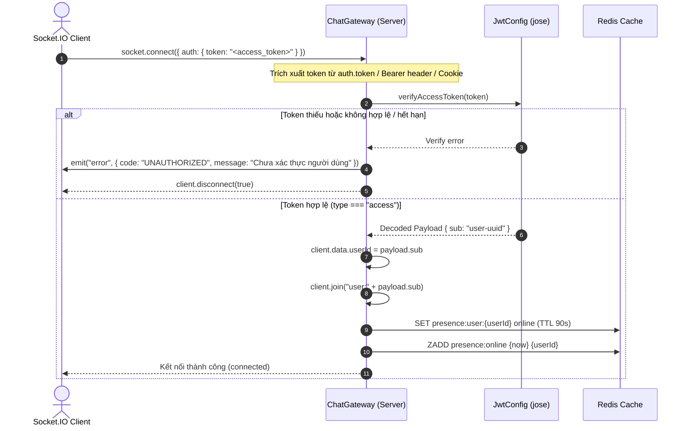
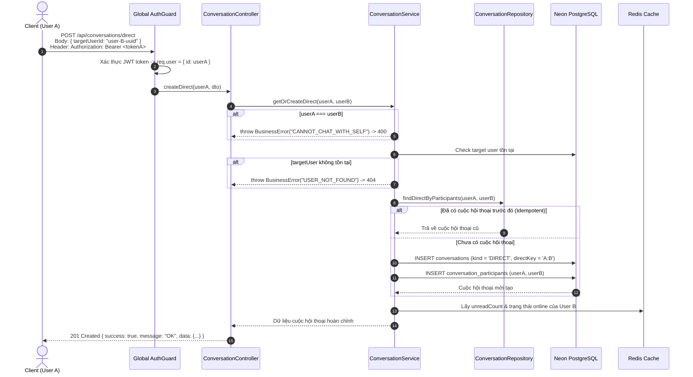
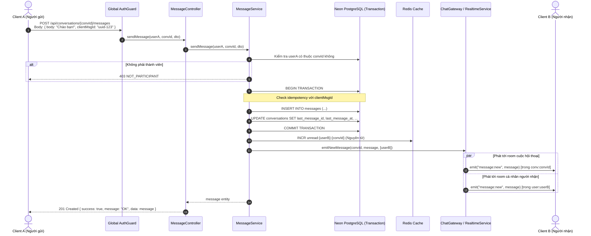
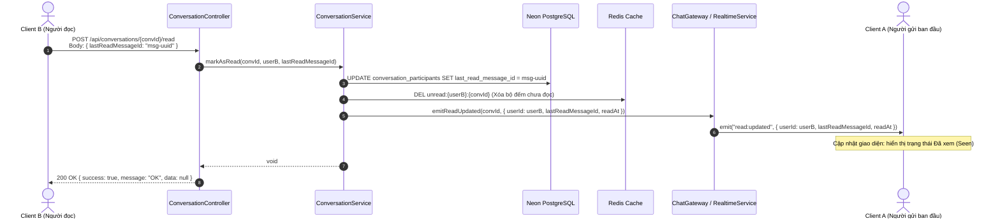
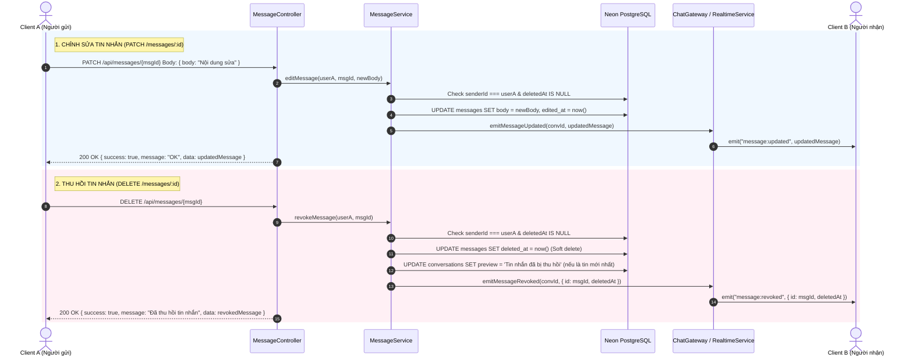
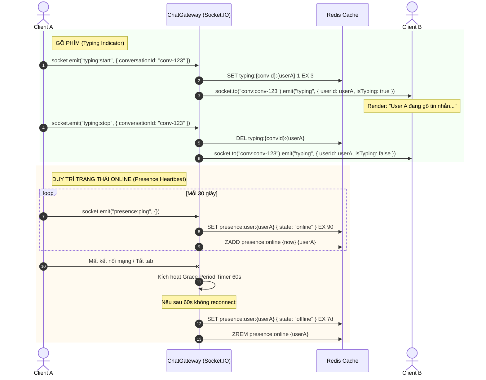

# LEMON CHAT — HỢP ĐỒNG API & WEBSOCKET: TÍNH NĂNG CHAT 1-1 (DIRECT MESSAGING)

> **Tài liệu chuẩn cho Frontend (Role 1) và Backend (Role 3) kết nối.**  
> Tuân thủ 100% chuẩn Envelope tại [`RESPONSES.md`](./RESPONSES.md) và hệ thống Authentication tại [`AUTH.md`](./AUTH.md).  
> Base URL: `http://localhost:3000/api` (hoặc domain production)  
> WebSocket URL: `ws://localhost:3000` (Socket.IO namespace `/`)

---

## MỤC LỤC
1. [Quy ước chung & Xác thực (Auth)](#1-quy-ước-chung--xác-thực-auth)
2. [Sơ đồ hóa các luồng nghiệp vụ (Sequence Diagrams)](#2-sơ-đồ-hóa-các-luồng-nghiệp-vụ-sequence-diagrams)
   - [2.1 Sơ đồ Xác thực Handshake & Kết nối Socket.IO Realtime](#21-sơ-đồ-xác-thực-handshake--kết-nối-socketio-realtime)
   - [2.2 Sơ đồ Tạo hoặc Mở phòng Chat 1-1](#22-sơ-đồ-tạo-hoặc-mở-phòng-chat-1-1)
   - [2.3 Sơ đồ Gửi tin nhắn & Đồng bộ Realtime đa thiết bị](#23-sơ-đồ-gửi-tin-nhắn--đồng-bộ-realtime-đa-thiết-bị)
   - [2.4 Sơ đồ Đánh dấu đã đọc & Đồng bộ trạng thái Seen](#24-sơ-đồ-đánh-dấu-đã-đọc--đồng-bộ-trạng-thái-seen)
   - [2.5 Sơ đồ Chỉnh sửa và Thu hồi tin nhắn](#25-sơ-đồ-chỉnh-sửa-và-thu-hồi-tin-nhắn)
   - [2.6 Sơ đồ Trạng thái soạn tin & Duy trì kết nối Online](#26-sơ-đồ-trạng-thái-soạn-tin--duy-trì-kết-nối-online)
3. [REST API — Danh sách Endpoints](#3-rest-api--danh-sách-endpoints)
   - [3.1 Tra cứu người dùng theo Username (`GET /users/by-username/:username`)](#31-tra-cứu-người-dùng-theo-username-get-usersby-usernameusername)
   - [3.2 Tra cứu người dùng theo Email (`GET /users/by-email/:email`)](#32-tra-cứu-người-dùng-theo-email-get-usersby-emailemail)
   - [3.3 Tạo hoặc lấy phòng chat 1-1 (`POST /conversations/direct`)](#33-tạo-hoặc-lấy-phòng-chat-1-1-post-conversationsdirect)
   - [3.4 Lấy danh sách hộp thư Inbox (`GET /conversations`)](#34-lấy-danh-sách-hộp-thư-inbox-get-conversations)
   - [3.5 Lấy chi tiết cuộc hội thoại (`GET /conversations/:id`)](#35-lấy-chi-tiết-cuộc-hội-thoại-get-conversationsid)
   - [3.6 Lấy lịch sử tin nhắn — Phân trang con trỏ (`GET /conversations/:id/messages`)](#36-lấy-lịch-sử-tin-nhắn--phân-trang-con-trỏ-get-conversationsidmessages)
   - [3.7 Gửi tin nhắn mới (`POST /conversations/:id/messages`)](#37-gửi-tin-nhắn-mới-post-conversationsidmessages)
   - [3.8 Chỉnh sửa tin nhắn (`PATCH /messages/:id`)](#38-chỉnh-sửa-tin-nhắn-patch-messagesid)
   - [3.9 Thu hồi tin nhắn (`DELETE /messages/:id`)](#39-thu-hồi-tin-nhắn-delete-messagesid)
   - [3.10 Đánh dấu đã đọc (`POST /conversations/:id/read`)](#310-đánh-dấu-đã-đọc-post-conversationsidread)
   - [3.11 Trả lời Story vào phòng chat 1-1 (`POST /stories/:id/reply`)](#311-trả-lời-story-vào-phòng-chat-1-1-post-storiesidreply)
4. [Socket.IO Realtime Events](#4-socketio-realtime-events)
   - [4.1 Kết nối & Xác thực Handshake](#41-kết-nối--xác-thực-handshake)
   - [4.2 Sự kiện Client gửi lên (Client → Server)](#42-sự-kiện-client-gửi-lên-client--server)
   - [4.3 Sự kiện Server phát xuống (Server → Client)](#43-sự-kiện-server-phát-xuống-server--client)
5. [Hướng dẫn Frontend Tích hợp (Code mẫu React)](#5-hướng-dẫn-frontend-tích-hợp-code-mẫu-react)

---

## 1. QUY ƯỚC CHUNG & XÁC THỰC (AUTH)

### 1.1 Envelope chuẩn ([RESPONSES.md](./RESPONSES.md))
* **Thành công (2xx):**
  ```json
  {
    "success": true,
    "message": "OK",
    "data": { ... } // hoặc mảng [ ... ]
  }
  ```
* **Thất bại (4xx, 5xx):**
  ```json
  {
    "success": false,
    "code": "ERROR_CODE_SCREAMING_SNAKE",
    "message": "Mô tả lỗi dễ hiểu cho người dùng"
  }
  ```

### 1.2 Cơ chế Xác thực (JWT Authentication)
* **Zero-Trust Identity**: Hệ thống **không chấp nhận** bất kỳ header giả mạo danh tính nào từ client (ví dụ `x-user-id`).
* Mọi request đến endpoint Chat 1-1 đều được bảo vệ bởi `AuthGuard` toàn cục. Client bắt buộc phải đính kèm Access Token nhận được từ luồng đăng nhập (`/api/auth/login` hoặc `/api/auth/verify-otp`):
  ```http
  Authorization: Bearer <access_token>
  ```
  *(Hoặc cookie `lemon_access_token` nếu chạy trên cùng domain trình duyệt).*
* Nếu không có token, token hết hạn hoặc sai chữ ký, API sẽ trả về `401 UNAUTHORIZED`:
  ```json
  {
    "success": false,
    "code": "UNAUTHORIZED",
    "message": "Chưa xác thực người dùng"
  }
  ```

---

## 2. SƠ ĐỒ HÓA CÁC LUỒNG NGHIỆP VỤ (SEQUENCE DIAGRAMS)

### 2.1 Sơ đồ Xác thực Handshake & Kết nối Socket.IO Realtime


---

### 2.2 Sơ đồ Tạo hoặc Mở phòng Chat 1-1


---

### 2.3 Sơ đồ Gửi tin nhắn & Đồng bộ Realtime đa thiết bị


---

### 2.4 Sơ đồ Đánh dấu đã đọc & Đồng bộ trạng thái Seen


---

### 2.5 Sơ đồ Chỉnh sửa và Thu hồi tin nhắn


---

### 2.6 Sơ đồ Trạng thái soạn tin & Duy trì kết nối Online


---

## 3. REST API — DANH SÁCH ENDPOINTS

### 3.1 Tra cứu người dùng theo Username (`GET /users/by-username/:username`)
> Dùng khi người dùng tìm kiếm bạn bè / đối tác qua username để mở phòng chat 1-1.

* **Method:** `GET`
* **Path:** `/api/users/by-username/:username`
* **Headers:** `Authorization: Bearer <access_token>`
* **Response Success (200 OK):**
  ```json
  {
    "success": true,
    "message": "OK",
    "data": {
      "id": "0193a2b1-7c4d-7e8f-9a0b-1c2d3e4f5a6b",
      "username": "minh_lemon",
      "email": "minh@lemon.dev",
      "fullName": "Nguyễn Văn Minh",
      "avatarUrl": "https://s3.lemonchat.io/avatars/minh.jpg",
      "bio": null,
      "phone": null,
      "emailVerifiedAt": "2026-10-15T00:00:00.000Z",
      "lastSeenAt": "2026-10-19T07:48:30.000Z",
      "isActive": true,
      "createdAt": "2026-10-15T00:00:00.000Z"
    }
  }
  ```
* **Response Error:**
  * `401 UNAUTHORIZED`: Chưa đăng nhập hoặc token không hợp lệ.
  * `404 NOT_FOUND`: Không tìm thấy người dùng (`USER_NOT_FOUND`).

---

### 3.2 Tra cứu người dùng theo Email (`GET /users/by-email/:email`)
> Dùng khi tìm kiếm bạn bè / đối tác qua địa chỉ email.

* **Method:** `GET`
* **Path:** `/api/users/by-email/:email`
* **Headers:** `Authorization: Bearer <access_token>`
* **Response Success (200 OK):**
  ```json
  {
    "success": true,
    "message": "OK",
    "data": {
      "id": "0193a2b1-7c4d-7e8f-9a0b-1c2d3e4f5a6b",
      "username": "minh_lemon",
      "email": "minh@lemon.dev",
      "fullName": "Nguyễn Văn Minh",
      "avatarUrl": "https://s3.lemonchat.io/avatars/minh.jpg",
      "bio": null,
      "phone": null,
      "emailVerifiedAt": "2026-10-15T00:00:00.000Z",
      "lastSeenAt": "2026-10-19T07:48:30.000Z",
      "isActive": true,
      "createdAt": "2026-10-15T00:00:00.000Z"
    }
  }
  ```
* **Response Error:**
  * `401 UNAUTHORIZED`: Chưa đăng nhập hoặc token không hợp lệ.
  * `404 NOT_FOUND`: Không tìm thấy người dùng (`USER_NOT_FOUND`).

---

### 3.3 Tạo hoặc lấy phòng chat 1-1 (`POST /conversations/direct`)
> Dùng khi người dùng bấm vào nút "Nhắn tin" trên trang cá nhân của bạn bè.  
> API có tính chất **Idempotent**: nếu 2 người đã từng có cuộc hội thoại, API trả về cuộc hội thoại cũ chứ không tạo trùng (dựa vào `direct_key`).

* **Method:** `POST`
* **Path:** `/api/conversations/direct`
* **Headers:** `Authorization: Bearer <access_token>`
* **Request Body:**
  ```json
  {
    "targetUserId": "0193a2b1-7c4d-7e8f-9a0b-1c2d3e4f5a6b"
  }
  ```

* **Response Success (200 OK hoặc 201 Created):**
  ```json
  {
    "success": true,
    "message": "OK",
    "data": {
      "id": "0193a2b1-8888-7777-9999-1c2d3e4f5a6b",
      "kind": "DIRECT",
      "directKey": "0193a2b1-7c4d-7e8f-9a0b-1c2d3e4f5a6a:0193a2b1-7c4d-7e8f-9a0b-1c2d3e4f5a6b",
      "partner": {
        "id": "0193a2b1-7c4d-7e8f-9a0b-1c2d3e4f5a6b",
        "username": "minh_lemon",
        "fullName": "Nguyễn Văn Minh",
        "avatarUrl": "https://s3.lemonchat.io/avatars/minh.jpg"
      },
      "lastMessagePreview": null,
      "lastMessageAt": null,
      "createdAt": "2026-10-16T16:00:00.000Z"
    }
  }
  ```

* **Response Error:**
  * `400 CANNOT_CHAT_WITH_SELF`: Không thể tự tạo chat với chính mình.
  * `401 UNAUTHORIZED`: Thiếu hoặc sai token xác thực.
  * `404 USER_NOT_FOUND`: Người dùng mục tiêu không tồn tại.
  * `422 VALIDATION_ERROR`: `targetUserId` không đúng định dạng UUID.

---

### 3.4 Lấy danh sách hộp thư Inbox (`GET /conversations`)
> Trả về danh sách các cuộc hội thoại của user hiện tại, sắp xếp theo thời gian tin nhắn mới nhất giảm dần (`lastMessageAt DESC`). Tự động làm giàu số tin chưa đọc và trạng thái online từ Redis.

* **Method:** `GET`
* **Path:** `/api/conversations?limit=20`
* **Headers:** `Authorization: Bearer <access_token>`

* **Response Success (200 OK):**
  ```json
  {
    "success": true,
    "message": "OK",
    "data": [
      {
        "id": "0193a2b1-8888-7777-9999-1c2d3e4f5a6b",
        "kind": "DIRECT",
        "partner": {
          "id": "0193a2b1-7c4d-7e8f-9a0b-1c2d3e4f5a6b",
          "username": "minh_lemon",
          "fullName": "Nguyễn Văn Minh",
          "avatarUrl": "https://s3.lemonchat.io/avatars/minh.jpg",
          "isOnline": true
        },
        "lastMessagePreview": "Tối nay đi cafe không bạn ơi?",
        "lastMessageAt": "2026-10-16T16:30:00.000Z",
        "unreadCount": 2,
        "isMuted": false
      }
    ]
  }
  ```

---

### 3.5 Lấy chi tiết cuộc hội thoại (`GET /conversations/:id`)
> Lấy thông tin phòng chat theo ID. Bắt buộc user gọi phải là thành viên trong phòng.

* **Method:** `GET`
* **Path:** `/api/conversations/0193a2b1-8888-7777-9999-1c2d3e4f5a6b`
* **Headers:** `Authorization: Bearer <access_token>`

* **Response Success (200 OK):**
  ```json
  {
    "success": true,
    "message": "OK",
    "data": {
      "id": "0193a2b1-8888-7777-9999-1c2d3e4f5a6b",
      "kind": "DIRECT",
      "partner": {
        "id": "0193a2b1-7c4d-7e8f-9a0b-1c2d3e4f5a6b",
        "username": "minh_lemon",
        "fullName": "Nguyễn Văn Minh",
        "avatarUrl": "https://s3.lemonchat.io/avatars/minh.jpg",
        "isOnline": true
      },
      "lastReadMessageId": "0193a2b1-aaaa-bbbb-cccc-1c2d3e4f5a6b",
      "unreadCount": 0
    }
  }
  ```
* **Response Error:**
  * `400 BAD_REQUEST`: `:id` không phải định dạng UUID hợp lệ.
  * `401 UNAUTHORIZED`: Chưa đăng nhập hoặc token không hợp lệ.
  * `403 NOT_PARTICIPANT`: Không phải thành viên cuộc trò chuyện.
  * `404 CONVERSATION_NOT_FOUND`: Không tìm thấy cuộc trò chuyện.

---

### 3.6 Lấy lịch sử tin nhắn — Phân trang con trỏ (`GET /conversations/:id/messages`)
> Phân trang bằng **con trỏ ID (UUIDv7)** thay vì offset page. Ổn định tuyệt đối khi có tin nhắn mới chèn vào.

> [!IMPORTANT]
> **Quy ước thứ tự tin nhắn (Timeline Sorting Contract):**
> * Mảng `items` được Database và Backend trả về theo thứ tự thời gian giảm dần: **`createdAt DESC`** (phần tử `items[0]` là tin nhắn mới nhất, các tin cũ hơn xếp tiếp theo).
> * **Cách phân trang:** `nextCursor` là `id` của tin nhắn cũ nhất ở cuối mảng `items`. Khi người dùng cuộn lên trên để tải thêm tin cũ hơn, client gửi query `cursor = nextCursor`.
> * **Khuyến nghị hiển thị Client (Frontend / Mobile):** Để khung chat hiển thị tin nhắn xuôi theo trục thời gian (tin cũ ở trên, tin mới ở dưới), Client cần **đảo chiều mảng** (`items.slice().reverse()` hoặc sắp xếp `createdAt ASC`) trước khi render ra MessageList. Khi có tin nhắn mới đến từ Socket hoặc người dùng vừa gửi, luôn `append` vào cuối mảng xuôi này.

* **Method:** `GET`
* **Path:** `/api/conversations/:id/messages?cursor=<uuid_cuoi_cung>&limit=30`
  * `cursor` (tuỳ chọn): ID của tin nhắn cũ nhất đang có trên màn hình. Nếu không truyền -> Lấy tin nhắn mới nhất.
  * `limit` (tuỳ chọn, mặc định 30, tối đa 100).
  * `after` (tuỳ chọn): Dùng khi reconnect mạng để lấy những tin nhắn bị lỡ sau ID này.
* **Headers:** `Authorization: Bearer <access_token>`

* **Response Success (200 OK):**
  ```json
  {
    "success": true,
    "message": "OK",
    "data": {
      "items": [
        {
          "id": "0193a2b1-9999-0000-1111-222233334444",
          "conversationId": "0193a2b1-8888-7777-9999-1c2d3e4f5a6b",
          "senderId": "0193a2b1-7c4d-7e8f-9a0b-1c2d3e4f5a6b",
          "kind": "TEXT",
          "body": "Tối nay đi cafe không bạn ơi?",
          "replyToId": null,
          "clientMsgId": "0193a2b1-client-msg-id-1",
          "editedAt": null,
          "deletedAt": null,
          "createdAt": "2026-10-16T16:30:00.000Z"
        }
      ],
      "nextCursor": "0193a2b1-9999-0000-1111-222233334444",
      "hasMore": true
    }
  }
  ```
* **Response Error:**
  * `401 UNAUTHORIZED`: Chưa đăng nhập hoặc token sai.
  * `403 NOT_PARTICIPANT`: Bạn không phải thành viên cuộc trò chuyện này.

---

### 3.7 Gửi tin nhắn mới (`POST /conversations/:id/messages`)
> Gửi tin nhắn vào cuộc hội thoại. Có hỗ trợ chống gửi trùng (`clientMsgId` chuẩn UUID).

* **Method:** `POST`
* **Path:** `/api/conversations/:id/messages`
* **Headers:** `Authorization: Bearer <access_token>`
* **Request Body:**
  ```json
  {
    "body": "Chào Minh, tối nay đi được nhé!",
    "clientMsgId": "0193a2b1-local-uuid-12345",
    "replyToId": null,
    "kind": "TEXT"
  }
  ```

* **Response Success (201 Created):**
  ```json
  {
    "success": true,
    "message": "OK",
    "data": {
      "id": "0193a2b1-beef-1111-2222-333344445555",
      "conversationId": "0193a2b1-8888-7777-9999-1c2d3e4f5a6b",
      "senderId": "0193a2b1-7c4d-7e8f-9a0b-1c2d3e4f5a6a",
      "kind": "TEXT",
      "body": "Chào Minh, tối nay đi được nhé!",
      "clientMsgId": "0193a2b1-local-uuid-12345",
      "replyToId": null,
      "editedAt": null,
      "deletedAt": null,
      "createdAt": "2026-10-16T16:32:00.000Z"
    }
  }
  ```
> **Cơ chế Backend:** Sau khi commit Database thành công:
> 1. Tự động tăng số tin chưa đọc (`unreadCount`) của đối phương trong Redis.
> 2. Phát sự kiện realtime `message:new` tới room cuộc hội thoại và room cá nhân của người nhận.

* **Response Error:**
  * `401 UNAUTHORIZED`: Chưa xác thực người dùng.
  * `403 NOT_PARTICIPANT`: Bạn không phải thành viên cuộc trò chuyện này.
  * `422 VALIDATION_ERROR`: Tin nhắn văn bản rỗng, độ dài vượt quá 4000 ký tự, hoặc `clientMsgId`/`replyToId` không phải UUID.

---

### 3.8 Chỉnh sửa tin nhắn (`PATCH /messages/:id`)
> Chỉ người gửi mới được sửa, chỉ áp dụng cho tin nhắn dạng `TEXT`.

* **Method:** `PATCH`
* **Path:** `/api/messages/:id`
* **Headers:** `Authorization: Bearer <access_token>`
* **Request Body:**
  ```json
  {
    "body": "Chào Minh, 8h tối nay nhé!"
  }
  ```
* **Response Success (200 OK):**
  ```json
  {
    "success": true,
    "message": "OK",
    "data": {
      "id": "0193a2b1-beef-1111-2222-333344445555",
      "body": "Chào Minh, 8h tối nhé!",
      "editedAt": "2026-10-16T16:33:00.000Z"
    }
  }
  ```
* **Response Error:**
  * `400 MESSAGE_REVOKED`: Tin nhắn đã bị thu hồi, không thể chỉnh sửa.
  * `400 BAD_REQUEST`: Chỉ có thể sửa tin nhắn dạng TEXT.
  * `401 UNAUTHORIZED`: Chưa đăng nhập.
  * `403 FORBIDDEN`: Bạn không có quyền chỉnh sửa tin nhắn này (không phải người gửi).
  * `404 MESSAGE_NOT_FOUND`: Không tìm thấy tin nhắn.
  * `422 VALIDATION_ERROR`: Nội dung tin nhắn rỗng hoặc vượt quá 4000 ký tự.

---

### 3.9 Thu hồi tin nhắn (`DELETE /messages/:id`)
> Thu hồi tin nhắn với mọi người (Soft delete: cập nhật `deletedAt = now()`). Cập nhật preview inbox thành `"Tin nhắn đã bị thu hồi"`.

* **Method:** `DELETE`
* **Path:** `/api/messages/:id`
* **Headers:** `Authorization: Bearer <access_token>`
* **Response Success (200 OK):**
  ```json
  {
    "success": true,
    "message": "Đã thu hồi tin nhắn",
    "data": {
      "id": "0193a2b1-beef-1111-2222-333344445555",
      "deletedAt": "2026-10-16T16:34:00.000Z"
    }
  }
  ```
* **Response Error:**
  * `400 MESSAGE_REVOKED`: Tin nhắn đã được thu hồi trước đó.
  * `401 UNAUTHORIZED`: Chưa xác thực người dùng.
  * `403 FORBIDDEN`: Bạn không có quyền thu hồi tin nhắn này (không phải người gửi).
  * `404 MESSAGE_NOT_FOUND`: Không tìm thấy tin nhắn.

---

### 3.10 Đánh dấu đã đọc (`POST /conversations/:id/read`)
> Client gọi khi user mở phòng chat hoặc scroll đọc tới tin nhắn mới. Reset unread counter trong Redis về 0.

* **Method:** `POST`
* **Path:** `/api/conversations/:id/read`
* **Headers:** `Authorization: Bearer <access_token>`
* **Request Body:**
  ```json
  {
    "lastReadMessageId": "0193a2b1-beef-1111-2222-333344445555"
  }
  ```
* **Response Success (200 OK):**
  ```json
  {
    "success": true,
    "message": "OK",
    "data": null
  }
  ```
* **Response Error:**
  * `401 UNAUTHORIZED`: Chưa đăng nhập.
  * `403 NOT_PARTICIPANT`: Không phải thành viên cuộc trò chuyện.
  * `404 CONVERSATION_NOT_FOUND`: Không tìm thấy cuộc trò chuyện.
  * `422 VALIDATION_ERROR`: `lastReadMessageId` không phải UUID hợp lệ.

---

### 3.11 Trả lời Story vào phòng chat 1-1 (`POST /stories/:id/reply`)
> Trả lời trực tiếp một Story 24h của bạn bè. Hệ thống tự động tìm hoặc mở phòng chat 1:1 (`DIRECT`) với chủ sở hữu Story, chèn tin nhắn kèm snapshot preview của Story (`storyId` & `storyPreview`), cập nhật `last_message_preview` cho hộp thư, tăng bộ đếm chưa đọc và phát sự kiện `message:new` realtime.

* **Method:** `POST`
* **Path:** `/api/stories/:id/reply`
* **Headers:** `Authorization: Bearer <access_token>`
* **Params:** `id` (UUID của Story cần trả lời)
* **Request Body:**
  ```json
  {
    "body": "Bức ảnh này chụp ở đâu đẹp thế bạn?"
  }
  ```
* **Response Success (201 Created):**
  ```json
  {
    "success": true,
    "message": "Đã trả lời story",
    "data": {
      "id": "0193a2b1-beef-1111-2222-333344445555",
      "conversationId": "0193a2b1-beef-0000-0000-111122223333",
      "senderId": "0193a2b1-7c4d-7e8f-9a0b-1c2d3e4f5a6b",
      "kind": "TEXT",
      "body": "Bức ảnh này chụp ở đâu đẹp thế bạn?",
      "replyToId": null,
      "storyId": "0193a2b1-beef-9999-0000-111122223333",
      "storyPreview": {
        "id": "0193a2b1-beef-9999-0000-111122223333",
        "kind": "IMAGE",
        "bucket": "lemon-stories",
        "objectKey": "stories/user-1/photo.jpg",
        "caption": "Sunset",
        "background": null
      },
      "createdAt": "2026-10-19T10:00:00.000Z",
      "editedAt": null,
      "deletedAt": null
    }
  }
  ```
* **Response Error:**
  * `400 CANNOT_REPLY_OWN_STORY`: Bạn không thể tự trả lời story của chính mình.
  * `401 UNAUTHORIZED`: Chưa đăng nhập.
  * `403 STORY_REPLY_FORBIDDEN`: Bạn chỉ có thể trả lời story của bạn bè (quan hệ `ACCEPTED`).
  * `404 STORY_NOT_FOUND`: Story không tồn tại hoặc đã hết hạn.
  * `422 VALIDATION_ERROR`: Nội dung `body` bị rỗng hoặc vượt quá 4000 ký tự.

---

## 4. SOCKET.IO REALTIME EVENTS

### 4.1 Kết nối & Xác thực Handshake
* **URL:** `ws://localhost:3000` (hoặc `http://localhost:3000`)
* **Handshake Authentication:**
  Client bắt buộc truyền JWT Access Token vào `auth.token` (hoặc `extraHeaders.Authorization`):
  ```javascript
  import { io } from "socket.io-client";

  const socket = io("http://localhost:3000", {
    auth: {
      token: accessToken // Access Token lấy từ /api/auth/login
    },
    transports: ["websocket", "polling"]
  });
  ```
* **Cơ chế từ chối:**
  Nếu không có token, token hết hạn hoặc không hợp lệ, Server sẽ:
  1. Phát sự kiện `error`: `{ code: "UNAUTHORIZED", message: "Chưa xác thực người dùng" }`.
  2. Ngắt kết nối socket ngay lập tức (`client.disconnect(true)`).
* **Rooms tự động:**
  * Khi xác thực JWT thành công, Server tự động giải mã `payload.sub` và đưa socket vào room cá nhân: `user:{userId}`.
  * Khi mở vào 1 cuộc hội thoại, Client gửi sự kiện `conv:join` để vào room `conv:{conversationId}` (Server sẽ xác thực quyền thành viên trước khi cho vào room).

---

### 4.2 Sự kiện Client gửi lên (Client → Server)

| Tên Event | Payload | Mô tả |
|---|---|---|
| `conv:join` | `{ "conversationId": "..." }` | Vào phòng chat để nhận thông báo gõ phím & tin nhắn |
| `conv:leave` | `{ "conversationId": "..." }` | Rời phòng chat khi back ra ngoài |
| `typing:start`| `{ "conversationId": "..." }` | Báo cho đối phương biết mình đang gõ phím (TTL 3s) |
| `typing:stop` | `{ "conversationId": "..." }` | Báo đã dừng gõ phím |
| `presence:ping`| `{}` | Gửi định kỳ mỗi 30s để duy trì trạng thái Online |

---

### 4.3 Sự kiện Server phát xuống (Server → Client)

#### A. Tin nhắn mới (`message:new`)
Server phát tới cả room cuộc hội thoại `conv:{convId}` và room cá nhân của người nhận `user:{targetUserId}`:
```json
{
  "id": "0193a2b1-beef-1111-2222-333344445555",
  "conversationId": "0193a2b1-8888-7777-9999-1c2d3e4f5a6b",
  "senderId": "0193a2b1-7c4d-7e8f-9a0b-1c2d3e4f5a6a",
  "kind": "TEXT",
  "body": "Chào bạn nhé!",
  "clientMsgId": "0193a2b1-local-uuid-12345",
  "replyToId": null,
  "createdAt": "2026-10-16T16:32:00.000Z"
}
```

> [!NOTE]
> **Cơ chế cập nhật hộp thư đến tự động (Inbox Auto-Discovery):**
> * Việc phát tới room cá nhân `user:{targetUserId}` đảm bảo người nhận dù **chưa mở phòng chat** (hoặc nhận tin nhắn từ cuộc trò chuyện hoàn toàn mới chưa có trong danh sách Inbox) vẫn nhận được sự kiện ngay lập tức.
> * **Xử lý phía Client:**
>   1. Nếu `conversationId` đã có trong danh sách Inbox: cập nhật `lastMessagePreview`, `lastMessageAt`, và tăng `unreadCount`.
>   2. Nếu `conversationId` chưa có trong danh sách Inbox (cuộc trò chuyện mới tinh): Client tự động gọi refetch danh sách (`invalidateQueries(['conversations'])`) và gọi `conv:join` để bắt đầu lắng nghe phòng chat mới này.
>   3. Nếu client đang mở đúng phòng chat này: tự động gọi `POST /conversations/:id/read` để đánh dấu đã đọc.

#### B. Sửa tin nhắn (`message:updated`)
```json
{
  "id": "0193a2b1-beef-1111-2222-333344445555",
  "conversationId": "0193a2b1-8888-7777-9999-1c2d3e4f5a6b",
  "body": "Nội dung sau khi sửa",
  "editedAt": "2026-10-16T16:33:00.000Z"
}
```

#### C. Thu hồi tin nhắn (`message:revoked`)
```json
{
  "id": "0193a2b1-beef-1111-2222-333344445555",
  "conversationId": "0193a2b1-8888-7777-9999-1c2d3e4f5a6b",
  "deletedAt": "2026-10-16T16:34:00.000Z"
}
```

#### D. Trạng thái gõ phím (`typing`)
```json
{
  "conversationId": "0193a2b1-8888-7777-9999-1c2d3e4f5a6b",
  "userId": "0193a2b1-7c4d-7e8f-9a0b-1c2d3e4f5a6a",
  "isTyping": true // hoặc false
}
```

#### E. Cập nhật đã đọc (`read:updated`)
```json
{
  "conversationId": "0193a2b1-8888-7777-9999-1c2d3e4f5a6b",
  "userId": "0193a2b1-7c4d-7e8f-9a0b-1c2d3e4f5a6a",
  "lastReadMessageId": "0193a2b1-beef-1111-2222-333344445555",
  "readAt": "2026-10-16T16:35:00.000Z"
}
```

#### F. Cảm xúc trên Story (`story:reaction`)
> Phát tới room cá nhân `user:{storyOwnerId}` của chủ sở hữu Story khi có bạn bè thả biểu cảm nhanh trên Story.

```json
{
  "storyId": "0193a2b1-beef-9999-0000-111122223333",
  "user": {
    "id": "0193a2b1-7c4d-7e8f-9a0b-1c2d3e4f5a6b",
    "username": "minh_tran",
    "fullName": "Trần Minh",
    "avatarUrl": "https://..."
  },
  "emoji": "🔥",
  "createdAt": "2026-10-19T10:00:00.000Z"
}
```

---

## 5. HƯỚNG DẪN FRONTEND TÍCH HỢP (CODE MẪU REACT)

```typescript
import { useEffect, useState } from "react";
import { io, Socket } from "socket.io-client";

let socket: Socket;

export function useChat(conversationId: string, accessToken: string) {
  const [messages, setMessages] = useState<any[]>([]);
  const [isPartnerTyping, setIsPartnerTyping] = useState(false);

  useEffect(() => {
    if (!accessToken) return;

    // 1. Khởi tạo socket kết nối với JWT Access Token
    socket = io("http://localhost:3000", {
      auth: { token: accessToken },
      transports: ["websocket", "polling"],
    });

    socket.on("connect_error", (err) => {
      console.error("Socket connect error:", err.message);
    });

    socket.on("error", (err) => {
      console.error("Socket error event:", err);
    });

    // 2. Tham gia phòng chat
    socket.emit("conv:join", { conversationId });

    // 3. Lắng nghe tin nhắn mới
    socket.on("message:new", (newMsg) => {
      if (newMsg.conversationId === conversationId) {
        setMessages((prev) => [...prev, newMsg]);
      }
    });

    // 4. Lắng nghe tin nhắn được chỉnh sửa
    socket.on("message:updated", (updatedMsg) => {
      setMessages((prev) =>
        prev.map((m) => (m.id === updatedMsg.id ? { ...m, ...updatedMsg } : m))
      );
    });

    // 5. Lắng nghe tin nhắn bị thu hồi
    socket.on("message:revoked", (revokedData) => {
      setMessages((prev) =>
        prev.map((m) =>
          m.id === revokedData.id ? { ...m, deletedAt: revokedData.deletedAt } : m
        )
      );
    });

    // 6. Lắng nghe đối phương gõ phím
    socket.on("typing", (data) => {
      if (data.conversationId === conversationId) {
        setIsPartnerTyping(data.isTyping);
      }
    });

    // 7. Heartbeat presence định kỳ 30s
    const pingTimer = setInterval(() => {
      socket.emit("presence:ping", {});
    }, 30000);

    return () => {
      clearInterval(pingTimer);
      socket.emit("conv:leave", { conversationId });
      socket.disconnect();
    };
  }, [conversationId, accessToken]);

  // Hàm gửi tin nhắn qua REST API
  const sendMessage = async (body: string) => {
    const res = await fetch(`http://localhost:3000/api/conversations/${conversationId}/messages`, {
      method: "POST",
      headers: {
        "Content-Type": "application/json",
        "Authorization": `Bearer ${accessToken}`,
      },
      body: JSON.stringify({
        body,
        clientMsgId: crypto.randomUUID(),
        kind: "TEXT",
      }),
    });
    return res.json();
  };

  return { messages, isPartnerTyping, sendMessage };
}
```
