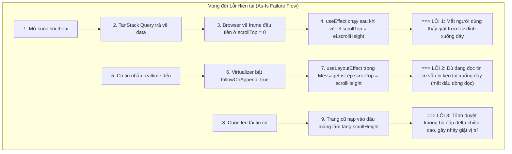
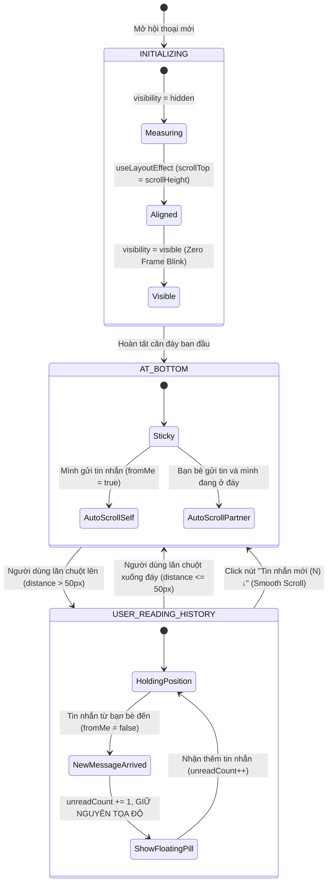

# Kế hoạch Kỹ thuật Tối ưu: Xử lý Cuộn Trang Tin nhắn & Phân trang Lịch sử (Chat Scroll & Pagination Architecture)

> **Mã lỗi / Yêu cầu**: *"Lỗi cuộn trang tin nhắn với phân trang và tanstack query, làm sao để cuộn mượt, vô trang là auto ở tin nhắn cuối (ko có hiệu ứng cuộn xuống), khi có tin nhắn mới đến thì ko đc cuộn xuống mà hiện 1 nút 'có tin nhắn mới' để người dùng tự click vào, khi click vào thì cuộn xuống tin nhắn mới."*  
> **Dự án**: Lemon Chat Web Tech  
> **Tài liệu**: Kế hoạch Tối ưu Cuối cùng (Final Optimized Blueprint) trước khi triển khai  
> **Trạng thái**: Sẵn sàng phê duyệt & thực thi

---

## 1. Bản đồ Vấn đề & Phân tích Nguyên nhân Kỹ thuật (Failure Analysis)

Hiện tại, việc quản lý cuộn đang xảy ra xung đột giữa 3 thực thể: **Trình duyệt (Browser Paint)**, **Thư viện Ảo hóa (TanStack Virtual)** và **TanStack Query (Infinite Cache)**.



---

## 2. Mô hình Máy Trạng thái Cuộn (Scroll State Machine Specification)

Để giải quyết triệt để và an toàn tuyệt đối, hệ thống sẽ được điều khiển bởi một State Machine chính xác:



---

## 3. Kiến trúc Chi tiết 4 Giải pháp Trọng tâm

### Trụ cột 1: Triệt tiêu 100% Hiệu ứng Trượt khi Mở Hội thoại (Zero-Blink Instant Bottom)
* **Nguyên lý**: Trình duyệt có chu kỳ: `Render -> useLayoutEffect -> DOM Mutation -> Browser Paint -> useEffect`.
  * Trước đây: Gán cuộn trong `useEffect` (chạy SAU Paint) $\rightarrow$ Trình duyệt vẽ ở 0 rồi mới nhảy xuống đáy.
  * Giải pháp:
    1. Đặt thuộc tính container: `style={{ visibility: isInitialAligned ? 'visible' : 'hidden' }}`.
    2. Trong `useLayoutEffect` (chạy TRƯỚC Paint):
       ```ts
       if (!isInitialAlignedRef.current && el && rows.length > 0) {
         el.scrollTop = el.scrollHeight;
         virtualizer.scrollToEnd({ behavior: 'auto' });
         isInitialAlignedRef.current = true;
         setIsInitialAligned(true);
       }
       ```
    3. **Kết quả**: Khi container chuyển sang `visible`, tọa độ hiển thị của frame hình đầu tiên đã nằm chính xác ở tin nhắn cuối cùng. Người dùng không thấy bất kỳ chuyển động trượt nào.

### Trụ cột 2: Cơ chế "Có tin nhắn mới" & Không tự động cuộn khi đang đọc tin cũ
* **Tước quyền can thiệp của Virtualizer**:
  * Đặt `followOnAppend: false` trong `useVirtualizer` (tại `MessageList.tsx`). Virtualizer chỉ tập trung ảo hóa DOM, không được tự ý can thiệp vào `scrollTop` của container.
* **Công thức toán học xác định trạng thái người dùng**:
  $$\text{distanceFromBottom} = \text{el.scrollHeight} - \text{el.scrollTop} - \text{el.clientHeight}$$
  - Ngưỡng bám đáy an toàn: `STICKY_THRESHOLD = 50px`.
  - `isNearBottom = distanceFromBottom <= STICKY_THRESHOLD`.
* **Phân luồng xử lý tin nhắn mới**:
  1. **Khi có tin nhắn do chính mình gửi (`fromMe === true` hoặc tin nhắn tạm optimistic)**:
     - Luôn tự động cuộn xuống đáy ngay lập tức (`behavior: 'smooth'`).
     - Ẩn nút "Có tin nhắn mới", reset `unreadCount = 0`.
  2. **Khi có tin nhắn do bạn bè gửi đến (`fromMe === false`)**:
     - **Nếu `isNearBottom === true`**: Cho phép tự động cuộn mượt theo tin nhắn mới.
     - **Nếu `isNearBottom === false` (người dùng đang đọc lịch sử cũ)**:
       - **TUYỆT ĐỐI KHÔNG cuộn màn hình**, giữ nguyên tọa độ scroll hiện tại.
       - Tăng biến đếm: `unreadNewCount += 1`.
       - Hiển thị nút nổi Floating Action Pill: **"Có tin nhắn mới (N) ↓"**.
* **Cơ chế tiêu biến tự động**:
  - Người dùng bấm nút: Cuộn mượt xuống đáy, ẩn nút, reset bộ đếm.
  - Người dùng tự lăn chuột xuống tới đáy: Nút tự động mờ dần và ẩn đi khi `distanceFromBottom <= 50px`.

### Trụ cột 3: Neo giữ Vị trí khi Cuộn lên Tải trang Cũ (Scroll Anchoring & Delta Compensation)
* **Vấn đề**: Khi nạp thêm 20 tin cũ vào đầu mảng, chiều cao tổng tăng thêm $\Delta H = H_{\text{new}} - H_{\text{old}}$. Nếu không bù đắp, người dùng sẽ bị nhảy lên vị trí mới.
* **Giải pháp Kỹ thuật**:
  1. Kích hoạt CSS: `overflow-anchor: auto;` trên khung cuộn.
  2. Cơ chế bù đắp thủ công an toàn:
     - Trước khi fetch: `snapshotScrollHeight = el.scrollHeight; snapshotScrollTop = el.scrollTop;`
     - Trong `useLayoutEffect` sau khi rows thay đổi:
       ```ts
       if (isPrependingOlderMessagesRef.current) {
         const deltaHeight = el.scrollHeight - snapshotScrollHeight;
         if (deltaHeight > 0) {
           el.scrollTop = snapshotScrollTop + deltaHeight;
         }
         isPrependingOlderMessagesRef.current = false;
       }
       ```
  3. Chỉ gọi `loadOlderMessages()` khi người dùng thực sự lăn chuột hướng lên trên (`scrollingUp && el.scrollTop < edgeThreshold`), ngăn chặn việc tải nhầm lịch sử lúc mở phòng chat.

### Trụ cột 4: Khóa Kích thước Hình ảnh / Video (Aspect Ratio Reservation)
* Tại `AttachmentBubble.tsx`:
  - Sử dụng trực tiếp `width` và `height` từ metadata để gán CSS `aspectRatio`:
    ```tsx
    style={{
      aspectRatio: attachment.width && attachment.height
        ? `${attachment.width} / ${attachment.height}`
        : '16 / 9',
      maxHeight: '280px'
    }}
    ```
  - Tránh hiện tượng layout shift sau khi ảnh/video tải xong làm đẩy trôi màn hình.

---

## 4. Thiết kế Giao diện Nút "Có tin nhắn mới" (Floating Pill UI/UX)

Nút được đặt cố định ở góc dưới giữa khu vực tin nhắn, nổi bật trên nền backdrop:

```tsx
{showJump && (
  <button
    type="button"
    onClick={handleJumpToBottom}
    className="absolute bottom-4 left-1/2 z-20 flex -translate-x-1/2 items-center gap-2 rounded-full border border-border/80 bg-card/95 px-4 py-2 text-xs font-semibold text-foreground shadow-lg backdrop-blur-md transition-all duration-200 hover:scale-105 hover:bg-card active:scale-95 animate-in fade-in slide-in-from-bottom-2"
  >
    <div className="grid size-5 place-items-center rounded-full bg-primary text-primary-foreground">
      <ArrowDown className="size-3" />
    </div>
    <span>
      {unreadNewCount > 1 
        ? t('chat.newMessagesCount', { count: unreadNewCount }) 
        : t('chat.newMessages')}
    </span>
  </button>
)}
```

---

## 5. Danh sách Tệp Thay đổi (Implementation File Manifest)

| STT | Tệp tin | Trách nhiệm thay đổi |
| :---: | :--- | :--- |
| **1** | [ConversationView.tsx](file:///home/duongan/Documents/Code/lemon-chat-project-web-tech/lemon-ui/src/features/chat/components/conversation/ConversationView.tsx) | Quản lý Scroll State Machine, `isInitialAligned`, ngưỡng bám đáy 50px, phân loại `fromMe`, floating pill |
| **2** | [MessageList.tsx](file:///home/duongan/Documents/Code/lemon-chat-project-web-tech/lemon-ui/src/features/chat/components/conversation/MessageList.tsx) | Tắt `followOnAppend: false`, chuyển quyền cuộn cho component cha, ổn định measurement |
| **3** | [AttachmentBubble.tsx](file:///home/duongan/Documents/Code/lemon-chat-project-web-tech/lemon-ui/src/features/chat/components/conversation/AttachmentBubble.tsx) | Bổ sung `aspectRatio` giữ chỗ cho ảnh/video để triệt tiêu layout shift bất đồng bộ |
| **4** | [MessageList.test.ts](file:///home/duongan/Documents/Code/lemon-chat-project-web-tech/lemon-ui/src/features/chat/components/conversation/MessageList.test.ts) | Bổ sung unit tests cho scroll state machine và logic bám đáy |
| **5** | [TODO_NEXT.md](file:///home/duongan/Documents/Code/lemon-chat-project-web-tech/docs/TODO_NEXT.md) | Cập nhật trạng thái hoàn thành của task 1 |

---

## 6. Tiêu chí Kiểm thử & Nghiệm thu (Verification & Acceptance Criteria)

- [ ] **Mở hội thoại mới (Cold Open)**: Màn hình hiển thị ngay lập tức tin nhắn cuối cùng. Hoàn toàn không có hiệu ứng "lướt từ trên xuống" (0 ms flicker).
- [ ] **Nhận tin nhắn khi đang đọc tin cũ**:
  - Khi cuộn lên xem lịch sử cách đáy > 50px: Tin nhắn mới đến **không** làm trôi màn hình.
  - Nút "Có tin nhắn mới (N) ↓" xuất hiện ở giữa đáy kèm đúng số lượng tin chưa đọc.
  - Nhấp vào nút: Cuộn mượt (`smooth`) xuống tin nhắn mới nhất và nút tự động biến mất.
  - Tự lăn chuột xuống đáy: Nút tự động mờ dần và biến mất khi chạm ngưỡng đáy.
- [ ] **Nhận tin nhắn khi đang ở đáy**: Tự động cuộn mượt theo tin nhắn mới đến.
- [ ] **Chính mình gửi tin nhắn**: Ngay khi bấm gửi, màn hình tự động cuộn xuống tin nhắn của mình.
- [ ] **Cuộn lên tải tin cũ**: Không bị giật bắn ngược lại; giữ nguyên đúng tin nhắn đang đọc trước khi tải thêm trang cũ.
- [ ] **Đảm bảo chất lượng**: `bun test` 100% passed, `bun run lint` 0 errors, `bun run build` thành công.
