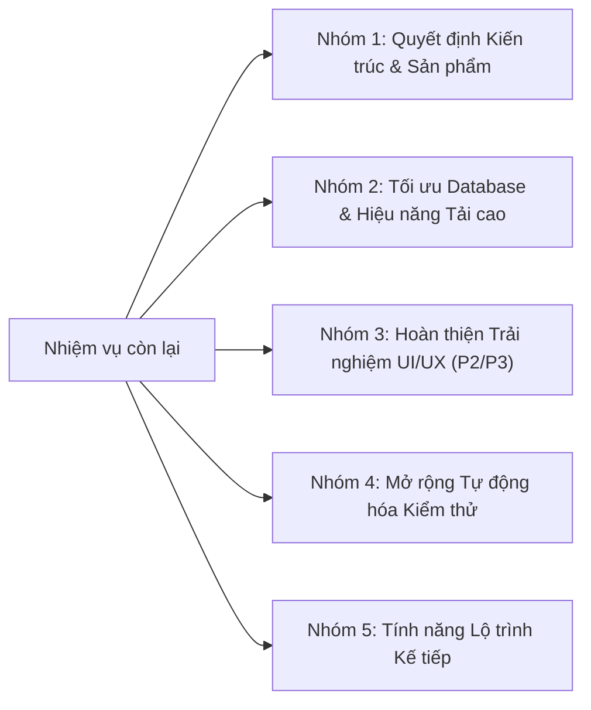

# Danh mục Nhiệm vụ Tiếp theo (Next Todo Tasks)

> **Dự án**: LemonChat (Group Chat & Messaging System)  
> **Tài liệu tham chiếu**: [`docs/GROUP_CHAT_REVIEW_REMEDIATION_PLAN.md`](GROUP_CHAT_REVIEW_REMEDIATION_PLAN.md), [`review.md`](../review.md), [`docs/TODO_NEXT.md`](TODO_NEXT.md)  
> **Trạng thái Baseline**: Đã hoàn thành 100% các hạng mục P0/P1 trước merge trên `lemon-backend` (`9601adb`) và `lemon-ui` (`a3a2e46`).  
> **Kết quả kiểm thử hiện tại**:
> - Backend: **78/78 suites (929/929 unit tests pass)**, **8/8 suites (52/52 E2E tests pass)**, Typecheck 0 error, Lint 0 error, Migration `0024` đã áp dụng.
> - Frontend: **26/26 files (183/183 component tests pass)**, Production build pass, Typecheck 0 error, Lint 0 error.

---

## Bảng tổng hợp trạng thái các nhóm nhiệm vụ

| Nhóm | Mã Task | Tên nhiệm vụ | Mức ưu tiên | Trạng thái | Phụ trách đề xuất |
|---|---|---|:---:|:---:|:---:|
| **1. Quyết định Sản phẩm** | `TASK-ARCH-01` | Chính sách truy cập Group Avatar (Public Capability vs Private Blob) | P1 | Cần thảo luận | TechLead / Product |
| | `TASK-ARCH-02` | Idempotency Key khi hard-delete tài khoản Creator | P2 | Cần thảo luận | Backend / TechLead |
| | `TASK-ARCH-03` | Mô hình quyền xem lịch sử khi Re-add thành viên nhiều lần | P2 | Đã có quy tắc / Backlog | Product |
| | `TASK-ARCH-04` | Chuẩn hóa HTTP Status Code cho Replay Request (201 vs 200) | P3 | Cần quyết định | Backend Lead |
| **2. Tối ưu Hiệu năng** | `TASK-PERF-01` | Script chạy `CREATE INDEX CONCURRENTLY` trên Production lớn | P2 | Sẵn sàng triển khai | DBA / DevOps |
| | `TASK-PERF-02` | Profiling `EXPLAIN (ANALYZE, BUFFERS)` inbox hàng triệu tin nhắn | P2 | Chờ môi trường Staging | Backend |
| | `TASK-PERF-03` | Throttling & Generation Counter cho Realtime Typing Indicator | P2 | Chờ triển khai | Backend / Realtime |
| | `TASK-PERF-04` | Chuẩn hóa thứ tự khóa giao dịch (Transaction Lock Order) | P2 | Chờ triển khai | Backend |
| **3. Hoàn thiện UI/UX** | `TASK-UI-01` | Hiển thị % tiến trình upload tệp đính kèm (`onUploadProgress`) | P2 | Chờ triển khai | Frontend |
| | `TASK-UI-02` | Quản lý vòng đời & Tự động thu hồi Blob URL tập trung | P2 | Chờ triển khai | Frontend |
| | `TASK-UI-03` | Lưu bền vững `clientRequestId` của Group Wizard trong `sessionStorage` | P2 | Chờ triển khai | Frontend |
| | `TASK-UI-04` | Rà soát hiển thị tên người gửi tin nhắn (Direct vs Group) | P3 | Chờ triển khai | Frontend |
| | `TASK-UI-05` | Đồng bộ hóa đối xứng 100% key i18n VI/EN và phụ đề count | P3 | Chờ triển khai | Frontend |
| **4. Tự động hóa CI/CD** | `TASK-TEST-01` | Thiết lập Browser E2E Automation với Playwright (Multi-tab realtime) | P2 | Chờ thiết lập | QA / Fullstack |
| | `TASK-TEST-02` | Tích hợp pre-merge gate vào GitHub Actions CI | P1 | Sẵn sàng triển khai | DevOps / An |
| **5. Tính năng Lộ trình** | `TASK-FEAT-01` | Tìm kiếm tin nhắn trong hội thoại (Message Search API + Scroll UI) | Feature | Kế hoạch chi tiết | An |
| | `TASK-FEAT-02` | Voice Call & Video Call Direct (1-1) | Feature | Đang làm branch riêng | Hiệu |

---

## Chi tiết từng nhiệm vụ

### Nhóm 1: Quyết định Kiến trúc & Sản phẩm (Product & Architecture Decisions)

#### `TASK-ARCH-01`: Chính sách truy cập Avatar Nhóm (Public Capability URL vs Private Stream/Blob)
- **Mức ưu tiên**: P1
- **Liên quan review**: Mục 7.1, Mục 3.1 (M5) trong `docs/GROUP_CHAT_REVIEW_REMEDIATION_PLAN.md`
- **Hiện trạng kỹ thuật**:
  - Endpoint `GET /files/group-avatars/:id` hiện được đánh dấu `@Public()` và trả về link capability hoặc stream file công khai tương tự user avatar.
  - Phía Frontend thẻ `` tải ảnh trực tiếp mà không kèm theo header `Authorization: Bearer <token>`.
- **Vấn đề đặt ra**:
  - Nếu nhóm là riêng tư, việc public avatar có được chấp nhận là một "capability URL ngẫu nhiên, không thể đoán được và không suy ra danh sách thành viên" hay bắt buộc phải là Private GET (chỉ thành viên hiện tại của nhóm mới được tải avatar)?
  - Nếu chuyển sang Private: Frontend sẽ cần tải ảnh qua Axios kèm header Authorization rồi chuyển thành `Blob URL` (`URL.createObjectURL(blob)`), kèm theo cơ chế giải phóng bộ nhớ khi unmount hoặc đổi phòng.
- **Tiêu chí nghiệm thu (DoD)**:
  - [ ] TechLead và Product chốt bằng văn bản chính sách: (A) Giữ Public capability URL với tên file UUID ngẫu nhiên; hoặc (B) Chuyển sang Private URL có xác thực.
  - [ ] Nếu chọn (A): Cập nhật tài liệu API khẳng định đây là ngoại lệ bảo mật có chủ đích; giữ nguyên precheck quyền ở bước upload và cơ chế dọn rác object.
  - [ ] Nếu chọn (B): Cập nhật endpoint BE yêu cầu Guard + Membership, cập nhật component Frontend sang tải authenticated Blob URL.

#### `TASK-ARCH-02`: Idempotency Key khi Hard-delete tài khoản Creator
- **Mức ưu tiên**: P2
- **Liên quan review**: Mục 7.3, Mục 3.2 (MINOR 3)
- **Hiện trạng kỹ thuật**:
  - Bảng `conversations` có ràng buộc duy nhất trên `(creator_id, create_request_id)` để đảm bảo tính idempotent khi tạo nhóm.
  - Nếu tài khoản creator bị xóa vĩnh viễn khỏi database (hard-delete), FK `creator_id` sẽ thành `NULL`, làm mất tính duy nhất của index `(NULL, create_request_id)`.
- **Giải pháp đề xuất**:
  - Lựa chọn 1: Chính sách bảo lưu dữ liệu (Retention policy) không hard-delete người dùng mà sử dụng soft-delete (`deleted_at IS NOT NULL`, ẩn thông tin cá nhân PII).
  - Lựa chọn 2: Sử dụng surrogate immutable creator key hoặc tombstone record để bảo toàn ràng buộc duy nhất.
- **Tiêu chí nghiệm thu (DoD)**:
  - [ ] Chốt chính sách retention của người dùng trong hệ thống LemonChat.
  - [ ] Bổ sung test case mô phỏng hành vi idempotency sau khi user bị xử lý xóa.

#### `TASK-ARCH-03`: Quyền xem lịch sử khi Re-add thành viên nhiều lần
- **Mức ưu tiên**: P2
- **Liên quan review**: Mục 7.2, Mục 3.2 (MINOR 5)
- **Hiện trạng kỹ thuật**:
  - Khi một người rời nhóm hoặc bị kích ra, sau đó được mời vào lại, hệ thống ghi đè mốc `history_boundary_message_id = messageId_tai_luc_vao_lai`.
  - Người dùng này **chỉ thấy lịch sử từ lần vào lại gần nhất**, hoàn toàn không thấy các tin nhắn gửi trong lúc họ đang ở ngoài nhóm.
- **Vấn đề đặt ra**:
  - Quy tắc hiện tại đảm bảo an toàn tối đa (fail-closed, không bao giờ lộ tin nhắn trong khoảng thời gian người đó vắng mặt).
  - Tuy nhiên, người dùng cũng sẽ bị tạm ẩn các tin nhắn cũ từ lần tham gia đầu tiên (trước khi họ rời nhóm).
- **Tiêu chí nghiệm thu (DoD)**:
  - [ ] Xác nhận từ Product: Duy trì quy tắc "chỉ thấy từ lần vào lại gần nhất" (được khuyến nghị vì đơn giản, an toàn).
  - [ ] Nếu Product muốn hỗ trợ xem lại lịch sử các đợt cũ: Lập ticket thiết kế bảng phụ `conversation_membership_intervals (id, user_id, conversation_id, joined_at, left_at, boundary_message_id)` để truy vấn đa khoảng thời gian.

#### `TASK-ARCH-04`: Chuẩn hóa HTTP Status Code cho Replay Request (201 vs 200)
- **Mức ưu tiên**: P3
- **Liên quan review**: Mục 7.4, Mục 3.2 (NIT)
- **Hiện trạng kỹ thuật**:
  - Khi client gửi lại cùng một `clientRequestId` tạo nhóm, server trả về đúng bản ghi đã tạo trước đó với mã HTTP `201 Created`.
- **Giải pháp**:
  - Giữ nguyên `201 Created` cho đến khi có phiên bản API v2 để tránh làm ảnh hưởng các client web/mobile đang xử lý phản hồi thành công trên mã 201.
- **Tiêu chí nghiệm thu (DoD)**:
  - [ ] Ghi chú vào tài liệu API về cơ chế replay idempotency.

---

### Nhóm 2: Tối ưu Cơ sở dữ liệu & Hiệu năng Tải cao (Backend & DB Infrastructure)

#### `TASK-PERF-01`: Script tạo Index độc lập `CREATE INDEX CONCURRENTLY` trên Production
- **Mức ưu tiên**: P2
- **Liên quan review**: Mục 3.2 (MINOR 1, MINOR 2), Mục 4.D
- **Vấn đề kỹ thuật**:
  - Drizzle migration chạy trong một transaction đơn lẻ (`BEGIN ... COMMIT`), do đó PostgreSQL không cho phép chạy `CREATE INDEX CONCURRENTLY`.
  - Trên cơ sở dữ liệu lớn có hàng triệu bản ghi, việc tạo index thông thường sẽ khóa bảng (Access Exclusive Lock), ảnh hưởng đến thời gian hoạt động của ứng dụng.
- **Nhiệm vụ cần làm**:
  - Viết một kịch bản migration chạy riêng (stand-alone migration runner script) có thể thực hiện `CREATE INDEX CONCURRENTLY` ngoài transaction cho:
    1. `idx_message_hidden_for_users_user_id` trên bảng `message_hidden_for_users(user_id)`.
    2. `idx_conversation_participants_boundary` trên bảng `conversation_participants(history_boundary_message_id)`.
  - Đặt `lock_timeout = '5s'` để tránh treo kết nối nếu có transaction dài đang chạy.
- **Tiêu chí nghiệm thu (DoD)**:
  - [ ] Script kiểm tra `IF NOT EXISTS` và kiểm tra trạng thái invalid index nếu quá trình chạy bị gián đoạn.
  - [ ] Đã chạy thử nghiệm trên môi trường Staging có dữ liệu mô phỏng.

#### `TASK-PERF-02`: Profiling `EXPLAIN (ANALYZE, BUFFERS)` Inbox & Timeline Tải cao
- **Mức ưu tiên**: P2
- **Liên quan review**: Mục 3.2 (MINOR 11)
- **Nhiệm vụ cần làm**:
  - Tạo script seed dữ liệu mô phỏng: 1.000 hội thoại, 1.000.000 tin nhắn, 50.000 bản ghi tin ẩn (`message_hidden_for_users`).
  - Chạy `EXPLAIN (ANALYZE, BUFFERS)` trên:
    - Query nạp timeline có cursor pagination và history boundary (`findTimeline`).
    - Query nạp danh sách inbox sắp xếp theo `visibleMessageAt` (`findUserConversations`).
  - Kiểm tra xem query planner có dùng Index Scan thay vì Seq Scan hoặc Bitmap Heap Scan tốn kém hay không.
- **Tiêu chí nghiệm thu (DoD)**:
  - [ ] Thời gian phản hồi của query timeline < 20ms cho mỗi trang 30 tin nhắn.
  - [ ] Thời gian phản hồi của query inbox < 50ms cho người dùng có 100 nhóm.

#### `TASK-PERF-03`: Throttling & Generation Counter cho Realtime Typing Indicator
- **Mức ưu tiên**: P2
- **Liên quan review**: Mục 3.2 (MINOR 13, MINOR 14)
- **Hiện trạng kỹ thuật**:
  - `ChatGateway` hiện lắng nghe `typing:start` và `typing:stop` và phát đến các thành viên trong phòng.
  - Khi người dùng gõ phím liên tục, socket gửi event dồn dập có thể gây tải không cần thiết.
  - Nếu kết nối mạng chập chờn, event `stop` cũ có thể đến sau event `start` mới, làm mất trạng thái đang gõ.
- **Giải pháp đề xuất**:
  - Thêm throttle per-socket trên Gateway (ví dụ tối đa 1 event `typing:start` mỗi 2 giây từ một socket).
  - Bổ sung `generation` hoặc `timestamp` vào payload typing để phía client bỏ qua các event cũ đến muộn.
  - Đảm bảo khi socket disconnect, gateway tự động dọn dẹp trạng thái typing mà không cần đợi TTL hết hạn.
- **Tiêu chí nghiệm thu (DoD)**:
  - [ ] Không còn tình trạng kẹt chữ "đang gõ tin nhắn..." khi người dùng thoát ứng dụng đột ngột.
  - [ ] Viết test mô phỏng race condition đảo thứ tự gói tin giữa `start` và `stop`.

#### `TASK-PERF-04`: Chuẩn hóa thứ tự khóa giao dịch (Transaction Lock Order)
- **Mức ưu tiên**: P2
- **Liên quan review**: Mục 3.2 (MINOR 8)
- **Nhiệm vụ cần làm**:
  - Rà soát các thao tác có transaction đa bảng (`reactMessage`, `removeMember`, `leaveGroup`, `disbandGroup`).
  - Đảm bảo tuân thủ một thứ tự khóa cố định: `conversations` → `conversation_participants` → `messages`.
  - Tránh nguy cơ deadlock khi hai thao tác đồng thời diễn ra (ví dụ: người A thả reaction vào tin nhắn đúng lúc quản trị viên kích người A ra khỏi nhóm).
- **Tiêu chí nghiệm thu (DoD)**:
  - [ ] Viết test case concurrency chạy song song 2 request `reactMessage` và `removeMember` trên cùng một transaction pool mà không sinh lỗi `deadlock detected (40P01)`.

---

### Nhóm 3: Hoàn thiện Trải nghiệm Người dùng & UI Polish (Frontend UX & Edge Cases)

#### `TASK-UI-01`: Hiển thị % Tiến trình Upload tệp đính kèm trong Message Composer
- **Mức ưu tiên**: P2
- **Liên quan review**: Mục 3.3 (P3-11), Mục 4.C
- **Hiện trạng kỹ thuật**:
  - Khi người dùng gửi tệp đính kèm lớn (ảnh độ phân giải cao, video, tài liệu dung lượng ~25MB), composer và bubble hiển thị trạng thái *"Đang tải tệp đính kèm..."* dạng spinner chung.
- **Giải pháp đề xuất**:
  - Cấu hình callback `onUploadProgress` trong hàm tải file của Axios client (`client.put(presignedUrl, file, { onUploadProgress: ... })`).
  - Cập nhật tỷ lệ `%` vào attempt state của outbox store (`progress: Math.round((loaded * 100) / total)`).
  - Hiển thị thanh tiến trình trực quan trên khung soạn thảo và trên bubble tin nhắn pending.
- **Tiêu chí nghiệm thu (DoD)**:
  - [ ] Thanh tiến trình tăng đều từ 0% đến 100% trong quá trình tải tệp.
  - [ ] Có nút "Hủy tải lên" cho phép hủy bỏ request qua `AbortController`.

#### `TASK-UI-02`: Quản lý Vòng đời & Tự động thu hồi Blob URL tập trung
- **Mức ưu tiên**: P2
- **Liên quan review**: Mục 3.3 (P3-10), Mục 4.A
- **Vấn đề kỹ thuật**:
  - `URL.createObjectURL(file)` được dùng để tạo preview ảnh/video trước khi tải lên.
  - Nếu không được giải phóng kịp thời bằng `URL.revokeObjectURL(url)`, bộ nhớ RAM của trình duyệt sẽ bị rò rỉ (memory leak), đặc biệt khi người dùng gửi nhiều ảnh chất lượng cao.
- **Giải pháp đề xuất**:
  - Xây dựng một utility hook/registry `useBlobUrlRegistry` hoặc centralized store:
    - Lưu danh sách active Blob URLs kèm reference counter.
    - Tự động gọi `URL.revokeObjectURL` khi tin nhắn đã gửi thành công và chuyển sang dùng remote URL từ S3.
    - Thu hồi toàn bộ Blob URLs khi người dùng đăng xuất hoặc chuyển đổi tài khoản.
- **Tiêu chí nghiệm thu (DoD)**:
  - [ ] Không còn sót URL dạng `blob:http://...` trong DOM sau khi tin nhắn đã được xác nhận thành công.
  - [ ] Đăng xuất giải phóng sạch sẽ toàn bộ đối tượng trong bộ nhớ.

#### `TASK-UI-03`: Lưu bền vững `clientRequestId` của Group Wizard trong `sessionStorage`
- **Mức ưu tiên**: P2
- **Liên quan review**: Mục 3.3 (P3-17), Mục 4.B
- **Hiện trạng kỹ thuật**:
  - `clientRequestId` của Wizard hiện được lưu trong React `useRef`, do đó nếu người dùng vô tình đóng modal hoặc chuyển tab rồi mở lại, một ID mới sẽ được sinh.
- **Giải pháp đề xuất**:
  - Lưu `clientRequestId` vào `sessionStorage` theo khóa `group_wizard_req_${userId}_${hash(memberIds, title)}`.
  - Nếu request tạo nhóm trước đó gặp sự cố mạng chập chờn, khi người dùng mở lại wizard và bấm Thử lại với cùng danh sách thành viên, ID cũ sẽ được tái sử dụng để kích hoạt cơ chế idempotent của backend, tránh tạo nhóm trùng lặp.
- **Tiêu chí nghiệm thu (DoD)**:
  - [ ] Mở wizard → nhập thông tin → ngắt mạng giả lập → gửi thất bại → đóng wizard → mở lại → bấm gửi: Server trả về đúng nhóm đã tạo, không tạo nhóm thứ 2.

#### `TASK-UI-04`: Rà soát hiển thị Tên người gửi tin nhắn (Direct vs Group)
- **Mức ưu tiên**: P3
- **Liên quan review**: Mục 3.3 (P3-15)
- **Hiện trạng kỹ thuật**:
  - Trong cuộc trò chuyện Direct (1-1), tên người gửi bên cạnh avatar tin nhắn nhận là dư thừa vì người dùng đã biết đối phương là ai từ Header.
  - Chỉ trong Group chat mới cần hiển thị nhãn tên người gửi phía trên bubble tin nhắn.
- **Giải pháp**:
  - Kiểm tra điều kiện `isGroup` trong component `MessageItem` / `MessageList` trước khi render tên tác giả tin nhắn.
- **Tiêu chí nghiệm thu (DoD)**:
  - [ ] Hội thoại 1-1 không hiển thị tên người gửi trên từng bubble tin nhắn.
  - [ ] Hội thoại nhóm hiển thị tên người gửi rõ ràng cho các tin nhắn nhận được.

#### `TASK-UI-05`: Đồng bộ hóa đối xứng 100% key i18n VI/EN và phụ đề count
- **Mức ưu tiên**: P3
- **Liên quan review**: Mục 3.3 (P3-16, P3-19)
- **Nhiệm vụ cần làm**:
  - Kiểm tra đối xứng key giữa `src/locales/vi/` và `src/locales/en/`.
  - Thay thế các đoạn văn bản fallback tiếng Việt còn sót trong code bằng hàm dịch `t('...')`.
  - Cập nhật số đếm thành viên trong Chat Info Panel sử dụng `memberCount` chuẩn từ mapper thay vì đọc trực tiếp mảng `members`.
- **Tiêu chí nghiệm thu (DoD)**:
  - [ ] Test suite `locales.test.ts` kiểm tra đối xứng key đạt 100% pass.
  - [ ] Chuyển đổi ngôn ngữ VI ↔ EN trên giao diện không xuất hiện key rỗng hoặc chữ chưa dịch.

---

### Nhóm 4: Mở rộng Tự động hóa Kiểm thử (Test Automation & CI/CD)

#### `TASK-TEST-01`: Thiết lập Browser E2E Automation với Playwright (Multi-tab realtime)
- **Mức ưu tiên**: P2
- **Liên quan review**: Mục 6 trong `docs/GROUP_CHAT_REVIEW_REMEDIATION_PLAN.md`
- **Hiện trạng kỹ thuật**:
  - Frontend hiện có 183 component/unit test chạy với jsdom/Vitest và mock server.
  - Chưa có browser E2E test harness tự động chạy trên trình duyệt thực tế (Chromium/Firefox) để mô phỏng tương tác 2 người dùng thời gian thực.
- **Nhiệm vụ cần làm**:
  - Khởi tạo cấu hình Playwright trong repo `lemon-ui`.
  - Viết kịch bản E2E:
    1. User A và User B cùng mở 2 trình duyệt riêng biệt.
    2. User A tạo nhóm mời User B.
    3. User B nhận realtime thông báo nhóm mới trong inbox mà không cần F5.
    4. User A gửi tin nhắn kèm tệp ảnh → User B nhìn thấy tin nhắn và mở xem ảnh trong lightbox modal.
    5. User A thu hồi tin nhắn → User B thấy bubble chuyển sang trạng thái đã thu hồi ngay lập tức.
- **Tiêu chí nghiệm thu (DoD)**:
  - [ ] Bộ test Playwright chạy ổn định không flake trên môi trường local và CI.

#### `TASK-TEST-02`: Tích hợp pre-merge gate vào GitHub Actions CI
- **Mức ưu tiên**: P1
- **Nhiệm vụ cần làm**:
  - Tạo / cập nhật workflow `.github/workflows/ci.yml` trên cả hai repo `lemon-backend` và `lemon-ui`.
  - Thiết lập các bước bắt buộc chạy qua trước khi cho phép merge PR:
    1. `oxlint` & `oxfmt --check`
    2. `tsc --noEmit`
    3. `vitest run` (Unit tests)
    4. `vitest run --config ./vitest.config.e2e.ts` (Backend E2E)
    5. `vite build` (Frontend production build)
- **Tiêu chí nghiệm thu (DoD)**:
  - [ ] Mọi Pull Request tạo mới đều tự động chạy kiểm tra và chặn merge nếu có bất kỳ bước nào thất bại.

---

### Nhóm 5: Các tính năng lộ trình kế tiếp (Feature Roadmap Follow-up)

#### `TASK-FEAT-01`: Tìm kiếm tin nhắn trong cuộc trò chuyện (Message Search)
- **Mức ưu tiên**: Feature
- **Mô tả**:
  - Xây dựng API `GET /api/conversations/:id/messages/search?q={keyword}&limit={limit}&cursor={cursor}` hỗ trợ tiếng Việt có dấu/không dấu (PostgreSQL `ILIKE` / FTS với `unaccent`).
  - Giao diện popover thanh tìm kiếm trên khung chat với phím tắt `Esc`, hiển thị số lượng kết quả (`1/12`), nút điều hướng Lên/Xuống.
  - Tính năng Scroll-to-message: Tự động cuộn đến tin nhắn tìm được và kích hoạt hiệu ứng flash highlight.
- **Phụ trách**: An

#### `TASK-FEAT-02`: Voice Call & Video Call Direct (1-1)
- **Mức ưu tiên**: Feature
- **Mô tả**:
  - Tích hợp WebRTC và socket signaling cho cuộc gọi thoại và video 1-1.
  - Hoàn thiện UI CallScreen, CallControls, VoiceCallStage và xử lý xung đột git trên nhánh phát triển cuộc gọi.
- **Phụ trách**: Hiệu / Công

---

## Nguyên tắc triển khai và nghiệm thu công việc

1. **Quy chuẩn mã nguồn (Quality Gates)**:
   - Mọi thay đổi code trên Backend đều phải vượt qua: `oxlint --type-aware`, `oxfmt --check`, `tsc --noEmit`, `vitest run`, `vitest run --config ./vitest.config.e2e.ts`.
   - Mọi thay đổi code trên Frontend đều phải vượt qua: `oxlint`, `oxfmt --check`, `vitest run`, `tsc -b && vite build`.
2. **Quy chuẩn Commit (Git Standards)**:
   - Tuân thủ chuẩn **Conventional Commits** (`feat:`, `fix:`, `refactor:`, `test:`, `docs:`, `perf:`).
   - Mô tả rõ ràng lý do thay đổi và kết quả xác minh kiểm thử.
3. **Quản lý dữ liệu**:
   - Tuyệt đối không chỉnh sửa các migration cũ đã áp dụng (`0020` - `0024`).
   - Mọi thay đổi schema mới phải được tạo qua `drizzle-kit generate` với migration additive có tính tương thích ngược (fail-closed).
