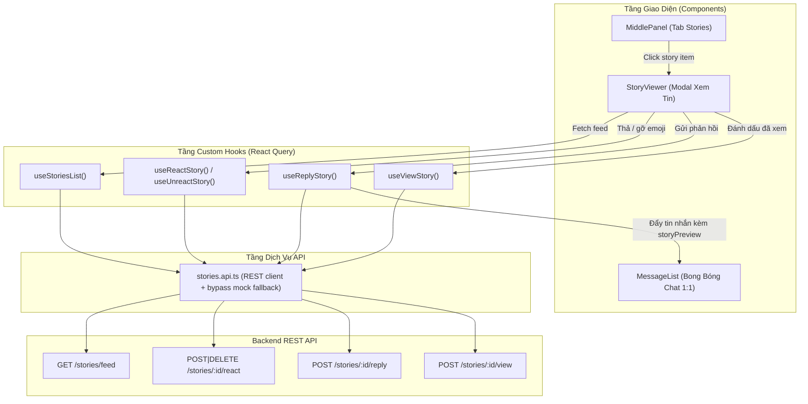

# Hướng Dẫn Tích Hợp Frontend Story & Tương Tác (Story Interactions)

Tài liệu hướng dẫn chi tiết về cấu trúc, luồng dữ liệu, component UI, và cách tích hợp các tính năng tương tác Story (`lemon-ui`) với hệ thống Backend (`lemon-backend`).

---

## 1. Tổng Quan Kiến Trúc Frontend

Kiến trúc Story trên giao diện web (`lemon-ui`) được xây dựng theo mô hình phân tầng chuẩn React 19 + TypeScript + Tailwind CSS v4 + React Query:



---

## 2. Danh Sách Endpoint & API Client Mappings

Các phương thức trong `src/features/chat/api/stories.api.ts` hỗ trợ 2 chế độ:
- **Live Mode** (`!isAuthBypass()`): Gọi trực tiếp API qua `request<T>()`.
- **Mock Bypass Mode** (`isAuthBypass()`): Lưu trữ trong bộ nhớ phiên làm việc (`storyStore`), phản hồi tức thì để kiểm thử offline.

| Hành động | Endpoint Backend | Hàm trong `stories.api.ts` | React Query Hook |
| :--- | :--- | :--- | :--- |
| Lấy bảng tin Story | `GET /stories/feed` | `listStories(currentUserId)` | `useStoriesList(currentUserId)` |
| Thả cảm xúc | `POST /stories/:id/react` | `reactStory(storyId, reaction)` | `useReactStory()` |
| Gỡ cảm xúc | `DELETE /stories/:id/react` | `unreactStory(storyId)` | `useUnreactStory()` |
| Danh sách biểu cảm | `GET /stories/:id/reactions` | `getStoryReactions(storyId)` | `useStoryReactions(storyId)` |
| Trả lời Story thành tin nhắn 1:1 | `POST /stories/:id/reply` | `replyStory(storyId, payload)` | `useReplyStory()` |
| Đánh dấu đã xem Story | `POST /stories/:id/view` | `viewStory(storyId)` | `useViewStory()` |
| Danh sách người xem | `GET /stories/:id/views` | `getStoryViews(storyId)` | `useStoryViews(storyId)` |

---

## 3. Chi Tiết Các Tính Năng & Component

### 3.1. Modal Xem Tin (`StoryViewer.tsx`)
- **Tiến trình tự động 5s (`progress`)**:
  - Tự động chạy thanh tiến trình trong 5 giây và chuyển/đóng story khi hết giờ.
  - **Tự động tạm dừng (pause)** khi người dùng hover chuột vào card story, chạm giữ màn hình, hoặc đang focus vào ô nhập tin nhắn phản hồi.
- **Tự động ghi nhận lượt xem (`viewStory`)**:
  - Khi người dùng mở story của người khác và chưa xem (`!story.mine && !story.viewed`), tự động gọi `POST /stories/:id/view`.
- **Thanh cảm xúc nhanh (`QUICK_REACTIONS`)**:
  - Dải 7 biểu cảm: `❤️`, `🔥`, `😂`, `😮`, `😢`, `👏`, `👍`.
  - Hiệu ứng phóng to khi hover/active.
  - Bấm vào biểu cảm đang chọn sẽ tự động gọi `unreactStory` để gỡ bỏ.
  - Cập nhật số lượng và trạng thái tức thì (optimistic update) kèm thông báo toast.
- **Thanh phản hồi Story (`Reply Bar`)**:
  - Ô input pill tại chân card story: `Nhắn tin cho [Tên tác giả]…`.
  - Nhấn `Enter` hoặc nút icon máy bay giấy `Send` để gửi tin nhắn.
  - Tự động tạo tin nhắn riêng 1:1 kèm trích dẫn story.

### 3.2. Trích Dẫn Story Trong Chat (`MessageList.tsx`)
Khi người dùng nhận được tin nhắn phản hồi từ một story, `ChatMessage` chứa thông tin `storyPreview`:
- Component `StoryReplyQuote` hiển thị một thẻ trích dẫn thanh lịch phía trên bong bóng tin nhắn:
  - Icon chanh thương hiệu 🍋 hoặc thumbnail phương tiện.
  - Tiêu đề: `Trả lời tin · [Tên tác giả]`.
  - Trích đoạn nội dung story hoặc chú thích.

---

## 4. Từ Điển Đa Ngôn Ngữ (Bilingual i18n Keys)

Các khóa dịch đã được cấu hình đồng bộ ở cả `src/locales/vi.json` và `src/locales/en.json`:

```json
{
  "chat": {
    "replyStoryPlaceholder": "Nhắn tin cho {{name}}…",
    "replyStorySuccess": "Đã gửi phản hồi vào cuộc trò chuyện 1:1",
    "replyStoryError": "Không thể gửi phản hồi",
    "reactStorySuccess": "Đã thả cảm xúc",
    "unreactStorySuccess": "Đã gỡ cảm xúc",
    "unreactStory": "Gỡ cảm xúc",
    "replyToStory": "Trả lời tin",
    "storyViewsCount": "{{count}} người xem",
    "storyReactionsCount": "{{count}} tương tác"
  }
}
```

---

## 5. Quy Chuẩn Kiểm Thử & Biên Dịch (QA Checklist)

- **Linter**:
  ```bash
  bun run lint
  # Found 0 warnings and 0 errors (oxlint on 119 files).
  ```
- **Typecheck & Production Build**:
  ```bash
  bun run build
  # tsc -b && vite build -> build thành công sạch sẽ 100% trong ~3.8s.
  ```
