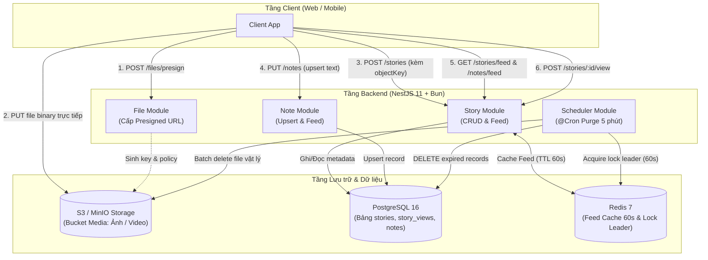
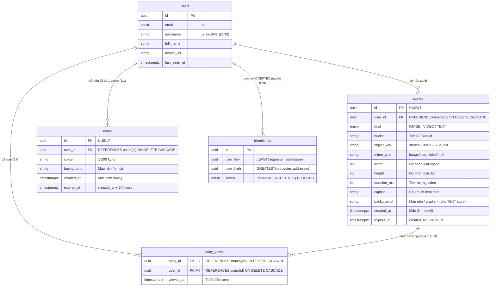
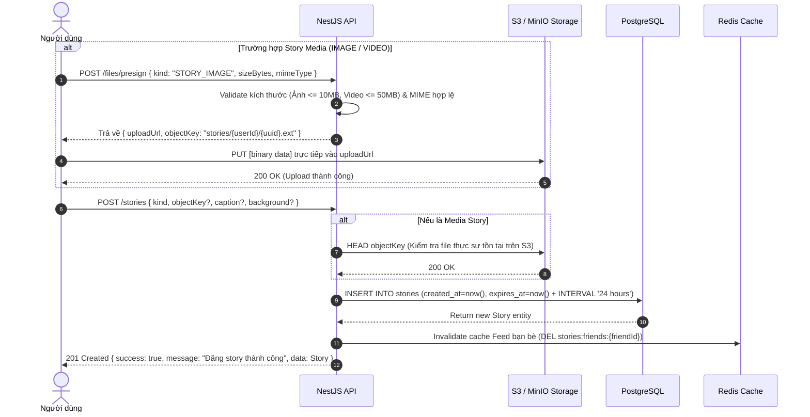
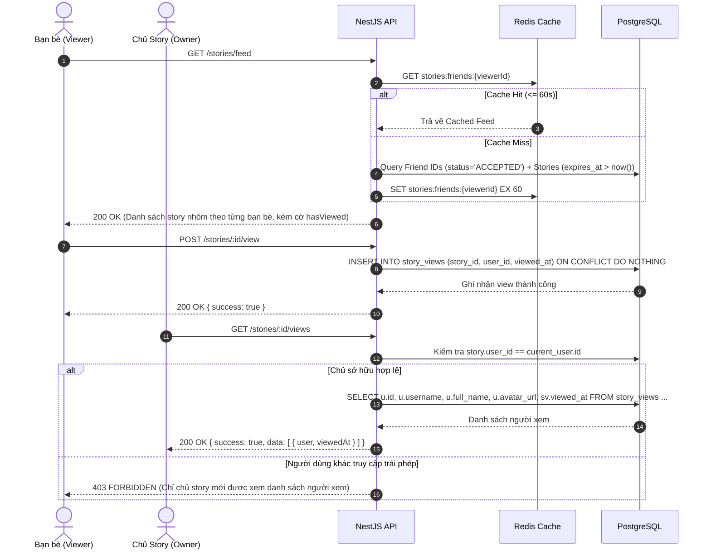
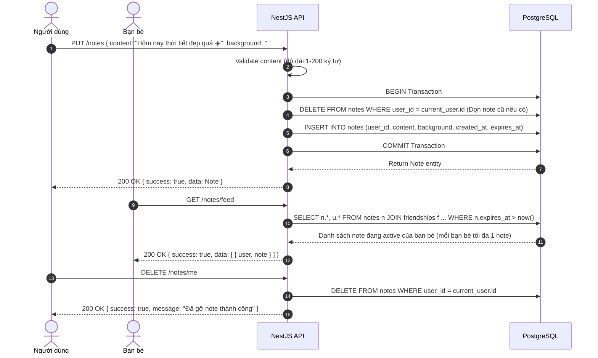
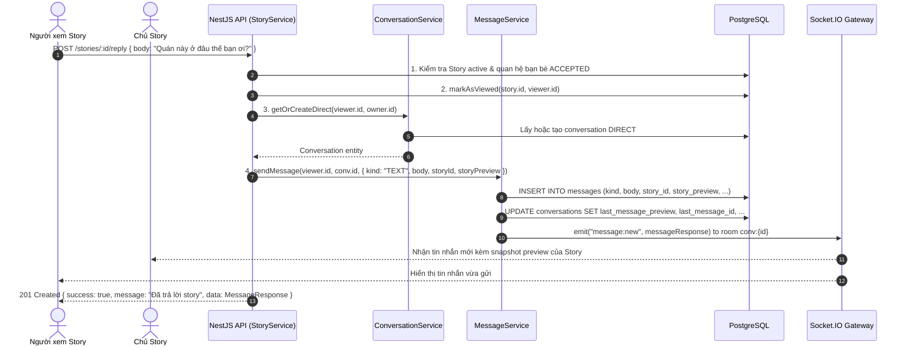
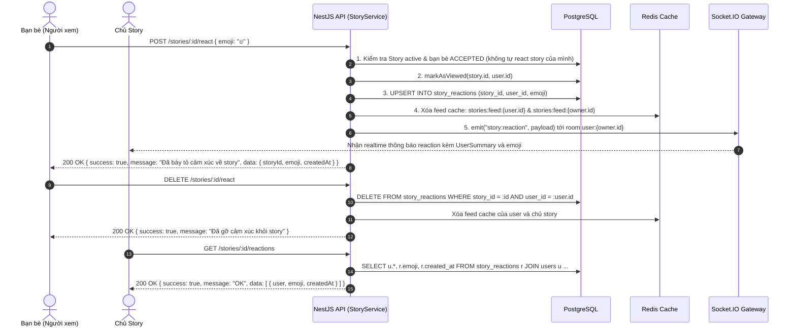

# LEMON CHAT — STORY 24H & NOTE 24H: Thiết kế Kiến trúc, Database & Sơ đồ Tương tác

> Đặc tả kỹ thuật chi tiết cho tính năng **Story 24h** (ảnh/video/text, danh sách người xem, tự hủy sau 24h)
> và **Note 24h** (trạng thái text ngắn 1–200 ký tự, upsert duy nhất 1 note active / user) của LEMON CHAT.
> Bao gồm quy hoạch mở rộng cho **Hướng phát triển tương lai (Phase 2)**: Rep Story thành Direct Message,
> React Story và React tin nhắn.

---

## Mục lục

1. [Tổng quan tính năng & Phạm vi](#1-tổng-quan-tính-năng--phạm-vi)
2. [Kiến trúc phân tầng & Luồng dữ liệu tổng thể](#2-kiến-trúc-phân-tầng--luồng-dữ-liệu-tổng-thể)
3. [Mô hình dữ liệu cơ sở dữ liệu ](#3-mô-hình-dữ-liệu-cơ-sở-dữ-liệu-postgresql-erd)
4. [Sơ đồ tuần tự các luồng chính ](#4-sơ-đồ-tuần-tự-các-luồng-chính-sequence-diagrams)
   - 4.1. [Luồng đăng tải Story 24h ](#41-luồng-đăng-tải-story-24h-presigned-s3--metadata)
   - 4.2. [Luồng xem Story Feed & Đánh dấu đã xem (](#42-luồng-xem-story-feed--đánh-dấu-đã-xem-privacy-first)
   - 4.3. [Luồng Note 24h ](#43-luồng-note-24h-trạng-thái-text--upsert)
   - 4.4. [Vòng đời 24h & Job dọn dẹp định kỳ ](#44-vòng-đời-24h--job-dọn-dẹp-định-kỳ-purge-cron-job)
5. [Quy hoạch Hướng phát triển tương lai](#5-quy-hoạch-hướng-phát-triển-tương-lai-phase-2-roadmap)
   - 5.1. [Luồng Rep Story vào tin nhắn riêng ](#51-luồng-rep-story-vào-tin-nhắn-riêng-instagrammessenger-style)
   - 5.2. [Luồng Thả cảm xúc Story & Thả cảm xúc Tin nhắn](#52-luồng-thả-cảm-xúc-story--thả-cảm-xúc-tin-nhắn-reactions)
   - 5.3. [Mô hình dữ liệu mở rộng cho Phase 2](#53-mô-hình-dữ-liệu-mở-rộng-cho-phase-2)
6. [Bảng danh mục API Endpoints & Mã lỗi](#6-bảng-danh-mục-api-endpoints--mã-lỗi)

---

## 1. Tổng quan tính năng & Phạm vi

### 1.1 Tính năng cốt lõi (MVP)

| Tính năng | Story 24h | Note 24h |
|---|---|---|
| **Định dạng nội dung** | Ảnh, Video, Chữ nền màu | Văn bản ngắn thuần túy (1–200 ký tự) kèm màu nền |
| **Media Storage** | Upload trực tiếp lên S3/MinIO qua Presigned URL | Không có file media (lưu trực tiếp trong DB) |
| **Số lượng hiển thị** | Nhiều story / user trong vòng 24h (xếp theo thời gian) | Tối đa **1 note active duy nhất** / user (app upsert) |
| **Đối tượng nhìn thấy** | Bạn bè có quan hệ `ACCEPTED` (và chính mình) | Bạn bè có quan hệ `ACCEPTED` (và chính mình) |
| **Quyền riêng tư người xem** | **Chỉ chủ story** thấy danh sách người đã xem | Không có danh sách người xem |
| **Cơ chế hết hạn** | Tự động hết hạn sau 24h, xóa kèm media S3 | Tự động hết hạn sau 24h, không lưu lịch sử |

### 1.2 Hướng phát triển tương lai (Phase 2+)

* **Rep Story thành tin nhắn**: Trả lời story chuyển thành tin nhắn 1:1 kèm thumbnail story trong cuộc trò chuyện `DIRECT`.
* **React Story**: Thả emoji (❤️, 🔥, 😂) trên story, tự động đồng bộ vào chat riêng của chủ story.
* **Message Reactions**: Thả biểu cảm trực tiếp trên từng tin nhắn hội thoại realtime.

---

## 2. Kiến trúc phân tầng & Luồng dữ liệu tổng thể

Hệ thống được thiết kế theo nguyên tắc phân tầng rõ ràng:
* **Media path**: Client upload trực tiếp lên S3/MinIO bằng Presigned PUT URL — **file binary không đi qua backend NestJS** để tối ưu băng thông và tài nguyên CPU.
* **Metadata path**: NestJS chỉ xử lý metadata gọn nhẹ, lưu trữ quan hệ trong PostgreSQL và cache feed tại Redis (TTL 60s).
* **Purge path**: Background Cron Job dọn dẹp dữ liệu quá hạn mỗi 5 phút in-process, giữ Redis Lock `SET NX` tránh xung đột đa instance.



---

## 3. Mô hình dữ liệu cơ sở dữ liệu 

Toàn bộ schema bám sát chuẩn Drizzle ORM và kiểu dữ liệu PostgreSQL tại [LEMON_CHAT.md §5.8](./LEMON_CHAT.md):



---

## 4. Sơ đồ tuần tự các luồng chính 

### 4.1. Luồng đăng tải Story 24h 



---

### 4.2. Luồng xem Story Feed & Đánh dấu đã xem 



---

### 4.3. Luồng Note 24h 

Mỗi tài khoản chỉ sở hữu tối đa **1 Note active**:



---

### 4.4. Vòng đời 24h & Job dọn dẹp định kỳ

Job quét định kỳ **mỗi 5 phút** (`@Cron('*/5 * * * *')`) chạy in-process với Redis Lock:

```mermaid
sequenceDiagram
    autonumber
    participant Scheduler as Scheduler (@nestjs/schedule)
    participant Redis as Redis Cache
    participant DB as PostgreSQL
    participant S3 as S3 / MinIO Storage

    Scheduler->>Scheduler: Kích hoạt định kỳ mỗi 5 phút (*/5 * * * *)
    Scheduler->>Redis: SET lock:purge-stories-notes <uuid> NX EX 60 (Xin Leader Lock; release compare-and-del)
    alt Node khác đang chạy (Lock thất bại)
        Redis-->>Scheduler: False -> Bỏ qua lần chạy này
    else Node hiện tại là Leader (Lock thành công)
        Redis-->>Scheduler: True -> Tiếp tục thực thi

        %% 1. Dọn dẹp Stories hết hạn
        Scheduler->>DB: DELETE FROM stories WHERE expires_at < now() OR deleted_at IS NOT NULL RETURNING object_key, bucket
        DB-->>Scheduler: Trả về danh sách object_key đã bị xóa

        opt Nếu có file media cần xóa
            Scheduler->>S3: DeleteObjectsCommand (Xóa batch các file media trên S3)
            S3-->>Scheduler: Xóa thành công
        end

        %% 2. Dọn dẹp Notes hết hạn
        Scheduler->>DB: DELETE FROM notes WHERE expires_at < now()
        DB-->>Scheduler: Hoàn tất xóa records notes
    end
```

> **Tombstone:** Story bị chủ động xóa (`DELETE /stories/:id`) chỉ được **đánh dấu** `deleted_at` — row và `object_key` còn nguyên để job dọn dẹp ở trên xóa S3 object theo batch (tránh orphan). Mọi read path trả 404 ngay khi xóa; purge job là nơi duy nhất xóa vĩnh viễn (trễ tối đa 1 chu kỳ cron ≈ 5 phút).

---

## 5. Quy hoạch Hướng phát triển tương lai (Phase 2 Roadmap)


> **Triết lý sản phẩm Lemon Chat**: Là ứng dụng trò chuyện riêng tư, hệ thống **không áp dụng bình luận công khai (Public Comment)** trên Story.
> Mọi tương tác phản hồi (Rep Story) hoặc thả biểu cảm (React Story) sẽ được định tuyến thông minh thành **Tin nhắn riêng (Direct Message)** vào cuộc hội thoại 1:1 có sẵn giữa hai người dùng (giống Instagram và Messenger).

---

### 5.1. Luồng Rep Story vào tin nhắn riêng (Direct Message)

Khi bạn bè gõ chữ trả lời Story (`POST /stories/:id/reply`), hệ thống tự động:
1. Đánh dấu người trả lời đã xem Story (`markAsViewed`).
2. Lấy hoặc tạo phòng hội thoại 1:1 (`conversations` DIRECT) giữa người trả lời và chủ sở hữu Story (`getOrCreateDirect`).
3. Chèn bản ghi tin nhắn mới vào bảng `messages` với snapshot preview của Story (`story_id` và `story_preview`), cập nhật snippet `last_message_preview` cho hội thoại.
4. Tăng unread counter trong Redis cho người nhận và phát sự kiện Socket.IO `message:new` tới room `conv:{id}`.



---

### 5.2. Luồng Thả cảm xúc Story (React & Unreact Story)

Người dùng có thể thả cảm xúc nhanh trên Story (`❤️`, `🔥`, `😂`, `😮`, `😢`, `👏`, `👍`):



---

### 5.3. Mô hình dữ liệu mở rộng

```sql
-- 1. Bảng cảm xúc trên Story (mỗi user tối đa 1 reaction active / story)
CREATE TABLE story_reactions (
  story_id   UUID NOT NULL REFERENCES stories(id) ON DELETE CASCADE,
  user_id    UUID NOT NULL REFERENCES users(id) ON DELETE CASCADE,
  emoji      TEXT NOT NULL, -- "❤️", "🔥", "😂", "😮", "😢", "👏", "👍"
  created_at TIMESTAMPTZ NOT NULL DEFAULT now(),
  PRIMARY KEY (story_id, user_id)
);
CREATE INDEX story_reactions_story_idx ON story_reactions(story_id);
CREATE INDEX story_reactions_user_idx ON story_reactions(user_id);

-- 2. Cột liên kết Story trên bảng messages
ALTER TABLE messages
  ADD COLUMN story_id UUID REFERENCES stories(id) ON DELETE SET NULL,
  ADD COLUMN story_preview JSONB; -- Snapshot { id, kind, bucket, objectKey, caption, background }

CREATE INDEX messages_story_idx ON messages(story_id);
```

---

## 6. Bảng danh mục API Endpoints & Mã lỗi

### 6.1 Bảng Endpoints Story

| Phương thức | Endpoint Path | Quyền truy cập | Mô tả tóm tắt |
|:---:|---|---|---|
| `POST` | `/stories` | Auth User | Đăng Story mới (`IMAGE`, `VIDEO`, hoặc `TEXT`). |
| `GET` | `/stories/feed` | Auth User | Lấy danh sách Story còn hạn của bạn bè & bản thân (kèm `myReaction`, `reactionsCount`). |
| `GET` | `/stories/:id` | Bạn bè / Chủ story | Xem chi tiết 1 Story (kèm `hasViewed`, `myReaction`, `reactionsCount`). |
| `POST` | `/stories/:id/view` | Bạn bè | Đánh dấu đã xem Story. |
| `GET` | `/stories/:id/views` | **Chỉ chủ Story** | Xem danh sách người đã xem (kèm biểu cảm `reaction` nếu có). |
| `POST` | `/stories/:id/react` | Bạn bè | Thả / cập nhật cảm xúc trên Story (`❤️`, `🔥`, `😂`, `😮`, `😢`, `👏`, `👍`). |
| `DELETE` | `/stories/:id/react` | Bạn bè | Gỡ cảm xúc khỏi Story. |
| `GET` | `/stories/:id/reactions` | **Chỉ chủ Story** | Xem danh sách chi tiết các biểu cảm trên Story. |
| `POST` | `/stories/:id/reply` | Bạn bè | Trả lời Story thành tin nhắn 1:1 trong phòng chat DIRECT. |
| `DELETE` | `/stories/:id` | **Chỉ chủ Story** | Xóa Story chủ động (tombstone `deleted_at`, dọn S3 qua Purge Job). |
| `PUT` | `/notes` | Auth User | Upsert Note trạng thái (tối đa 1 note active / user). |
| `GET` | `/notes/feed` | Auth User | Lấy danh sách Note còn hạn của bạn bè. |
| `DELETE` | `/notes/me` | Auth User | Gỡ Note của mình sớm. |

### 6.2 Bảng Mã lỗi đặc thù Story & Interaction

| HTTP Status | Error Code | Mô tả thông báo |
|:---:|---|---|
| `400` | `INVALID_MEDIA_TYPE` | Định dạng file không được hỗ trợ cho Story. |
| `400` | `FILE_TOO_LARGE` | Dung lượng file vượt quá giới hạn (Ảnh > 10MB, Video > 50MB). |
| `400` | `INVALID_EMOJI` | Biểu cảm không hợp lệ (chỉ chấp nhận các icon story chuẩn). |
| `400` | `CANNOT_REACT_OWN_STORY` | Bạn không thể tự bày tỏ cảm xúc story của chính mình. |
| `400` | `CANNOT_REPLY_OWN_STORY` | Bạn không thể tự trả lời story của chính mình. |
| `403` | `STORY_VIEW_FORBIDDEN` | Bạn chỉ có thể xem story của bạn bè hoặc chính mình. |
| `403` | `STORY_VIEWERS_FORBIDDEN` | Chỉ người đăng story mới có thể xem danh sách người xem / reactions. |
| `403` | `STORY_REACT_FORBIDDEN` | Bạn chỉ có thể bày tỏ cảm xúc story của bạn bè. |
| `403` | `STORY_REPLY_FORBIDDEN` | Bạn chỉ có thể trả lời story của bạn bè. |
| `403` | `STORY_DELETE_FORBIDDEN` | Chỉ chủ sở hữu mới có quyền xóa story. |
| `404` | `STORY_NOT_FOUND` | Story không tồn tại hoặc đã hết hạn sau 24h. |
| `404` | `NOTE_NOT_FOUND` | Không tìm thấy Note hoặc Note đã hết hạn. |

---

## 7. Tài liệu tích hợp Frontend (`lemon-ui`)

Chi tiết kiến trúc giao diện, Component hierarchy, React Query hooks, từ điển đa ngôn ngữ (vi/en), và hướng dẫn kết nối E2E xem tại:
👉 **[STORIES_FRONTEND_GUIDE.md](./STORIES_FRONTEND_GUIDE.md)**

