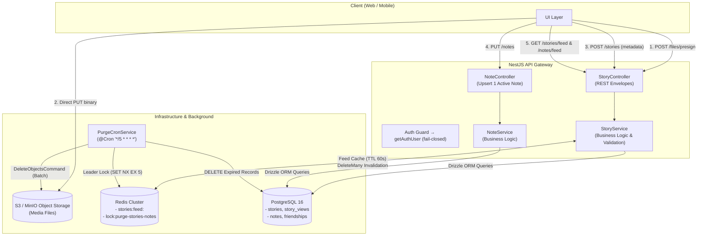

# TÀI LIỆU KIẾN TRÚC, PHÂN TÍCH PATTERNS & LỘ TRÌNH TRIỂN KHAI STORY & NOTE 24H

> Dành cho Kỹ sư Phát triển & AI Coding Agents — Lemon Chat Backend  
> Phiên bản: 1.1 (Cập nhật sau phản biện & commit `f69a81d`)

---

## 1. Kiểm tra & Phân tích Commit mới trên Nhánh (`f69a81d`)

Sau khi pull commit mới nhất `f69a81d` (`fix(story): fail-closed auth, revive cached Dates, shared constants, UUID pipes`), nhóm đã thực hiện các cải tiến kỹ thuật quan trọng:

1. **Bảo mật Fail-Closed Authentication**:
   - Identity đến **duy nhất** từ auth middleware (`req.user = { id }`, fail-closed 401 khi thiếu/sai access token) theo `AUTH.md` — **không** có bất kỳ header fallback nào; mọi header do client gửi không bao giờ được dùng làm identity.
   - Trong production, hệ thống bắt buộc lấy user identity từ `request.user.id` (được giải mã từ Access Token qua Auth Guard), chặn hoàn toàn nguy cơ giả mạo định danh qua header HTTP.
2. **Hồi sinh kiểu dữ liệu `Date` khi đọc từ Redis Cache (Revive Cached Dates)**:
   - Redis lưu trữ JSON chuỗi (JSON serialization biến `Date` thành ISO string). Khi cache hit, service tự động map và khởi tạo lại đối tượng `new Date(item.createdAt)` và `new Date(item.expiresAt)`, ngăn chặn lỗi runtime khi tầng controller/client gọi các phương thức thời gian.
3. **Invalidation Cache diện rộng theo mạng lưới bạn bè (`deleteManyBestEffort`)**:
   - Khi tạo hoặc xóa story, service tự động tính toán và xóa đồng thời feed cache của chính chủ và toàn bộ bạn bè (`[userFeedKey, ...friendFeedKeys]`).
4. **Chuẩn hóa Hằng số & Validation Pipes**:
   - Tách hằng số dùng chung trong `src/utils/cache/constants.ts`: `STORY_FEED_TTL_SECS = 60`, `STORY_TTL_MS = 24h`, `STORY_MAX_CAPTION_LENGTH = 500`, `NOTE_MAX_CONTENT_LENGTH = 200`.
   - Sử dụng `new ParseUUIDPipe()` trên tất cả các route parameters `:id` để từ chối sớm (fail-fast) các ID không đúng định dạng UUID.
5. **Bổ sung Unit Tests**:
   - Thêm `test/unit/domain/story/mapper.spec.ts` kiểm thử toàn diện mappers `toStoryItemResponse` và `groupStoriesByUser`.
   - Kiểm tra chặn caption chỉ chứa khoảng trắng (`whitespace-only`), và tự động bỏ qua tự xem story của chính mình (`self-view ignored`).

---

## 2. Nghiên cứu Patterns từ các Hệ thống Lớn

Nghiên cứu chi tiết (Facebook/Messenger/Instagram Story & Notes, Signal Stories, WhatsApp Status, Redis-first) được tổng hợp tại `../RESEARCH_STORY_NOTE_REDIS.md` trong workspace — dùng làm input cho các đợt kế tiếp. Các pattern đã chốt áp dụng: media qua Presigned URL + `HeadObject` verify, feed Fan-In on Read + Redis TTL 60s, view receipt idempotent (`ON CONFLICT DO NOTHING`), purge job dọn S3 + DB.

---

## 3. Kiến trúc Áp dụng cho Lemon Backend

Hệ thống tuân thủ nghiêm ngặt quy ước thiết kế trong `AGENTS.md` và `../docs/STORIES_NOTES.md`:

### Các nguyên tắc cốt lõi dành cho AI & Kỹ sư:

1. **Rust-style Role-Only Filenames**: Tên file trong domain không lặp lại tên thư mục (chỉ đặt `service.ts`, `controller.ts`, `module.ts`, `pg.ts`, `repository.ts`, `schema.ts`).
2. **Không ép kiểu bừa bãi (`no-any`)**: Nghiêm cấm sử dụng `as any` trong cả mã nguồn chính và test code.
3. **Không tạo Unbound Methods trong Spies**: Khi mock vitest, gán các hàm giả lập vào biến rời có định danh rõ ràng thay vì trích xuất từ object để linter `typescript(unbound-method)` luôn đạt 0 cảnh báo.
4. **Phản hồi Envelope Thống nhất (`../docs/RESPONSES.md`)**:
   - Thành công: `{ success: true, message: string, data?: T }`
   - Thất bại: `{ success: false, error: { code: string, message: string, details?: unknown } }`

---

## 4. Lộ trình Triển khai Chi tiết Theo Từng Đợt Commit

Toàn bộ công việc tiếp theo được chia nhỏ thành các đợt (Phases/Batches), mỗi đợt có phạm vi và cam kết cụ thể:

### Đợt 1: Hoàn thiện Ổn định Hạ tầng & Presigned Media Upload

- **Mục tiêu**: Đảm bảo 100% test suites không bị flake trên môi trường Windows và hỗ trợ cơ chế Presigned URL cho Story Media theo chuẩn S3.
- **Commit 1.1**: `fix(test): set realistic test timeout in cache suite to prevent Windows CI flake`
  - _Công việc_: Điều chỉnh timeout 15000ms trong `test/unit/configs/cache.spec.ts` cho test case khởi tạo dynamic testing module.
  - _Verify_: `bun run test` 100% green trên cả 16 test files.
- **Commit 1.2**: `feat(story): implement S3 presigned URL generation and media head verification`
  - _Công việc_:
    - Xây dựng service hỗ trợ sinh Presigned PUT URL với MinIO/S3 SDK (`@aws-sdk/client-s3`, `@aws-sdk/s3-request-presigner`).
    - Endpoint `POST /files/presign` (hoặc `POST /stories/presign`) kiểm tra kích thước tối đa (Ảnh <= 10MB, Video <= 50MB) và mime type hợp lệ.
    - Validate kiểm tra file thực sự tồn tại trên S3 (`HeadObjectCommand`) trước khi lưu record Story.

### Đợt 2: Xây dựng Worker Dọn dẹp Định kỳ (Background Purge Cron Job)

- **Mục tiêu**: Tự động giải phóng dung lượng đĩa và dọn dẹp các story/note đã quá hạn 24 giờ.
- **Commit 2.1**: `feat(story): implement PurgeCronService with distributed Redis lock and S3 batch deletion`
  - _Công việc_:
    - Tạo `src/jobs/purge.job.ts` (hoặc `src/domain/story/cron.ts`) với `@Cron('*/5 * * * *')`.
    - Sử dụng Redis Distributed Lock (`SET lock:purge-stories-notes 1 NX EX 5`) để chỉ duy nhất 1 pod/instance thực thi tại một thời điểm.
    - Truy vấn các story có `expiresAt <= NOW()`, thu thập danh sách `(bucket, objectKey)`.
    - Gọi lệnh S3 `DeleteObjectsCommand` để xóa file vật lý hàng loạt.
    - Xóa các records đã hết hạn trong PostgreSQL (`stories`, `notes`).
- **Commit 2.2**: `test(story): add unit tests for PurgeCronService leader election and batch deletion`
  - _Công việc_:
    - Viết unit test cho cron service: Kiểm thử kịch bản lock thành công/thất bại, batch deletion S3, rollback an toàn khi DB lỗi.

### Đợt 3: Triển khai Domain Note 24h (Text Status)

- **Mục tiêu**: Hoàn thành tính năng Note 24h (trạng thái text ngắn 1-200 ký tự, upsert duy nhất 1 active note/user).
- **Commit 3.1**: `feat(note): define Note DTOs, repository contract, and Drizzle PG implementation`
  - _Công việc_:
    - Tạo `src/domain/note/dto/request.ts`, `src/domain/note/dto/response.ts`.
    - Định nghĩa `NoteRepository` contract và hiện thực `NotePgRepository` truy vấn bảng `notes`.
    - Logic `upsert`: `INSERT ... ON CONFLICT (user_id) DO UPDATE` nguyên tử 1 statement — mỗi user đúng 1 note active, `expiresAt = NOW() + 24h`.
- **Commit 3.2**: `feat(note): implement NoteService and NoteController with friend feed and early deletion`
  - _Công việc_:
    - `NoteService`: Quản lý nghiệp vụ note, kiểm tra độ dài 1-200 ký tự, lấy note feed của bạn bè có quan hệ `ACCEPTED`.
    - `NoteController`:
      - `PUT /notes`: Tạo hoặc cập nhật note.
      - `GET /notes/feed`: Lấy feed note của bạn bè.
      - `DELETE /notes/me`: Chủ động gỡ note trước thời hạn 24h.
    - Đăng ký `NoteModule` vào `AppModule`.
- **Commit 3.3**: `test(note): add unit tests for NoteService and NoteController`
  - _Công việc_:
    - Viết bộ test đầy đủ cho service và controller của Note domain.

### Tương lai (ngoài phạm vi tài liệu này)

Story reactions và reply-story-into-DM (Phase 2 theo `../docs/STORIES_NOTES.md` §5) **không** nằm trong roadmap của tài liệu này — sẽ được plan riêng khi bắt đầu.

---

## 5. Quy tắc Kiểm thử & Tiêu chuẩn Bàn giao (Definition of Done)

1. **Linter & Typecheck**:
   - `bun run typecheck` ➜ Exit code 0, 0 lỗi.
   - `bun run lint` ➜ Exit code 0, 0 warnings, 0 errors.
2. **Unit Tests**:
   - `bun run test` ➜ 100% test cases passed, không có test nào bị timeout hay flakiness.
3. **Build & E2E**:
   - `bun run build` ➜ Build NestJS hoàn tất không có cảnh báo module thiếu.
   - `bun run test:e2e` ➜ Toàn bộ luồng E2E passed.
4. **Git Hygiene**:
   - Commit atomic, thông điệp tuân thủ Conventional Commits (`feat(...)`, `fix(...)`, `test(...)`).
   - Tuyệt đối không push đè lên `main`, luôn tạo nhánh tính năng và mở Pull Request để review.
