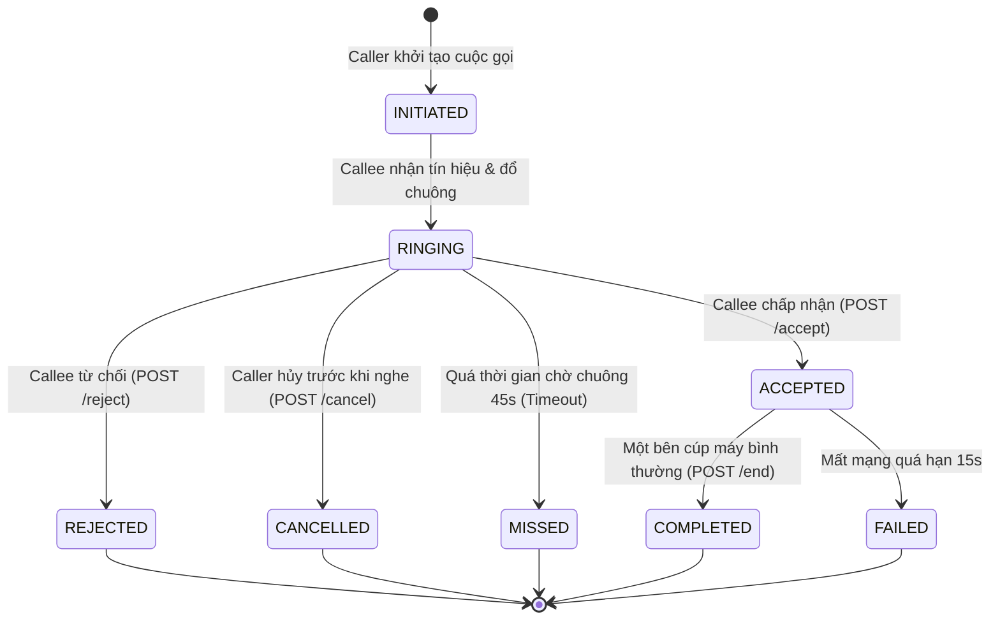
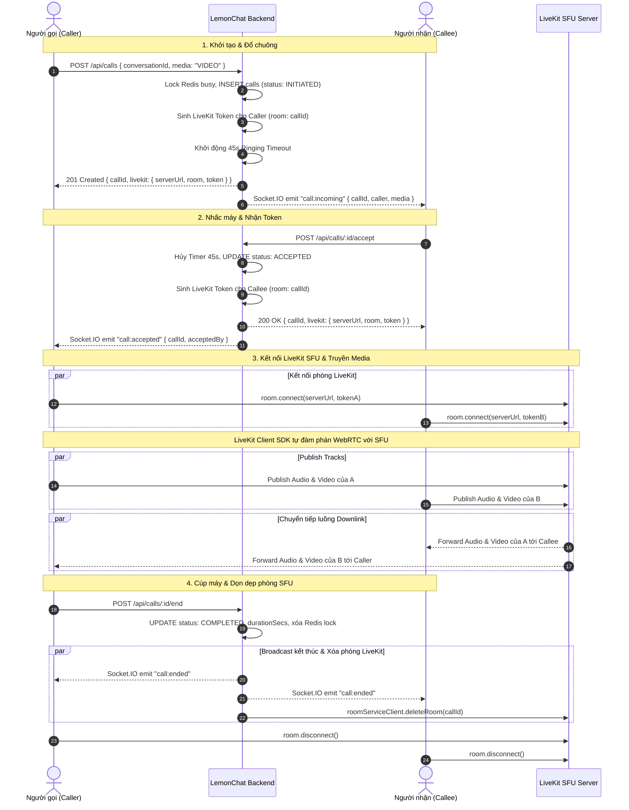
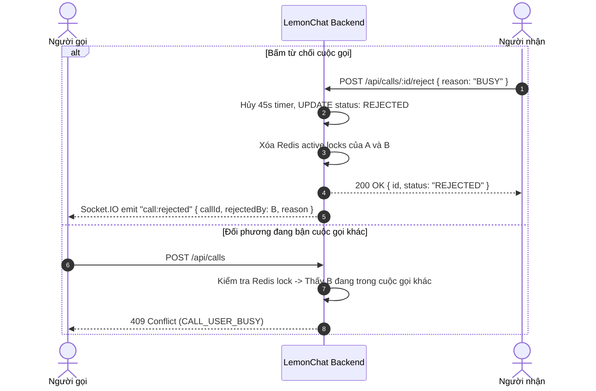
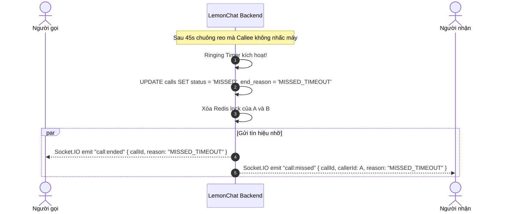
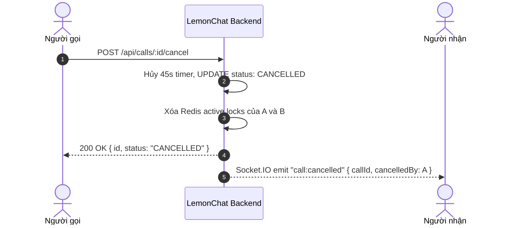
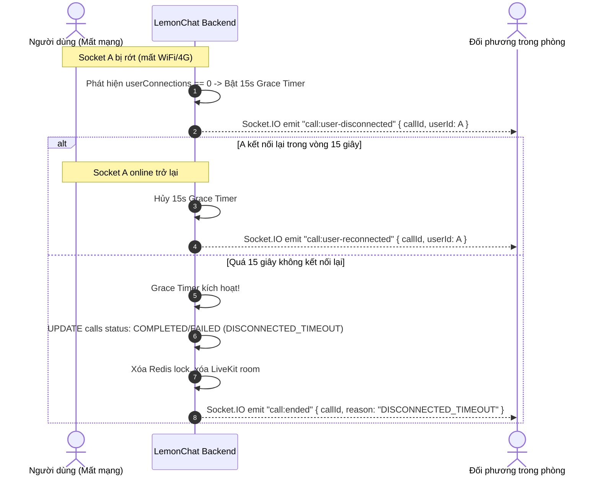

# LEMON CHAT — HƯỚNG DẪN THIẾT KẾ & PHÁT TRIỂN CALL SERVER (LIVEKIT SFU)

> **Tài liệu đặc tả kiến trúc, REST API, WebSocket Topics và Hướng dẫn triển khai Signalling & Token Issuer Server cho tính năng Gọi Thoại / Gọi Video sử dụng LiveKit SFU.**  
> Tuân thủ chuẩn Response Envelope tại [`RESPONSES.md`](./RESPONSES.md), hệ thống Authentication tại [`AUTH.md`](./AUTH.md), và cấu trúc Hợp đồng Realtime tại [`API_CHAT_1_1.md`](./API_CHAT_1_1.md).  
> **Base URL:** `http://localhost:3000/api` (hoặc domain production)  
> **WebSocket URL:** `ws://localhost:3000` (Socket.IO namespace `/`)  
> **LiveKit URL:** `ws://localhost:7880` (hoặc LiveKit Cloud `wss://...`)

---

## MỤC LỤC
1. [Tổng quan Kiến trúc LiveKit SFU & Backend Server](#1-tổng-quan-kiến-trúc-livekit-sfu--backend-server)
   - [1.1 Vai trò của LemonChat Backend](#11-vai-trò-của-lemonchat-backend)
   - [1.2 Vai trò của LiveKit SFU Media Server](#12-vai-trò-của-livekit-sfu-media-server)
   - [1.3 Vòng đời cuộc gọi & State Machine](#13-vòng-đời-cuộc-gọi--state-machine)
2. [Cấu hình LiveKit Server qua Biến Môi trường (.env)](#2-cấu-hình-livekit-server-qua-biến-môi-trường-env)
   - [2.1 Đặc tả biến môi trường](#21-đặc-tả-biến-môi-trường)
   - [2.2 Cơ chế sinh LiveKit Access Token (JWT)](#22-cơ-chế-sinh-livekit-access-token-jwt)
3. [Sơ đồ Luồng Nghiệp vụ (Sequence Diagrams)](#3-sơ-đồ-luồng-nghiệp-vụ-sequence-diagrams)
   - [3.1 Sơ đồ Cuộc gọi thành công (Happy Path & SFU Media Connection)](#31-sơ-đồ-cuộc-gọi-thành-công-happy-path--sfu-media-connection)
   - [3.2 Sơ đồ Người nhận từ chối hoặc đang bận (Reject / Busy)](#32-sơ-đồ-người-nhận-từ-chối-hoặc-đang-bận-reject--busy)
   - [3.3 Sơ đồ Cuộc gọi nhỡ do Timeout chuông (Missed Call / 45s Timeout)](#33-sơ-đồ-cuộc-gọi-nhỡ-do-timeout-chuông-missed-call--45s-timeout)
   - [3.4 Sơ đồ Người gọi chủ động hủy (Caller Cancel)](#34-sơ-đồ-người-gọi-chủ-động-hủy-caller-cancel)
   - [3.5 Sơ đồ Mất kết nối & Grace Period Reconnection](#35-sơ-đồ-mất-kết-nối--grace-period-reconnection)
4. [Đặc tả REST API Endpoints (Domain `call`)](#4-đặc-tả-rest-api-endpoints-domain-call)
   - [4.1 Khởi tạo cuộc gọi (`POST /calls`)](#41-khởi-tạo-cuộc-gọi-post-calls)
   - [4.2 Chấp nhận cuộc gọi (`POST /calls/:id/accept`)](#42-chấp-nhận-cuộc-gọi-post-callsidaccept)
   - [4.3 Lấy Token LiveKit (`GET /calls/:id/token`)](#43-lấy-token-livekit-get-callsidtoken)
   - [4.4 Lấy thông tin cuộc gọi đang hoạt động (`GET /calls/active`)](#44-lấy-thông-tin-cuộc-gọi-đang-hoạt-động-get-callsactive)
   - [4.5 Lấy chi tiết cuộc gọi (`GET /calls/:id`)](#45-lấy-chi-tiết-cuộc-gọi-get-callsid)
   - [4.6 Lịch sử cuộc gọi của người dùng (`GET /calls`)](#46-lịch-sử-cuộc-gọi-của-người-dùng-get-calls)
   - [4.7 Lịch sử cuộc gọi theo hội thoại (`GET /conversations/:id/calls`)](#47-lịch-sử-cuộc-gọi-theo-hội-thoại-get-conversationsidcalls)
   - [4.8 Từ chối cuộc gọi qua REST (`POST /calls/:id/reject`)](#48-từ-chối-cuộc-gọi-qua-rest-post-callsidreject)
   - [4.9 Hủy cuộc gọi trước khi nghe (`POST /calls/:id/cancel`)](#49-hủy-cuộc-gọi-trước-khi-nghe-post-callsidcancel)
   - [4.10 Kết thúc cuộc gọi qua REST (`POST /calls/:id/end`)](#410-kết-thúc-cuộc-gọi-qua-rest-post-callsidend)
5. [Đặc tả WebSocket Topics & Call Lifecycle Events](#5-đặc-tả-websocket-topics--call-lifecycle-events)
   - [5.1 Quản lý Phòng Socket.IO (`callRoom`)](#51-quản-lý-phòng-socketio-callroom)
   - [5.2 Nhóm sự kiện Điều khiển Vòng đời Cuộc gọi (Call Lifecycle)](#52-nhóm-sự-kiện-điều-khiển-vòng-đời-cuộc-gọi-call-lifecycle)
   - [5.3 Sự khác biệt: Không relay SDP & ICE qua Socket.IO](#53-sự-khác-biệt-không-relay-sdp--ice-qua-socketio)
6. [Thiết kế & Cấu trúc Mã nguồn Backend (`src/domain/call`)](#6-thiết-kế--cấu-trúc-mã-nguồn-backend-srcdomaincall)
   - [6.1 Cấu trúc thư mục chuẩn](#61-cấu-trúc-thư-mục-chuẩn)
   - [6.2 Tích hợp LiveKit Server SDK & Dọn dẹp phòng SFU](#62-tích-hợp-livekit-server-sdk--dọn-dẹp-phòng-sfu)
   - [6.3 Bảo toàn Tính toàn vẹn Dữ liệu & Xử lý Tranh chấp (Concurrency & Race Conditions)](#63-bảo-toàn-tính-toàn-vẹn-dữ-liệu--xử-lý-tranh-chấp-concurrency--race-conditions)
7. [Kế hoạch Mở rộng Cuộc gọi Nhóm (Group Call Readiness)](#7-kế-hoạch-mở-rộng-cuộc-gọi-nhóm-group-call-readiness)
8. [Kế hoạch Kiểm thử & Xác minh (Verification Plan)](#8-kế-hoạch-kiểm-thử--xác-minh-verification-plan)

---

## 1. TỔNG QUAN KIẾN TRÚC LIVEKIT SFU & BACKEND SERVER

### 1.1 Vai trò của LemonChat Backend
Hệ thống sử dụng mô hình **SFU (Selective Forwarding Unit)** với **LiveKit Server** làm trung tâm xử lý media. **LemonChat Backend đóng vai trò là một Business & Auth Signalling Server**:
1. **Quản lý phiên & Trạng thái cuộc gọi (Call Session Management):** Khởi tạo, đổ chuông (ringing), chấp nhận (accept), từ chối (reject), bận (busy), hủy (cancel), kết thúc (end), và tính toán thời lượng cuộc gọi (`duration_secs`).
2. **Quản lý trạng thái bận (Active Call Locking):** Sử dụng Redis Lock ngăn chặn một user vừa gọi vừa nhận thêm cuộc gọi khác.
3. **Đếm ngược thời gian chuông (45s Ringing Timeout):** Tự động phát hiện cuộc gọi nhỡ và giải phóng tài nguyên nếu người nhận không nhấc máy sau 45 giây.
4. **Cấp phát quyền hạn LiveKit (Token Issuer):** Sinh JWT `AccessToken` có mã hóa bảo mật cấp quyền cho người dùng truy cập vào phòng Media cụ thể trên LiveKit.
5. **Dọn dẹp tài nguyên SFU:** Kích hoạt lệnh `deleteRoom` trên LiveKit thông qua `RoomServiceClient` khi cuộc gọi kết thúc để thu hồi tài nguyên phòng trên server media.

```
       +-------------------------------------------------------+
       |             LemonChat Signalling Server               |
       |     (NestJS + Socket.IO + Redis + PostgreSQL)         |
       +-------------------------------------------------------+
            ^                                             ^
            |  REST API (Initiate, Accept, End)           |  REST API
            |  Socket.IO (Call Ringing, State Events)     |  Socket.IO
            v                                             v
     +-------------+                               +-------------+
     |   Client A  |                               |   Client B  |
     |   (Caller)  |                               |   (Callee)  |
     +-------------+                               +-------------+
            \                                             /
             \  WebRTC Media (Uplink/Downlink)           /  WebRTC Media (Uplink/Downlink)
              \                                         /
               v                                       v
        +-----------------------------------------------------+
        |                 LIVEKIT SFU SERVER                  |
        |  (Selective Forwarding Unit / Dynacast / Simulcast) |
        +-----------------------------------------------------+
```

---

### 1.2 Vai trò của LiveKit SFU Media Server
- **Không gửi media trực tiếp giữa 2 client:** Client chỉ mở 1 kết nối duy nhất (WebSocket kết hợp WebRTC PeerConnection) tới LiveKit Server.
- **Tiếp nhận luồng tải lên (Uplink):** Client gửi luồng Microphone và Camera lên SFU.
- **Phân phối luồng tải về (Downlink):** SFU chuyển tiếp các track audio/video tới người nghe.
- **Tự động thích ứng mạng:** Hỗ trợ Dynacast/Simulcast tự hạ độ phân giải khi mạng người nhận yếu hoặc ngắt track audio khi người nói im lặng, đảm bảo cuộc gọi không bị đứt quãng.

---

### 1.3 Vòng đời cuộc gọi & State Machine
Bảng `calls` sử dụng enum `callStatusEnum` (`src/domain/call/schema.ts`):
```ts
export const callStatusEnum = pgEnum("call_status", [
  "INITIATED", // Caller bấm gọi, server tạo bản ghi
  "RINGING",   // Callee nhận tín hiệu call:incoming và bắt đầu đổ chuông
  "ACCEPTED",  // Callee nhấc máy, bắt đầu kết nối LiveKit (answered_at được ghi nhận)
  "REJECTED",  // Callee chủ động bấm từ chối
  "MISSED",    // Callee không trả lời sau timeout chuông (45s)
  "CANCELLED", // Caller bấm cúp máy trước khi Callee trả lời
  "COMPLETED", // Cuộc gọi diễn ra thành công và kết thúc bình thường
  "FAILED",    // Cuộc gọi đứt đoạn hoặc lỗi không thể phục hồi
]);
```

#### Bảng chuyển trạng thái (State Transition Table):

| Trạng thái hiện tại | Sự kiện kích hoạt | Trạng thái mới | Hành động phụ đi kèm |
| :--- | :--- | :--- | :--- |
| *(None)* | Caller gửi `POST /calls` | **INITIATED** | Tạo record DB, lock trạng thái bận trong Redis, sinh LiveKit Token cho Caller, gửi `call:incoming` cho Callee |
| **INITIATED** | Callee nhận socket và phát tín hiệu chuông | **RINGING** | Đặt timer đếm ngược timeout chuông (45 giây) |
| **RINGING** | Callee bấm nhận cuộc gọi (`POST /calls/:id/accept`) | **ACCEPTED** | Hủy timer chuông, ghi nhận `answeredAt = NOW()`, sinh LiveKit Token cho Callee, gửi `call:accepted` cho Caller |
| **RINGING** | Callee bấm từ chối (`POST /calls/:id/reject`) | **REJECTED** | Hủy timer chuông, giải phóng Redis lock, ghi nhận `endedAt = NOW()`, `endReason = 'REJECTED'` |
| **RINGING** | Hết 45s không ai trả lời (Timer fires) | **MISSED** | Server tự động đổi status thành `MISSED`, gửi thông báo `call:missed` cho Callee và `call:ended` cho Caller |
| **INITIATED / RINGING** | Caller bấm hủy gọi (`POST /calls/:id/cancel`) | **CANCELLED** | Hủy timer chuông, giải phóng Redis lock, ghi nhận `endedAt = NOW()`, `endReason = 'CANCELLED'` |
| **ACCEPTED** | Bất kỳ bên nào cúp máy (`POST /calls/:id/end`) | **COMPLETED** | Ghi nhận `endedAt = NOW()`, tính `duration_secs`, xóa Redis lock, gọi `deleteRoom` trên LiveKit |
| **ACCEPTED** | Mất kết nối mạng quá Grace Period (15s) | **FAILED** | Ghi nhận `endedAt = NOW()`, `endReason = 'DISCONNECTED_TIMEOUT'`, dọn dẹp SFU room |



---

## 2. CẤU HÌNH LIVEKIT SERVER QUA BIẾN MÔI TRƯỜNG (.ENV)

> [!IMPORTANT]
> **Tuân thủ quy tắc bảo mật:** Tuyệt đối không đọc file `.env` thực tế của dự án. Mọi biến cấu hình được khai báo trong `.env.example` và đọc thông qua helper `get_env()`.

### 2.1 Đặc tả biến môi trường
File `.env.example`:
```env
# ------------------------------------------------------------------------------
# LiveKit SFU (Voice & Video Calls)
# ------------------------------------------------------------------------------
LIVEKIT_URL=ws://localhost:7880
LIVEKIT_API_KEY=devkey
LIVEKIT_API_SECRET=secret
```

- `LIVEKIT_URL`: URL WebSocket tới máy chủ LiveKit SFU.
  - Development nội bộ: `ws://localhost:7880`.
  - Production: `wss://lemonchat-xxxx.livekit.cloud` hoặc domain SFU riêng.
- `LIVEKIT_API_KEY`: API Key để định danh ứng dụng LemonChat với LiveKit.
- `LIVEKIT_API_SECRET`: Secret Key để ký HMAC cho JWT Access Token.

---

### 2.2 Cơ chế sinh LiveKit Access Token (JWT)
Backend sử dụng thư viện `livekit-server-sdk` để ký JWT Token:
```ts
import { AccessToken } from "livekit-server-sdk";

export async function generateLiveKitToken(
  apiKey: string,
  apiSecret: string,
  userId: string,
  roomName: string,
  userName?: string,
): Promise<string> {
  const at = new AccessToken(apiKey, apiSecret, {
    identity: userId,
    name: userName || userId,
    ttl: "2h", // Token có hiệu lực 2 giờ
  });

  at.addGrant({
    roomJoin: true,
    room: roomName,
    canPublish: true,
    canSubscribe: true,
    canPublishData: true,
  });

  return await at.toJwt();
}
```

---

## 3. SƠ ĐỒ LUỒNG NGHIỆP VỤ (SEQUENCE DIAGRAMS)

### 3.1 Sơ đồ Cuộc gọi thành công (Happy Path & SFU Media Connection)



---

### 3.2 Sơ đồ Người nhận từ chối hoặc đang bận (Reject / Busy)



---

### 3.3 Sơ đồ Cuộc gọi nhỡ do Timeout chuông (Missed Call / 45s Timeout)



---

### 3.4 Sơ đồ Người gọi chủ động hủy (Caller Cancel)



---

### 3.5 Sơ đồ Mất kết nối & Grace Period Reconnection



---

## 4. ĐẶC TẢ REST API ENDPOINTS (DOMAIN `CALL`)

### 4.1 Khởi tạo cuộc gọi (`POST /calls`)
- **Mục đích:** Bắt đầu cuộc gọi 1-1.
- **Yêu cầu:** JWT Bearer Token.
- **Request Body:**
  ```json
  {
    "conversationId": "0193a2b1-0000-7000-8000-000000000010",
    "media": "VIDEO"
  }
  ```
- **Response `201 Created`:**
  ```json
  {
    "data": {
      "id": "0193a2b1-0000-7000-8000-000000000020",
      "conversationId": "0193a2b1-0000-7000-8000-000000000010",
      "callerId": "0193a2b1-0000-7000-8000-000000000001",
      "calleeId": "0193a2b1-0000-7000-8000-000000000002",
      "media": "VIDEO",
      "status": "INITIATED",
      "startedAt": "2026-11-21T02:00:00.000Z",
      "answeredAt": null,
      "endedAt": null,
      "durationSecs": 0,
      "livekit": {
        "serverUrl": "ws://localhost:7880",
        "room": "0193a2b1-0000-7000-8000-000000000020",
        "token": "eyJhbGciOi..."
      }
    },
    "message": "Call initiated"
  }
  ```

---

### 4.2 Chấp nhận cuộc gọi (`POST /calls/:id/accept`)
- **Mục đích:** Người nhận nhấc máy.
- **Response `200 OK`:**
  ```json
  {
    "data": {
      "id": "0193a2b1-0000-7000-8000-000000000020",
      "status": "ACCEPTED",
      "answeredAt": "2026-11-21T02:00:05.000Z",
      "livekit": {
        "serverUrl": "ws://localhost:7880",
        "room": "0193a2b1-0000-7000-8000-000000000020",
        "token": "eyJhbGciOi..."
      }
    },
    "message": "Success"
  }
  ```

---

### 4.3 Lấy Token LiveKit (`GET /calls/:id/token`)
- **Mục đích:** Lấy hoặc làm mới token truy cập LiveKit cho người tham gia hợp lệ của cuộc gọi `:id`.
- **Response `200 OK`:**
  ```json
  {
    "data": {
      "serverUrl": "ws://localhost:7880",
      "room": "0193a2b1-0000-7000-8000-000000000020",
      "token": "eyJhbGciOi..."
    },
    "message": "Success"
  }
  ```

---

### 4.4 Lấy thông tin cuộc gọi đang hoạt động (`GET /calls/active`)
- **Mục đích:** Phục hồi trạng thái cuộc gọi nếu người dùng F5 tải lại trang.
- **Response `200 OK`:**
  ```json
  {
    "data": {
      "call": {
        "id": "0193a2b1-0000-7000-8000-000000000020",
        "status": "ACCEPTED",
        "media": "VIDEO",
        "startedAt": "2026-11-21T02:00:00.000Z"
      }
    },
    "message": "Success"
  }
  ```

---

### 4.5 Lấy chi tiết cuộc gọi (`GET /calls/:id`)
- **Response `200 OK`:** Trả về đối tượng `CallResponse`.

---

### 4.6 Lịch sử cuộc gọi của người dùng (`GET /calls`)
- **Query Params:** `cursor`, `limit` (mặc định 20, tối đa 50).
- **Response `200 OK`:**
  ```json
  {
    "data": {
      "items": [ /* CallResponse[] */ ],
      "hasMore": false,
      "nextCursor": null
    },
    "message": "Success"
  }
  ```

---

### 4.7 Lịch sử cuộc gọi theo hội thoại (`GET /conversations/:id/calls`)
- **Query Params:** `cursor`, `limit`.
- **Response `200 OK`:** Trả về danh sách cuộc gọi thuộc hội thoại cụ thể.

---

### 4.8 Từ chối cuộc gọi (`POST /calls/:id/reject`)
- **Request Body:**
  ```json
  {
    "reason": "BUSY"
  }
  ```
- **Response `200 OK`:** Trả về `CallResponse` với status `REJECTED`.

---

### 4.9 Hủy cuộc gọi trước khi nghe (`POST /calls/:id/cancel`)
- **Response `200 OK`:** Trả về `CallResponse` với status `CANCELLED`.

---

### 4.10 Kết thúc cuộc gọi (`POST /calls/:id/end`)
- **Request Body:**
  ```json
  {
    "reason": "NORMAL"
  }
  ```
- **Response `200 OK`:** Trả về `CallResponse` với status `COMPLETED`, kèm thời lượng `durationSecs`. Đồng thời kích hoạt xóa SFU Room trên LiveKit.

---

## 5. ĐẶC TẢ WEBSOCKET TOPICS & CALL LIFECYCLE EVENTS

### 5.1 Quản lý Phòng Socket.IO (`callRoom`)
- Tên phòng: `call:<callId>`.
- Được quản lý bởi `realtimeService.joinCall([callerId, calleeId], callId)` và `realtimeService.leaveCall(...)`.

### 5.2 Nhóm sự kiện Vòng đời Cuộc gọi

| Tên sự kiện | Room phát tín hiệu | Payload | Mô tả |
|---|---|---|---|
| `call:incoming` | `user:<calleeId>` | `{ callId, conversationId, caller, media }` | Chuông cuộc gọi đến |
| `call:accepted` | `call:<callId>` | `{ callId, acceptedBy, answeredAt }` | Callee đã nhấc máy |
| `call:rejected` | `user:<callerId>` | `{ callId, rejectedBy, reason }` | Callee từ chối |
| `call:cancelled` | `user:<calleeId>` | `{ callId, cancelledBy }` | Caller hủy chuông |
| `call:missed` | `user:<calleeId>` | `{ callId, callerId, media, reason: "MISSED_TIMEOUT" }` | Thông báo cuộc gọi nhỡ |
| `call:ended` | `call:<callId>`, `user:<callerId>`, `user:<calleeId>` | `{ callId, endedBy, reason, durationSecs }` | Cuộc gọi kết thúc |
| `call:user-disconnected`| `call:<callId>` | `{ callId, userId }` | Người dùng tạm thời mất kết nối |
| `call:user-reconnected` | `call:<callId>` | `{ callId, userId }` | Người dùng đã kết nối lại |

### 5.3 Sự khác biệt: Không relay SDP & ICE qua Socket.IO
Trong mô hình LiveKit SFU:
- **KHÔNG relay SDP Offer/Answer:** Client đàm phán trực tiếp với SFU.
- **KHÔNG relay Trickle ICE Candidates:** LiveKit SFU tự thu thập và trao đổi candidate với Client qua WebSocket riêng của LiveKit.
- **KHÔNG relay Media State:** Trạng thái Mute/Camera được LiveKit SDK đồng bộ tự động giữa các participants.

---

## 6. THIẾT KẾ & CẤU TRÚC MÃ NGUỒN BACKEND (`src/domain/call`)

### 6.1 Cấu trúc thư mục chuẩn
```
src/domain/call/
├── constants.ts         # Ring timeout (45s), Grace period (15s), LiveKit token TTL
├── controller.ts        # REST Endpoints (/calls, /calls/:id/token, v.v.)
├── module.ts            # NestJS Module đăng ký controller & service
├── repository.ts        # Interface CallRepository
├── pg.ts                # Drizzle ORM implementation tương tác DB
├── schema.ts            # Drizzle Schema (calls table & enums)
├── service.ts           # Business logic, LiveKit Token Issuer, SFU Room Cleanup
├── types.ts             # TypeScript Interfaces & Socket Payloads
└── dto/
    ├── request.ts       # Zod schemas (InitiateCallDto, RejectCallDto, EndCallDto)
    ├── response.ts      # Response interfaces (CallResponse, CallTokenResponse)
    └── mapper.ts        # Chuyển đổi entity DB sang CallResponse
```

---

### 6.2 Tích hợp LiveKit Server SDK & Dọn dẹp phòng SFU
Trong `CallService`:
```ts
import { AccessToken, RoomServiceClient } from "livekit-server-sdk";

@Injectable()
export class CallService {
  private get livekitUrl(): string {
    return get_env("LIVEKIT_URL", "ws://localhost:7880");
  }

  private get livekitApiKey(): string {
    return get_env("LIVEKIT_API_KEY", "devkey");
  }

  private get livekitApiSecret(): string {
    return get_env("LIVEKIT_API_SECRET", "secret");
  }

  async createLiveKitToken(userId: string, callId: string, userName?: string): Promise<LiveKitConnectionDetails> {
    const at = new AccessToken(this.livekitApiKey, this.livekitApiSecret, {
      identity: userId,
      name: userName || userId,
      ttl: "2h",
    });

    at.addGrant({
      roomJoin: true,
      room: callId,
      canPublish: true,
      canSubscribe: true,
      canPublishData: true,
    });

    const token = await at.toJwt();
    return {
      serverUrl: this.livekitUrl,
      room: callId,
      token,
    };
  }

  async deleteLiveKitRoom(callId: string): Promise<void> {
    try {
      const roomService = new RoomServiceClient(this.livekitUrl, this.livekitApiKey, this.livekitApiSecret);
      await roomService.deleteRoom(callId);
    } catch (err) {
      this.logger.warn(`Failed to delete LiveKit room ${callId}: ${String(err)}`);
    }
  }
}
```

---

### 6.3 Bảo toàn Tính toàn vẹn Dữ liệu & Xử lý Tranh chấp (Concurrency)
1. **Redis Active Lock:**
   - Khi khởi tạo: `tryAcquireLock(activeCallUserKey(userId), "pending", 60)`.
   - Ngăn người dùng thực hiện 2 cuộc gọi cùng lúc.
   - Khi cuộc gọi kết thúc: Luôn giải phóng lock trong khối `finally` hoặc `Promise.allSettled`.
2. **Atomic Status Update:**
   - Dùng Drizzle `updateStatus(callId, allowedPreviousStatuses, updates)` để ngăn Race Condition khi nhiều sự kiện (ví dụ `accept` và `timeout`) kích hoạt đồng thời.

---

## 7. KẾ HOẠCH MỞ RỘNG CUỘC GỌI NHÓM (GROUP CALL READINESS)

Kiến trúc LiveKit SFU cho phép mở rộng sang Cuộc gọi nhóm với chi phí thấp nhất:
1. `conversationId` hỗ trợ nhóm (`GROUP`).
2. Mọi thành viên trong nhóm gọi `GET /api/calls/:id/token` để nhận `AccessToken` gia nhập cùng một `room: callId`.
3. LiveKit SFU tự động quản lý phân phối đa luồng (Multi-stream) và Dynacast thích ứng băng thông.

---

## 8. KẾ HOẠCH KIỂM THỬ & XÁC MINH (VERIFICATION PLAN)

### 8.1 Automated Tests
1. **TypeScript Typecheck:**
   ```bash
   bun run typecheck
   ```
2. **Linting:**
   ```bash
   bun run lint
   ```
3. **Unit Tests:**
   ```bash
   bun run test -- test/unit/domain/call/service.spec.ts test/unit/domain/call/controller.spec.ts
   ```

### 8.2 Manual Verification
- Chạy backend `bun run dev` và LiveKit server local.
- Gọi `POST /api/calls` -> Kiểm tra response trả về LiveKit token hợp lệ.
- Giải mã token JWT trên jwt.io xác nhận claims: `sub: userId`, `video.room: callId`.
- Gọi `POST /api/calls/:id/end` -> Kiểm tra phòng SFU được dọn dẹp.
