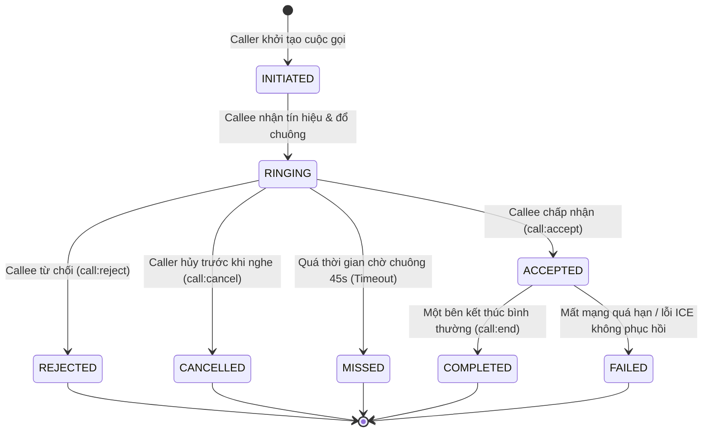
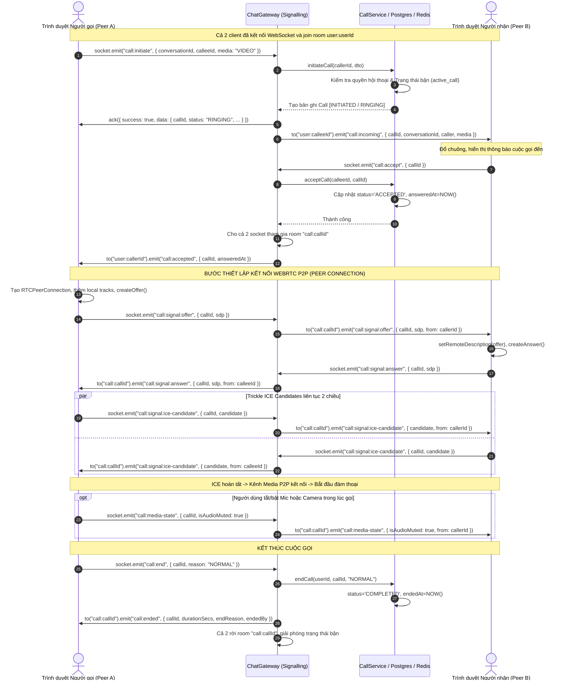
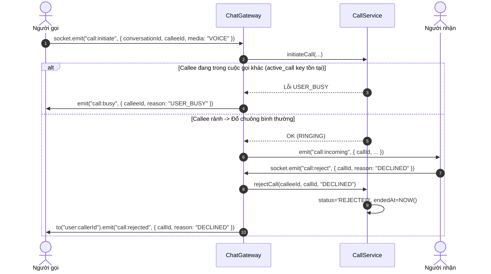
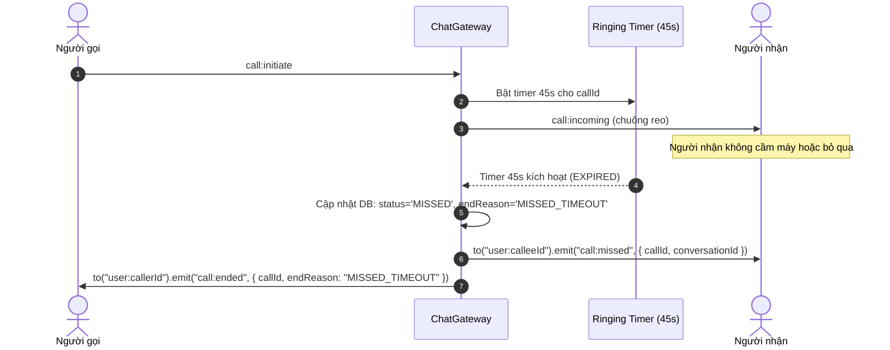
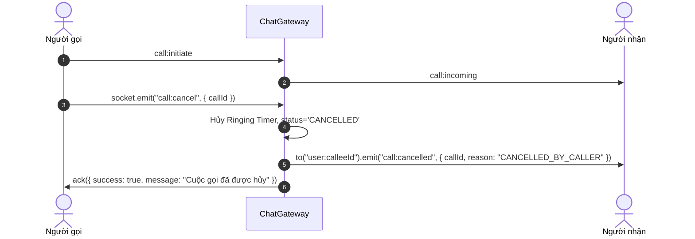
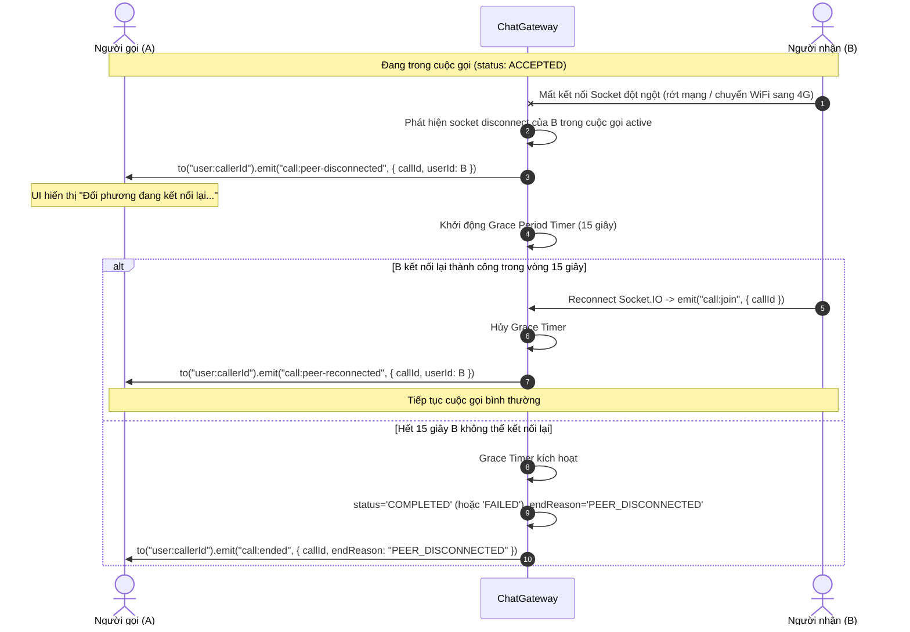

# LEMON CHAT — HƯỚNG DẪN THIẾT KẾ & PHÁT TRIỂN WEBRTC CALL & SIGNALLING SERVER

> **Tài liệu đặc tả kiến trúc, REST API, WebSocket Topics và Hướng dẫn triển khai Signalling Server cho tính năng Gọi Thoại / Gọi Video 1-1 (P2P WebRTC).**  
> Tuân thủ chuẩn Response Envelope tại [`RESPONSES.md`](./RESPONSES.md), hệ thống Authentication tại [`AUTH.md`](./AUTH.md), và cấu trúc Hợp đồng Realtime tại [`API_CHAT_1_1.md`](./API_CHAT_1_1.md).  
> **Base URL:** `http://localhost:3000/api` (hoặc domain production)  
> **WebSocket URL:** `ws://localhost:3000` (Socket.IO namespace `/`)

---

## MỤC LỤC
1. [Tổng quan Kiến trúc WebRTC 1-1 & Signalling Server](#1-tổng-quan-kiến-trúc-webrtc-1-1--signalling-server)
   - [1.1 Vai trò của Backend Signalling Server](#11-vai-trò-của-backend-signalling-server)
   - [1.2 Mô hình kết nối P2P & Relay (STUN/TURN)](#12-mô-hình-kết-nối-p2p--relay-stunturn)
   - [1.3 Vòng đời cuộc gọi & State Machine](#13-vòng-đời-cuộc-gọi--state-machine)
2. [Cấu hình STUN / TURN Server qua Biến Môi trường (.env)](#2-cấu-hình-stun--turn-server-qua-biến-môi-trường-env)
   - [2.1 Đặc tả biến môi trường tương lai](#21-đặc-tả-biến-môi-trường-tương-lai)
   - [2.2 Cơ chế sinh Ephemeral Credentials (RFC 5766 coturn REST API)](#22-cơ-chế-sinh-ephemeral-credentials-rfc-5766-coturn-rest-api)
3. [Sơ đồ Luồng Nghiệp vụ (Sequence Diagrams)](#3-sơ-đồ-luồng-nghiệp-vụ-sequence-diagrams)
   - [3.1 Sơ đồ Cuộc gọi thành công (Happy Path & SDP/ICE Exchange)](#31-sơ-đồ-cuộc-gọi-thành-công-happy-path--sdpice-exchange)
   - [3.2 Sơ đồ Người nhận từ chối hoặc đang bận (Reject / Busy)](#32-sơ-đồ-người-nhận-từ-chối-hoặc-đang-bận-reject--busy)
   - [3.3 Sơ đồ Cuộc gọi nhỡ do Timeout chuông (Missed Call / 45s Timeout)](#33-sơ-đồ-cuộc-gọi-nhỡ-do-timeout-chuông-missed-call--45s-timeout)
   - [3.4 Sơ đồ Người gọi chủ động hủy (Caller Cancel)](#34-sơ-đồ-người-gọi-chủ-động-hủy-caller-cancel)
   - [3.5 Sơ đồ Mất kết nối & Grace Period Reconnection](#35-sơ-đồ-mất-kết-nối--grace-period-reconnection)
4. [Đặc tả REST API Endpoints (Domain `call`)](#4-đặc-tả-rest-api-endpoints-domain-call)
   - [4.1 Lấy cấu hình ICE Servers (`GET /calls/ice-servers`)](#41-lấy-cấu-hình-ice-servers-get-callsice-servers)
   - [4.2 Khởi tạo cuộc gọi (`POST /calls`)](#42-khởi-tạo-cuộc-gọi-post-calls)
   - [4.3 Lấy thông tin cuộc gọi đang hoạt động (`GET /calls/active`)](#43-lấy-thông-tin-cuộc-gọi-đang-hoạt-động-get-callsactive)
   - [4.4 Lấy chi tiết cuộc gọi (`GET /calls/:id`)](#44-lấy-chi-tiết-cuộc-gọi-get-callsid)
   - [4.5 Lịch sử cuộc gọi của người dùng (`GET /calls`)](#45-lịch-sử-cuộc-gọi-của-người-dùng-get-calls)
   - [4.6 Lịch sử cuộc gọi theo hội thoại (`GET /conversations/:id/calls`)](#46-lịch-sử-cuộc-gọi-theo-hội-thoại-get-conversationsidcalls)
   - [4.7 Chấp nhận cuộc gọi qua REST (`POST /calls/:id/accept`)](#47-chấp-nhận-cuộc-gọi-qua-rest-post-callsidaccept)
   - [4.8 Từ chối cuộc gọi qua REST (`POST /calls/:id/reject`)](#48-từ-chối-cuộc-gọi-qua-rest-post-callsidreject)
   - [4.9 Kết thúc cuộc gọi qua REST (`POST /calls/:id/end`)](#49-kết-thúc-cuộc-gọi-qua-rest-post-callsidend)
5. [Đặc tả WebSocket Topics & Signalling Events](#5-đặc-tả-websocket-topics--signalling-events)
   - [5.1 Quản lý Phòng Socket.IO (`callRoom`)](#51-quản-lý-phòng-socketio-callroom)
   - [5.2 Nhóm sự kiện Điều khiển Vòng đời Cuộc gọi (Call Lifecycle)](#52-nhóm-sự-kiện-điều-khiển-vòng-đời-cuộc-gọi-call-lifecycle)
   - [5.3 Nhóm sự kiện WebRTC Signalling (SDP Offer / Answer & Trickle ICE)](#53-nhóm-sự-kiện-webrtc-signalling-sdp-offer--answer--trickle-ice)
   - [5.4 Nhóm sự kiện Đồng bộ Trạng thái Media trong cuộc gọi (In-Call Media State)](#54-nhóm-sự-kiện-đồng-bộ-trạng-thái-media-trong-cuộc-gọi-in-call-media-state)
6. [Thiết kế & Cấu trúc Mã nguồn Backend (`src/domain/call`)](#6-thiết-kế--cấu-trúc-mã-nguồn-backend-srcdomaincall)
   - [6.1 Cấu trúc thư mục chuẩn](#61-cấu-trúc-thư-mục-chuẩn)
   - [6.2 Tích hợp với Realtime Gateway & Redis Cache](#62-tích-hợp-với-realtime-gateway--redis-cache)
   - [6.3 Bảo toàn Tính toàn vẹn Dữ liệu & Xử lý Tranh chấp (Concurrency & Race Conditions)](#63-bảo-toàn-tính-toàn-vẹn-dữ-liệu--xử-lý-tranh-chấp-concurrency--race-conditions)
7. [Kế hoạch Kiểm thử & Xác minh (Verification Plan)](#7-kế-hoạch-kiểm-thử--xác-minh-verification-plan)
8. [Hướng dẫn Tích hợp Frontend (Client WebRTC Integration Guide)](#8-hướng-dẫn-tích-hợp-frontend-client-webrtc-integration-guide)

---

## 1. TỔNG QUAN KIẾN TRÚC WEBRTC 1-1 & SIGNALLING SERVER

### 1.1 Vai trò của Backend Signalling Server
WebRTC (Web Real-Time Communication) là công nghệ cho phép hai trình duyệt / ứng dụng client truyền tải trực tiếp luồng Âm thanh (Audio) và Hình ảnh (Video) theo thời gian thực với độ trễ siêu thấp (sub-second latency) theo mô hình P2P (Peer-to-Peer).

Tuy nhiên, WebRTC **không quy định giao thức thiết lập kết nối ban đầu**. Trình duyệt của hai bên không thể tự tìm thấy nhau trên mạng Internet công cộng do nằm sau các lớp NAT (Network Address Translation) và tường lửa (Firewall). Do đó, **LemonChat Backend đóng vai trò là một Signalling Server** (Máy chủ Báo hiệu) với 4 nhiệm vụ cốt lõi:
1. **Quản lý phiên & Trạng thái cuộc gọi (Call Session Management):** Khởi tạo, đổ chuông (ringing), chấp nhận (accept), từ chối (reject), bận (busy), hủy (cancel), kết thúc (end), và tính toán thời lượng cuộc gọi (`duration_secs`).
2. **Trao đổi thông tin năng lực truyền thông (SDP Offer / Answer Exchange):** Định dạng độ phân giải, codecs hỗ trợ (Opus, VP8/VP9, H.264), cấu hình luồng audio/video.
3. **Trao đổi địa chỉ mạng ứng viên (Trickle ICE Candidates):** IP public, IP private, port, giao thức (UDP/TCP) thu thập từ STUN/TURN server để hai máy tìm được đường truyền ngắn nhất tới nhau.
4. **Phân phối cấu hình bảo mật STUN / TURN:** Trả về danh sách ICE servers hợp lệ từ cấu hình môi trường để client khởi tạo đối tượng `RTCPeerConnection`.

> **LƯU Ý:** Signalling Server **không bao giờ truyền dữ liệu âm thanh/hình ảnh media**. Media payload được truyền P2P trực tiếp giữa 2 client hoặc thông qua TURN relay.

```
       +-------------------------------------------------------+
       |             LemonChat Signalling Server               |
       |  (NestJS + Socket.IO [callRoom] + Redis + PostgreSQL) |
       +-------------------------------------------------------+
                ^                                       ^
                |  SDP Offer / Answer                   |
  WebSocket     |  Trickle ICE Candidates               |  WebSocket
  Signalling    |  Call State (Ring, Accept, End)       |  Signalling
                v                                       v
         +-------------+                         +-------------+
         | Peer A      |                         | Peer B      |
         | (Caller)    |                         | (Callee)    |
         +-------------+                         +-------------+
                \                                       /
                 \                                     /
                  \====== Direct P2P Media (SRTP) =====/
                   (Hoặc thông qua TURN Relay nếu đối xứng NAT)
```

---

### 1.2 Mô hình kết nối P2P & Relay (STUN/TURN)
- **STUN (Session Traversal Utilities for NAT):** Giúp client xác định địa chỉ IP công cộng (Public IP) và Port của chính mình sau NAT. STUN rất nhẹ, chi phí máy chủ thấp. Nếu cả 2 client ở sau NAT thân thiện (Full-cone, Restricted-cone), kết nối P2P trực tiếp được thiết lập thành công.
- **TURN (Traversal Using Relays around NAT):** Nếu một hoặc cả hai client nằm sau Symmetric NAT (NAT đối xứng - phổ biến ở mạng 4G/5G Viettel/VinaPhone hoặc mạng doanh nghiệp/trường học), P2P trực tiếp không thể thông qua. Khi đó, client bắt buộc phải truyền toàn bộ media qua TURN Server đóng vai trò làm trung gian chuyển tiếp (Relay).
- **Backend Endpoint `GET /calls/ice-servers`** cung cấp danh sách hỗn hợp: STUN (miễn phí, ưu tiên thử trước) và TURN (có username/credential bảo mật) cho client.

---

### 1.3 Vòng đời cuộc gọi & State Machine
Domain `call` đã có bảng `calls` với enum trạng thái `callStatusEnum` trong `src/domain/call/schema.ts`:
```ts
export const callStatusEnum = pgEnum("call_status", [
  "INITIATED", // Caller bấm gọi, server tạo bản ghi
  "RINGING",   // Callee nhận tín hiệu call:incoming và bắt đầu đổ chuông
  "ACCEPTED",  // Callee nhấc máy, bắt đầu kết nối WebRTC (answered_at được ghi nhận)
  "REJECTED",  // Callee chủ động bấm từ chối
  "MISSED",    // Callee không trả lời sau timeout chuông (mặc định 45s)
  "CANCELLED", // Caller bấm cúp máy trước khi Callee trả lời
  "COMPLETED", // Cuộc gọi diễn ra thành công và kết thúc bình thường
  "FAILED",    // Cuộc gọi đứt đoạn hoặc lỗi kết nối ICE/mạng không thể phục hồi
]);
```

#### Bảng chuyển trạng thái (State Transition Table):

| Trạng thái hiện tại | Sự kiện kích hoạt | Trạng thái mới | Hành động phụ đi kèm |
| :--- | :--- | :--- | :--- |
| *(None)* | Caller gửi `POST /calls` hoặc `call:initiate` | **INITIATED** | Tạo record DB, lock trạng thái bận trong Redis, gửi `call:incoming` cho Callee |
| **INITIATED** | Callee nhận socket và phát tín hiệu chuông | **RINGING** | Đặt timer đếm ngược timeout chuông (45 giây) |
| **RINGING** | Callee bấm nhận cuộc gọi (`call:accept`) | **ACCEPTED** | Hủy timer chuông, ghi nhận `answeredAt = NOW()`, cả hai tham gia `call:<callId>`, bắt đầu WebRTC Handshake |
| **RINGING** | Callee bấm từ chối (`call:reject`) | **REJECTED** | Hủy timer chuông, giải phóng Redis lock, ghi nhận `endedAt = NOW()`, `endReason = 'REJECTED'` |
| **RINGING** | Hết 45s không ai trả lời (Timer fires) | **MISSED** | Server tự động đổi status thành `MISSED`, gửi thông báo `call:missed` cho cả 2 bên |
| **INITIATED / RINGING** | Caller bấm hủy gọi (`call:cancel`) | **CANCELLED** | Hủy timer chuông, giải phóng Redis lock, ghi nhận `endedAt = NOW()`, `endReason = 'CANCELLED_BY_CALLER'` |
| **ACCEPTED** | Bất kỳ bên nào cúp máy (`call:end`) | **COMPLETED** | Ghi nhận `endedAt = NOW()`, cột `duration_secs` tự động tính theo Postgres, rời phòng `call:<callId>` |
| **ACCEPTED** | Mất kết nối mạng quá Grace Period (15s) | **FAILED** | Ghi nhận `endedAt = NOW()`, `endReason = 'PEER_DISCONNECTED'`, dọn dẹp phòng |



---

## 2. CẤU HÌNH TURN SERVER QUA BIẾN MÔI TRƯỜNG (.ENV)

> [!IMPORTANT]
> **Tuân thủ quy tắc bảo mật:** Tuyệt đối không đọc file `.env` thực tế của dự án. Phần này đặc tả cấu trúc biến môi trường và thiết kế module cấu hình để đội ngũ DevOps / Backend có thể điền vào file `.env` khi triển khai hạ tầng TURN trong tương lai.

### 2.1 Lựa chọn Metered.ca TURN Service (Khuyến nghị số 1 — Miễn phí 50GB/tháng, KHÔNG CẦN THẺ VISA)
**Metered.ca** là dịch vụ TURN Server rất phổ biến cho các dự án WebRTC vì **hoàn toàn miễn phí, đăng ký bằng email thông thường và không yêu cầu thẻ tín dụng/Visa**.

Trong file `.env`, bạn chỉ cần lưu **2 biến duy nhất**:

```env
# ------------------------------------------------------------------------------
# METERED.CA TURN CONFIGURATION (MIỄN PHÍ, KHÔNG CẦN VISA)
# ------------------------------------------------------------------------------
# 1. Domain trên Dashboard (ví dụ: lemonchat.metered.live hoặc chỉ cần điền lemonchat)
METERED_DOMAIN=your-app-name.metered.live

# 2. Secret Key lấy từ Metered Dashboard
METERED_SECRET_KEY=your_metered_secret_key
```

#### Các bước lấy thông số trên Metered.ca:
1. Truy cập [metered.ca/tools/openrelay](https://www.metered.ca/tools/openrelay) hoặc [metered.ca](https://www.metered.ca) và bấm **Sign Up** (chỉ cần nhập Email + Mật khẩu, không hỏi thẻ).
2. Trong tab **Dashboard**, sao chép giá trị **Domain** (ví dụ: `lemonchat.metered.live`) dán vào `METERED_DOMAIN`.
3. Trong tab **API Keys / Settings**, sao chép giá trị **API Key / Secret Key** dán vào `METERED_SECRET_KEY`.

---

### 2.2 Cơ chế Backend tích hợp & Cache Redis
Khi client gọi endpoint `GET /api/calls/ice-servers`:
1. Backend kiểm tra **Redis Cache** theo key `cache:metered_turn_ice_servers`. Nếu còn hạn (cache 12 giờ), trả về ngay lập tức cho client (<1ms).
2. Nếu cache trống hoặc hết hạn, Backend chuẩn hóa `METERED_DOMAIN` và gửi HTTP GET đến Metered API:
   ```http
   GET https://<METERED_DOMAIN>/api/v1/turn/credentials?apiKey=<METERED_SECRET_KEY>
   ```
3. Metered trả về mảng danh sách `iceServers` đầy đủ gồm STUN và TURN (hỗ trợ cả port 80, 443 và transports UDP/TCP giúp xuyên qua mọi tường lửa):
   ```json
   [
     {
       "urls": "stun:stun.relay.metered.ca:80"
     },
     {
       "urls": "turn:global.relay.metered.ca:80",
       "username": "...",
       "credential": "..."
     },
     {
       "urls": "turn:global.relay.metered.ca:80?transport=tcp",
       "username": "...",
       "credential": "..."
     },
     {
       "urls": "turn:global.relay.metered.ca:443",
       "username": "...",
       "credential": "..."
     },
     {
       "urls": "turns:global.relay.metered.ca:443?transport=tcp",
       "username": "...",
       "credential": "..."
     }
   ]
   ```
4. Backend lưu mảng này vào Redis với TTL 43,200 giây (12 giờ) và trả về chuẩn JSON Envelope cho client.

---

### 2.3 Cấu hình Thay thế (Static Credentials hoặc Local Dev Fallback)
Nếu muốn dùng tài khoản tĩnh hoặc tự host Coturn:
```env
# Cấu hình tự host Coturn / Static Credentials
RTC_TURN_URLS=turn:global.relay.metered.ca:443?transport=tcp
RTC_TURN_USERNAME=your_username
RTC_TURN_CREDENTIAL=your_password
```

> [!TIP]
> **Local Development Fallback:** Nếu trong file `.env` chưa điền cả Metered lẫn Coturn, Backend sẽ tự động trả về Public STUN miễn phí của Google (`stun:stun.l.google.com:19302`) để nhà phát triển có thể test cuộc gọi P2P nội bộ mà không gặp lỗi.

---

## 3. SƠ ĐỒ LUỒNG NGHIỆP VỤ (SEQUENCE DIAGRAMS)

### 3.1 Sơ đồ Cuộc gọi thành công (Happy Path & SDP/ICE Exchange)


---

### 3.2 Sơ đồ Người nhận từ chối hoặc đang bận (Reject / Busy)


---

### 3.3 Sơ đồ Cuộc gọi nhỡ do Timeout chuông (Missed Call / 45s Timeout)


---

### 3.4 Sơ đồ Người gọi chủ động hủy (Caller Cancel)


---

### 3.5 Sơ đồ Mất kết nối & Grace Period Reconnection


---

## 4. ĐẶC TẢ REST API ENDPOINTS (DOMAIN `CALL`)

Tất cả các endpoint đều yêu cầu xác thực người dùng (`AuthGuard`) qua Bearer Token hoặc Cookie `lemon_access_token`.

### 4.1 Lấy cấu hình ICE Servers (`GET /calls/ice-servers`)
Endpoint cung cấp danh sách STUN và TURN servers hợp lệ (kèm credentials ngắn hạn) để client cấu hình vào `new RTCPeerConnection({ iceServers })`.

- **Method:** `GET`
- **Path:** `/api/calls/ice-servers`
- **Response 200 OK:**
```json
{
  "success": true,
  "message": "OK",
  "data": {
    "iceServers": [
      {
        "urls": [
          "stun:turn.lemonchat.example.com:3478"
        ]
      },
      {
        "urls": [
          "turn:turn.lemonchat.example.com:3478?transport=udp",
          "turn:turn.lemonchat.example.com:3478?transport=tcp"
        ],
        "username": "1716200000:019345a6-78bc-7def-8123-456789abcdef",
        "credential": "generated_hmac_sha1_secret=="
      }
    ]
  }
}
```

---

### 4.2 Khởi tạo cuộc gọi (`POST /calls`)
Cho phép client khởi tạo cuộc gọi thông qua REST API (hỗ trợ REST-first client hoặc dự phòng trường hợp socket tạm thời gián đoạn).

- **Method:** `POST`
- **Path:** `/api/calls`
- **Request Body:**
```json
{
  "conversationId": "019345a0-1234-7def-8000-000000000001",
  "calleeId": "019345a0-1234-7def-8000-000000000002",
  "media": "VIDEO"
}
```
- **Validation Rules:**
  - `conversationId`: UUID hợp lệ, người gọi phải là thành viên trong cuộc trò chuyện.
  - `calleeId`: UUID hợp lệ, phải là thành viên trong cuộc trò chuyện, không được là chính mình (`callerId <> calleeId`).
  - `media`: Enum `"VOICE"` hoặc `"VIDEO"`.
- **Response 201 Created:**
```json
{
  "success": true,
  "message": "Cuộc gọi đã được khởi tạo",
  "data": {
    "id": "019345a6-78bc-7def-8123-456789abcdef",
    "conversationId": "019345a0-1234-7def-8000-000000000001",
    "callerId": "019345a0-1234-7def-8000-000000000001",
    "calleeId": "019345a0-1234-7def-8000-000000000002",
    "media": "VIDEO",
    "status": "RINGING",
    "startedAt": "2026-11-20T10:00:00.000Z",
    "answeredAt": null,
    "endedAt": null,
    "endReason": null,
    "durationSecs": 0
  }
}
```
- **Lỗi thường gặp:**
  - `409 CONFLICT` (`CALL_USER_BUSY`): Đối phương hoặc người gọi đang trong cuộc gọi khác.
  - `403 FORBIDDEN` (`USER_BLOCKED`): Một trong hai người dùng đã chặn người kia.
  - `404 NOT_FOUND` (`CONVERSATION_NOT_FOUND`): Cuộc hội thoại không tồn tại hoặc người dùng không thuộc phòng.

---

### 4.3 Lấy thông tin cuộc gọi đang hoạt động (`GET /calls/active`)
Dùng khi người dùng mở lại trang web / ứng dụng sau khi refresh hoặc rớt mạng để khôi phục giao diện cuộc gọi đang diễn ra.

- **Method:** `GET`
- **Path:** `/api/calls/active`
- **Response 200 OK (Đang có cuộc gọi):**
```json
{
  "success": true,
  "message": "OK",
  "data": {
    "id": "019345a6-78bc-7def-8123-456789abcdef",
    "conversationId": "019345a0-1234-7def-8000-000000000001",
    "media": "VIDEO",
    "status": "ACCEPTED",
    "caller": {
      "id": "019345a0-1234-7def-8000-000000000001",
      "username": "hoang_anh",
      "fullName": "Hoàng Anh",
      "avatarUrl": "https://cdn.example.com/avatars/ha.jpg"
    },
    "callee": {
      "id": "019345a0-1234-7def-8000-000000000002",
      "username": "minh_thu",
      "fullName": "Minh Thư",
      "avatarUrl": "https://cdn.example.com/avatars/mt.jpg"
    },
    "startedAt": "2026-11-20T10:00:00.000Z",
    "answeredAt": "2026-11-20T10:00:05.000Z",
    "durationSecs": 45
  }
}
```
- **Response 200 OK (Không có cuộc gọi):**
```json
{
  "success": true,
  "message": "OK",
  "data": null
}
```

---

### 4.4 Lấy chi tiết cuộc gọi (`GET /calls/:id`)
- **Method:** `GET`
- **Path:** `/api/calls/:id`
- **Response 200 OK:** Trả về chi tiết bản ghi cuộc gọi (người dùng phải là Caller hoặc Callee).

---

### 4.5 Lịch sử cuộc gọi của người dùng (`GET /calls`)
- **Method:** `GET`
- **Path:** `/api/calls?limit=20&cursor=...&media=VIDEO`
- **Response 200 OK:**
```json
{
  "success": true,
  "message": "OK",
  "data": {
    "items": [
      {
        "id": "019345a6-78bc-7def-8123-456789abcdef",
        "conversationId": "019345a0-1234-7def-8000-000000000001",
        "media": "VIDEO",
        "status": "COMPLETED",
        "caller": { ... },
        "callee": { ... },
        "startedAt": "2026-11-20T10:00:00.000Z",
        "answeredAt": "2026-11-20T10:00:05.000Z",
        "endedAt": "2026-11-20T10:05:05.000Z",
        "endReason": "NORMAL",
        "durationSecs": 300
      }
    ],
    "nextCursor": "019345a0-...",
    "hasMore": true
  }
}
```

---

### 4.6 Lịch sử cuộc gọi theo hội thoại (`GET /conversations/:id/calls`)
Tương tự endpoint trên nhưng lọc riêng cho một `conversationId`.

---

### 4.7 Chấp nhận cuộc gọi qua REST (`POST /calls/:id/accept`)
- **Method:** `POST`
- **Path:** `/api/calls/:id/accept`
- **Response 200 OK:** `{ "success": true, "message": "Cuộc gọi đã được chấp nhận", "data": { ... } }`

### 4.8 Từ chối cuộc gọi qua REST (`POST /calls/:id/reject`)
- **Method:** `POST`
- **Path:** `/api/calls/:id/reject`
- **Body:** `{ "reason": "DECLINED" }` (tùy chọn)

### 4.9 Kết thúc cuộc gọi qua REST (`POST /calls/:id/end`)
- **Method:** `POST`
- **Path:** `/api/calls/:id/end`
- **Body:** `{ "reason": "NORMAL" }`

---

## 5. ĐẶC TẢ WEBSOCKET TOPICS & SIGNALLING EVENTS

Tất cả các sự kiện signalling được truyền tải qua kết nối Socket.IO tại root namespace `/`. Client sau khi handshake bằng token sẽ nhận định danh `userId` trong `client.data.userId`.

### 5.1 Quản lý Phòng Socket.IO (`callRoom`)
Định nghĩa hàm chuẩn tại `src/domain/realtime/rooms.ts`:
```ts
export function callRoom(callId: string): string {
  return `call:${callId}`;
}
```
- Khi cuộc gọi được khởi tạo hoặc chấp nhận, cả Caller và Callee đều được server tự động thêm vào phòng `call:${callId}` thông qua lệnh:
  ```ts
  this.gateway.server.in([userRoom(callerId), userRoom(calleeId)]).socketsJoin(callRoom(callId));
  ```
- Khi cuộc gọi kết thúc, server gọi:
  ```ts
  this.gateway.server.in([userRoom(callerId), userRoom(calleeId)]).socketsLeave(callRoom(callId));
  ```
- Nhờ vậy, mọi dữ liệu WebRTC (SDP, ICE) chỉ cần phát tán qua `client.to(callRoom(callId)).emit(...)` mà **không cần truy vấn Database**, đảm bảo độ trễ ở mức tối thiểu (<5ms).

---

### 5.2 Nhóm sự kiện Điều khiển Vòng đời Cuộc gọi (Call Lifecycle)

#### 1. Khởi tạo cuộc gọi (`call:initiate`) — [Client -> Server]
```json
// Payload
{
  "conversationId": "019345a0-1234-7def-8000-000000000001",
  "calleeId": "019345a0-1234-7def-8000-000000000002",
  "media": "VOICE" // hoặc "VIDEO"
}

// Ack Callback trả lời lại cho Caller:
{
  "success": true,
  "data": {
    "callId": "019345a6-78bc-7def-8123-456789abcdef",
    "conversationId": "019345a0-1234-7def-8000-000000000001",
    "media": "VOICE",
    "status": "RINGING",
    "startedAt": "2026-11-20T10:00:00.000Z"
  }
}
```

#### 2. Thông báo cuộc gọi đến (`call:incoming`) — [Server -> Callee]
Server phát tới phòng cá nhân `user:<calleeId>`:
```json
{
  "callId": "019345a6-78bc-7def-8123-456789abcdef",
  "conversationId": "019345a0-1234-7def-8000-000000000001",
  "media": "VOICE",
  "caller": {
    "id": "019345a0-1234-7def-8000-000000000001",
    "username": "hoang_anh",
    "fullName": "Hoàng Anh",
    "avatarUrl": "https://..."
  },
  "startedAt": "2026-11-20T10:00:00.000Z"
}
```

#### 3. Chấp nhận cuộc gọi (`call:accept`) — [Callee -> Server]
```json
// Payload
{
  "callId": "019345a6-78bc-7def-8123-456789abcdef"
}
```
Server xử lý xong sẽ phát sự kiện `call:accepted` tới phòng `call:<callId>`:
```json
// Server -> Client (cả Caller và Callee)
{
  "callId": "019345a6-78bc-7def-8123-456789abcdef",
  "calleeId": "019345a0-1234-7def-8000-000000000002",
  "answeredAt": "2026-11-20T10:00:05.000Z"
}
```

#### 4. Từ chối cuộc gọi (`call:reject`) — [Callee -> Server]
```json
// Payload
{
  "callId": "019345a6-78bc-7def-8123-456789abcdef",
  "reason": "DECLINED" // hoặc "BUSY"
}
```
Server phát `call:rejected` tới `user:<callerId>`:
```json
{
  "callId": "019345a6-78bc-7def-8123-456789abcdef",
  "reason": "DECLINED"
}
```

#### 5. Hủy cuộc gọi (`call:cancel`) — [Caller -> Server]
```json
// Payload
{
  "callId": "019345a6-78bc-7def-8123-456789abcdef"
}
```
Server phát `call:cancelled` tới `user:<calleeId>`:
```json
{
  "callId": "019345a6-78bc-7def-8123-456789abcdef",
  "reason": "CANCELLED_BY_CALLER"
}
```

#### 6. Cuộc gọi nhỡ (`call:missed`) — [Server -> Callee]
Phát sinh khi chuông reo quá 45s mà không có phản hồi:
```json
{
  "callId": "019345a6-78bc-7def-8123-456789abcdef",
  "conversationId": "019345a0-1234-7def-8000-000000000001",
  "reason": "MISSED_TIMEOUT"
}
```

#### 7. Kết thúc cuộc gọi (`call:end`) — [Client -> Server]
```json
// Payload
{
  "callId": "019345a6-78bc-7def-8123-456789abcdef",
  "reason": "NORMAL"
}
```
Server phát `call:ended` tới `call:<callId>`:
```json
{
  "callId": "019345a6-78bc-7def-8123-456789abcdef",
  "conversationId": "019345a0-1234-7def-8000-000000000001",
  "endedAt": "2026-11-20T10:05:00.000Z",
  "durationSecs": 295,
  "endReason": "NORMAL",
  "endedBy": "019345a0-1234-7def-8000-000000000001"
}
```

#### 8. Đối phương bận (`call:busy`) — [Server -> Caller]
```json
{
  "calleeId": "019345a0-1234-7def-8000-000000000002",
  "reason": "USER_BUSY"
}
```

---

### 5.3 Nhóm sự kiện WebRTC Signalling (SDP Offer / Answer & Trickle ICE)

Đây là các sự kiện vận chuyển payload báo hiệu WebRTC giữa 2 máy khách thông qua phòng `call:<callId>`. Server đóng vai trò Relay Router nguyên vẹn payload sang đầu bên kia:

#### 1. Gửi SDP Offer (`call:signal:offer`)
- **Client A gửi lên:**
```json
{
  "callId": "019345a6-78bc-7def-8123-456789abcdef",
  "sdp": {
    "type": "offer",
    "sdp": "v=0\r\no=- 4611731400430051336 2 IN IP4 127.0.0.1\r\ns=-\r\nt=0 0\r\na=group:BUNDLE 0 1\r\n..."
  }
}
```
- **Server chuyển tiếp sang Client B (`call:signal:offer`):**
```json
{
  "callId": "019345a6-78bc-7def-8123-456789abcdef",
  "from": "019345a0-1234-7def-8000-000000000001",
  "sdp": {
    "type": "offer",
    "sdp": "v=0\r\no=- 4611731400430051336 2 IN IP4 127.0.0.1..."
  }
}
```

#### 2. Gửi SDP Answer (`call:signal:answer`)
- **Client B gửi lên:**
```json
{
  "callId": "019345a6-78bc-7def-8123-456789abcdef",
  "sdp": {
    "type": "answer",
    "sdp": "v=0\r\no=- 1234567890123456789 2 IN IP4 127.0.0.1\r\ns=-\r\n..."
  }
}
```
- **Server chuyển tiếp sang Client A (`call:signal:answer`):**
```json
{
  "callId": "019345a6-78bc-7def-8123-456789abcdef",
  "from": "019345a0-1234-7def-8000-000000000002",
  "sdp": {
    "type": "answer",
    "sdp": "v=0\r\no=- 1234567890123456789 2 IN IP4 127.0.0.1..."
  }
}
```

#### 3. Gửi Trickle ICE Candidate (`call:signal:ice-candidate`)
- **Client gửi lên mỗi khi gom được một ứng viên mạng:**
```json
{
  "callId": "019345a6-78bc-7def-8123-456789abcdef",
  "candidate": {
    "candidate": "candidate:842163049 1 udp 1677729535 192.168.1.15 54321 typ srflx raddr 192.168.1.15 rport 54321",
    "sdpMid": "0",
    "sdpMLineIndex": 0
  }
}
```
- **Server chuyển tiếp sang đối phương (`call:signal:ice-candidate`):**
```json
{
  "callId": "019345a6-78bc-7def-8123-456789abcdef",
  "from": "user-uuid",
  "candidate": {
    "candidate": "candidate:842163049 1 udp 1677729535 192.168.1.15 54321 typ srflx raddr 192.168.1.15 rport 54321",
    "sdpMid": "0",
    "sdpMLineIndex": 0
  }
}
```

---

### 5.4 Nhóm sự kiện Đồng bộ Trạng thái Media trong cuộc gọi (In-Call Media State)

Giúp cập nhật tức thì trạng thái giao diện UI (ví dụ hiển thị icon "Đối phương đang tắt micro", "Đối phương đã tắt camera", hoặc "Đối phương đang chia sẻ màn hình"):

#### Sự kiện `call:media-state`
- **Client gửi lên:**
```json
{
  "callId": "019345a6-78bc-7def-8123-456789abcdef",
  "isAudioMuted": true,
  "isVideoMuted": false,
  "isScreenSharing": false
}
```
- **Server chuyển tiếp sang đối phương:**
```json
{
  "callId": "019345a6-78bc-7def-8123-456789abcdef",
  "from": "user-uuid",
  "isAudioMuted": true,
  "isVideoMuted": false,
  "isScreenSharing": false
}
```

---

## 6. THIẾT KẾ & CẤU TRÚC MÃ NGUỒN BACKEND (`src/domain/call`)

Tuân thủ nghiêm ngặt các quy tắc kiến trúc tại `AGENTS.md`:
- File theo vai trò Rust-style: `service.ts`, `controller.ts`, `module.ts`, `repository.ts`, `pg.ts`, `schema.ts`.
- Mọi import nội bộ kết thúc bằng đuôi `.js`.
- Tuyệt đối không dùng `as any`.
- Đảm bảo tương thích chạy song song trên cả **Node.js ≥ 20 và Bun**.

### 6.1 Cấu trúc thư mục chuẩn
```
src/domain/call/
├── constants.ts         # Biến số cố định (CALL_RING_TIMEOUT_SECS, CALL_GRACE_PERIOD_MS, ...)
├── types.ts             # TypeScript interfaces cho WebRTC, ICE, Session State
├── schema.ts            # (Đã có sẵn) Bảng calls, enum call_media, call_status
├── repository.ts        # Interface CallRepository & Symbol CALL_REPOSITORY
├── pg.ts                # Drizzle ORM implementation truy vấn PostgreSQL
├── service.ts           # Business logic: validate, timers, Redis locks, Realtime dispatch
├── controller.ts        # REST Endpoints: GET /calls/ice-servers, POST /calls, v.v.
├── module.ts            # NestJS Module đăng ký Controller, Providers, Exports
└── dto/
    ├── request.ts       # Zod schemas & DTOs cho các request REST & WS
    ├── response.ts      # DTOs chuẩn hóa dữ liệu trả về client
    └── mapper.ts        # Chuyển đổi từ Call entity sang CallResponse
```

### 6.2 Tích hợp với Realtime Gateway & Redis Cache

1. **Cập nhật `src/domain/realtime/rooms.ts`:**
   ```ts
   export function callRoom(callId: string): string {
     return `call:${callId}`;
   }
   ```

2. **Cập nhật `src/utils/cache/keys.ts`:**
   Thêm các hàm sinh Redis key thuần túy (pure sync functions):
   ```ts
   export function activeCallUserKey(userId: string): string {
     return `call:active:user:${userId}`;
   }
   
   export function callSessionKey(callId: string): string {
     return `call:session:${callId}`;
   }
   ```

3. **Cập nhật `src/domain/realtime/realtime.service.ts`:**
   Thêm các phương thức chuyên biệt phát tín hiệu cuộc gọi:
   ```ts
   emitCallIncoming(calleeId: string, payload: CallIncomingPayload): void;
   emitCallAccepted(callId: string, payload: CallAcceptedPayload): void;
   emitCallRejected(callerId: string, payload: CallRejectedPayload): void;
   emitCallCancelled(calleeId: string, payload: CallCancelledPayload): void;
   emitCallMissed(calleeId: string, payload: CallMissedPayload): void;
   emitCallEnded(callId: string, userIds: string[], payload: CallEndedPayload): void;
   joinCall(userIds: string[], callId: string): void;
   leaveCall(userIds: string[], callId: string): void;
   ```

4. **Cập nhật `src/domain/realtime/chat.gateway.ts`:**
   Đăng ký các `@SubscribeMessage` xử lý routing nhanh:
   - `call:signal:offer` -> `client.to(callRoom(data.callId)).emit("call:signal:offer", ...)`
   - `call:signal:answer` -> `client.to(callRoom(data.callId)).emit("call:signal:answer", ...)`
   - `call:signal:ice-candidate` -> `client.to(callRoom(data.callId)).emit("call:signal:ice-candidate", ...)`
   - `call:media-state` -> `client.to(callRoom(data.callId)).emit("call:media-state", ...)`

---

### 6.3 Bảo toàn Tính toàn vẹn Dữ liệu & Xử lý Tranh chấp (Concurrency & Race Conditions)

1. **Chống Race Condition khi Trả lời / Hủy cùng lúc (Double Answer / Cancel Conflict):**
   Sử dụng câu lệnh `UPDATE ... WHERE status IN ('INITIATED', 'RINGING')` nguyên tử trong PostgreSQL:
   ```sql
   UPDATE calls 
   SET status = 'ACCEPTED', answered_at = NOW() 
   WHERE id = $1 AND status IN ('INITIATED', 'RINGING')
   RETURNING *;
   ```
   Nếu Caller bấm hủy đúng vào mili-giây Callee bấm nhận, câu lệnh của bên đến sau sẽ trả về 0 dòng cập nhật -> Hệ thống bắt được điều kiện này và trả về lỗi hợp lệ (`CALL_INVALID_STATE`), ngăn chặn trạng thái bất nhất.

2. **Chống Gọi Chéo (Call Glare):**
   Khi A bấm gọi B đúng lúc B bấm gọi A:
   - Kiểm tra Redis key `activeCallUserKey(userId)`: Khi A tạo cuộc gọi, server ghi `SET call:active:user:A <callId> EX 60 NX` và `SET call:active:user:B <callId> EX 60 NX`.
   - Nếu B gọi A trong lúc đó, lệnh `SET ... NX` thất bại -> Trả về ngay lập tức mã lỗi `CALL_USER_BUSY`.

3. **Tự động dọn dẹp cuộc gọi treo (Zombie Calls):**
   - Thiết lập Timer 45 giây trong bộ nhớ Node.js khi cuộc gọi chuyển sang `RINGING`.
   - Bổ sung định kỳ Cron Job (mỗi 5 phút) trong `CallService` quét tìm các cuộc gọi có `status IN ('INITIATED', 'RINGING')` có `started_at < NOW() - INTERVAL '2 minutes'` và đánh dấu thành `FAILED` hoặc `MISSED` để tránh treo trạng thái người dùng.

---

## 7. KẾ HOẠCH KIỂM THỬ & XÁC MINH (VERIFICATION PLAN)

Theo yêu cầu nghiêm ngặt của `AGENTS.md`, mọi service và repository mới đều phải có unit test tương ứng trong `test/unit/domain/call/` chạy bằng Vitest.

### 7.1 Danh mục Unit Tests cần thực hiện
1. **`test/unit/domain/call/service.spec.ts`:**
   - Khởi tạo cuộc gọi thành công (trả về status `RINGING`, phát tín hiệu `call:incoming`).
   - Khởi tạo thất bại khi gọi cho chính mình (`CALL_CANNOT_CALL_SELF`).
   - Khởi tạo thất bại khi người nhận đang bận (`CALL_USER_BUSY`).
   - Callee chấp nhận cuộc gọi thành công (status chuyển thành `ACCEPTED`, ghi nhận `answeredAt`).
   - Xử lý đua tranh khi Callee chấp nhận cuộc gọi đã bị Caller hủy trước đó.
   - Timeout 45s chuông tự động chuyển status sang `MISSED`.
   - Kết thúc cuộc gọi tính toán thời lượng chính xác và giải phóng trạng thái bận.
   - Endpoint cấu hình ICE trả về đúng định dạng STUN/TURN.

2. **`test/unit/domain/call/controller.spec.ts`:**
   - Kiểm tra xác thực Bearer token trên tất cả endpoints.
   - Kiểm tra validation Zod DTO (thiếu conversationId, media không đúng enum).
   - Kiểm tra format Envelope JSON theo chuẩn `RESPONSES.md`.

3. **`test/unit/domain/call/pg.spec.ts`:**
   - Kiểm tra truy vấn lấy danh sách cuộc gọi phân trang (cursor-based pagination).
   - Kiểm tra truy vấn tìm cuộc gọi active của user.

### 7.2 Lệnh kiểm thử
```bash
# Kiểm tra định kiểu Typecheck
bun run typecheck   # hoặc: npm run typecheck

# Kiểm tra Linter
bun run lint        # hoặc: npx oxlint --type-aware src/ test/

# Chạy toàn bộ Unit Tests domain call
bun run test -- test/unit/domain/call/
```

---

## 8. HƯỚNG DẪN TÍCH HỢP FRONTEND (CLIENT WEBRTC INTEGRATION GUIDE)

Frontend (React / Next.js) có thể triển khai WebRTC Client theo các bước chuẩn mực dưới đây:

### 8.1 Chu kỳ khởi tạo và đàm phán PeerConnection (Code mẫu React Hook)

```typescript
import { useEffect, useRef, useState } from "react";
import { Socket } from "socket.io-client";

interface UseWebRTCOptions {
  socket: Socket;
  callId: string;
  isCaller: boolean;
  onRemoteStream: (stream: MediaStream) => void;
  onCallEnded: (reason: string) => void;
}

export function useWebRTCCall({
  socket,
  callId,
  isCaller,
  onRemoteStream,
  onCallEnded,
}: UseWebRTCOptions) {
  const pcRef = useRef<RTCPeerConnection | null>(null);
  const localStreamRef = useRef<MediaStream | null>(null);

  useEffect(() => {
    async function setupCall() {
      // 1. Lấy cấu hình ICE Servers từ Backend
      const res = await fetch("/api/calls/ice-servers");
      const { data } = await res.json();
      const iceServers: RTCIceServer[] = data.iceServers;

      // 2. Tạo đối tượng RTCPeerConnection
      const pc = new RTCPeerConnection({ iceServers });
      pcRef.current = pc;

      // 3. Lấy luồng Media cục bộ (Microphone & Camera)
      const localStream = await navigator.mediaDevices.getUserMedia({
        audio: true,
        video: true,
      });
      localStreamRef.current = localStream;
      localStream.getTracks().forEach((track) => pc.addTrack(track, localStream));

      // 4. Lắng nghe luồng Media từ đối phương truyền về
      pc.ontrack = (event) => {
        if (event.streams && event.streams[0]) {
          onRemoteStream(event.streams[0]);
        }
      };

      // 5. Gom và gửi Trickle ICE Candidate lên Backend
      pc.onicecandidate = (event) => {
        if (event.candidate) {
          socket.emit("call:signal:ice-candidate", {
            callId,
            candidate: event.candidate.toJSON(),
          });
        }
      };

      // 6. Nếu là Caller: Tạo và gửi SDP Offer sau khi đối phương bấm Accept
      if (isCaller) {
        const offer = await pc.createOffer();
        await pc.setLocalDescription(offer);
        socket.emit("call:signal:offer", { callId, sdp: offer });
      }
    }

    // 7. Lắng nghe các sự kiện Signalling từ Server
    socket.on("call:signal:offer", async ({ sdp }) => {
      const pc = pcRef.current;
      if (!pc) return;
      await pc.setRemoteDescription(new RTCSessionDescription(sdp));
      const answer = await pc.createAnswer();
      await pc.setLocalDescription(answer);
      socket.emit("call:signal:answer", { callId, sdp: answer });
    });

    socket.on("call:signal:answer", async ({ sdp }) => {
      const pc = pcRef.current;
      if (!pc) return;
      await pc.setRemoteDescription(new RTCSessionDescription(sdp));
    });

    socket.on("call:signal:ice-candidate", async ({ candidate }) => {
      const pc = pcRef.current;
      if (!pc || !candidate) return;
      await pc.addIceCandidate(new RTCIceCandidate(candidate));
    });

    socket.on("call:ended", ({ endReason }) => {
      cleanup();
      onCallEnded(endReason);
    });

    setupCall();

    return () => {
      cleanup();
    };
  }, [callId, isCaller]);

  function cleanup() {
    localStreamRef.current?.getTracks().forEach((t) => t.stop());
    pcRef.current?.close();
    pcRef.current = null;
  }

  // Hàm toggle Mute Micro
  function toggleMute(isMuted: boolean) {
    localStreamRef.current?.getAudioTracks().forEach((t) => (t.enabled = !isMuted));
    socket.emit("call:media-state", { callId, isAudioMuted: isMuted });
  }

  // Hàm toggle Video Camera
  function toggleCamera(isEnabled: boolean) {
    localStreamRef.current?.getVideoTracks().forEach((t) => (t.enabled = isEnabled));
    socket.emit("call:media-state", { callId, isVideoMuted: !isEnabled });
  }

  return { toggleMute, toggleCamera };
}
```

---

## 9. TỔNG KẾT & DANH SÁCH FILE CẦN TRIỂN KHAI

| STT | File Path | Trạng thái | Nhiệm vụ chính |
| :--- | :--- | :--- | :--- |
| 1 | `E:/Project-Web-IT4409/docs/WebRTC_Call_Dev_GUIDE.md` | **ĐÃ TẠO** | Tài liệu hướng dẫn & đặc tả hoàn chỉnh cho FE và BE |
| 2 | `src/domain/call/schema.ts` | **ĐÃ CÓ** | Bảng `calls`, enum `callMediaEnum`, `callStatusEnum` |
| 3 | `src/domain/call/constants.ts` | **MỚI** | Timeout chuông (45s), grace period (15s), page limits |
| 4 | `src/domain/call/types.ts` | **MỚI** | Types cho RTCIceServer, Session State, DTO types |
| 5 | `src/domain/call/repository.ts` | **MỚI** | Interface `CallRepository` & Symbol `CALL_REPOSITORY` |
| 6 | `src/domain/call/pg.ts` | **MỚI** | Drizzle ORM implementation truy vấn PostgreSQL |
| 7 | `src/domain/call/service.ts` | **MỚI** | Nghiệp vụ cuộc gọi, timers, active call locks, STUN/TURN generator |
| 8 | `src/domain/call/controller.ts` | **MỚI** | REST Endpoints (`GET /calls/ice-servers`, `POST /calls`, v.v.) |
| 9 | `src/domain/call/module.ts` | **MỚI** | Đăng ký Module trong NestJS |
| 10 | `src/domain/call/dto/` | **MỚI** | `request.ts`, `response.ts`, `mapper.ts` |
| 11 | `src/domain/realtime/rooms.ts` | **CHỈNH SỬA** | Bổ sung hàm `callRoom(callId)` |
| 12 | `src/domain/realtime/realtime.service.ts` | **CHỈNH SỬA** | Bổ sung các hàm phát tán sự kiện cuộc gọi |
| 13 | `src/domain/realtime/chat.gateway.ts` | **CHỈNH SỬA** | Lắng nghe các event signalling và điều hướng |
| 14 | `src/utils/cache/keys.ts` | **CHỈNH SỬA** | Bổ sung cache key `activeCallUserKey`, `callSessionKey` |
| 15 | `src/utils/errors/codes.ts` | **CHỈNH SỬA** | Bổ sung các Error Codes: `CALL_NOT_FOUND`, `CALL_USER_BUSY`, ... |
| 16 | `src/app.ts` | **CHỈNH SỬA** | Import `CallModule` vào `AppModule` |
| 17 | `test/unit/domain/call/**` | **MỚI** | Bộ Unit Tests toàn diện cho service, controller, repository |
