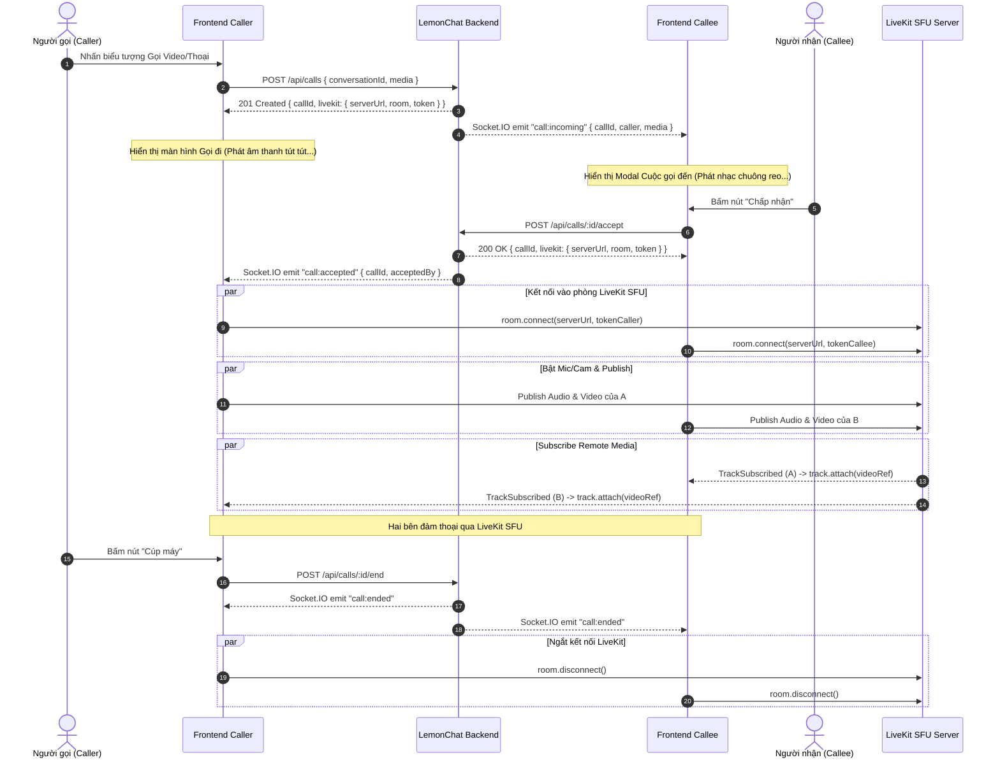

# HƯỚNG DẪN TRIỂN KHAI FRONTEND CALL VỚI LIVEKIT SFU
## LemonChat Web Client (React 19 + TypeScript + Vite + TailwindCSS)

---

## 1. TỔNG QUAN KIẾN TRÚC & MỤC TIÊU

Tài liệu này là đặc tả kỹ thuật và hướng dẫn triển khai tính năng **Gọi Thoại (Voice Call) & Gọi Video (Video Call)** trên Frontend của ứng dụng LemonChat (`E:/Project-Web-IT4409/FE`), tích hợp với máy chủ **LiveKit SFU** và **LemonChat Backend Signalling Server**.

### 1.1 Nguyên lý cốt lõi: Đàm phán Media qua SFU & Điều khiển Vòng đời qua Backend
- **Không tự xử lý P2P:** Không sử dụng `RTCPeerConnection` thủ công, không tạo SDP Offer/Answer thủ công, không relay ICE Candidates qua Socket.IO.
- **LiveKit Client SDK (`livekit-client`):** Đảm nhiệm việc đàm phán WebRTC trực tiếp với LiveKit SFU Server thông qua WebSocket riêng (`LIVEKIT_URL`), hỗ trợ tự động điều chỉnh bitrate thích ứng (Simulcast/Dynacast).
- **Backend Signalling:** Chỉ đóng vai trò điều khiển vòng đời cuộc gọi (đổ chuông 45s, trạng thái bận, thông báo chấp nhận/từ chối/hủy/kết thúc) và cấp phát JWT `AccessToken` để truy cập phòng LiveKit.

### 1.2 Yêu cầu đặc biệt: Xử lý quyền thiết bị mềm mại (Soft Permission Fallback)
> [!IMPORTANT]
> **Quy tắc quan trọng nhất về trải nghiệm người dùng:**  
> Nếu người dùng từ chối quyền truy cập Microphone hoặc Camera trên trình duyệt (hoặc thiết bị phần cứng không tồn tại):
> 1. **TUYỆT ĐỐI KHÔNG ngắt hay kết thúc cuộc gọi.** Cuộc gọi vẫn tiếp tục bình thường để người dùng có thể nghe và xem hình ảnh của đối phương.
> 2. Hiển thị một **badge tròn nhỏ màu vàng/hổ phách chứa ký tự `!`** tại góc trên bên phải nút Mic hoặc Camera trong `CallControls`.
> 3. Khi người dùng nhấp vào nút có badge `!`, ứng dụng sẽ yêu cầu xin lại quyền từ trình duyệt (`room.localParticipant.setMicrophoneEnabled(true)` hoặc `setCameraEnabled(true)`). Khi người dùng cấp quyền, LiveKit sẽ tự động xuất bản (publish) track lên SFU ngay lập tức mà không cần tải lại trang hay ngắt kết nối cuộc gọi.

---

## 2. QUY TRÌNH LUỒNG TÍN HIỆU CHI TIẾT (SEQUENCE DIAGRAM)



---

## 3. CẤU TRÚC MÃ NGUỒN FRONTEND (`src/features/call`)

```
src/features/call/
├── api/
│   └── call.api.ts              # REST API calls (/api/calls/*)
├── types/
│   └── call.types.ts            # Data contracts & LiveKit types
├── hooks/
│   └── useLiveKitCall.ts        # Hook quản lý kết nối LiveKit, tracks, và Soft Permissions
├── context/
│   └── CallContext.tsx          # Global Call Provider (Incoming call, active session, ringtone)
├── components/
│   ├── IncomingCallModal.tsx    # Pop-up toàn cục khi có cuộc gọi đến
│   ├── CallsView.tsx            # Danh sách lịch sử cuộc gọi
│   └── CallScreen/              # Giao diện đàm thoại
│       ├── CallScreen.tsx       # Màn hình chính (chuyển đổi ringing -> active -> ended)
│       ├── CallControls.tsx     # Bảng điều khiển (Mic, Cam có badge '!', Speaker, Cúp máy)
│       ├── VideoCallStage.tsx   # Hiển thị video remote và video preview local
│       ├── VoiceCallStage.tsx   # Hiển thị âm thanh và hiệu ứng pulse phát biểu
│       └── CallWindowProvider.tsx # Hỗ trợ Picture-in-Picture (PiP)
```

---

## 4. CHI TIẾT TRIỂN KHAI CÁC MODULE

### 4.1 Cài đặt Package
```bash
npm install livekit-client
```

### 4.2 Tầng API Client (`src/features/call/api/call.api.ts`)
```ts
import { apiClient } from '@/infrastructure/api/client';
import type {
  AcceptCallResponse,
  CallResponse,
  CallTokenResponse,
  InitiateCallResponse,
} from '../types/call.types';

export const callApi = {
  initiateCall: async (data: { conversationId: string; media: 'VOICE' | 'VIDEO' }) => {
    const res = await apiClient.post<{ data: InitiateCallResponse }>('/calls', data);
    return res.data.data;
  },

  acceptCall: async (callId: string) => {
    const res = await apiClient.post<{ data: AcceptCallResponse }>(`/calls/${callId}/accept`);
    return res.data.data;
  },

  getCallToken: async (callId: string) => {
    const res = await apiClient.get<{ data: CallTokenResponse }>(`/calls/${callId}/token`);
    return res.data.data;
  },

  rejectCall: async (callId: string, reason?: string) => {
    const res = await apiClient.post<{ data: CallResponse }>(`/calls/${callId}/reject`, { reason });
    return res.data.data;
  },

  cancelCall: async (callId: string) => {
    const res = await apiClient.post<{ data: CallResponse }>(`/calls/${callId}/cancel`);
    return res.data.data;
  },

  endCall: async (callId: string, reason?: string) => {
    const res = await apiClient.post<{ data: CallResponse }>(`/calls/${callId}/end`, { reason });
    return res.data.data;
  },

  getActiveCall: async () => {
    const res = await apiClient.get<{ data: { call: CallResponse | null } }>('/calls/active');
    return res.data.data.call;
  },

  getCallById: async (callId: string) => {
    const res = await apiClient.get<{ data: CallResponse }>(`/calls/${callId}`);
    return res.data.data;
  },

  listCalls: async (params?: { cursor?: string; limit?: number; conversationId?: string }) => {
    const res = await apiClient.get<{ data: { items: CallResponse[]; hasMore: boolean } }>('/calls', { params });
    return res.data.data;
  },
};
```

---

### 4.3 Hook Điều khiển Media (`useLiveKitCall.ts`)
Hook này quản lý kết nối LiveKit và thực thi **Soft Permission Fallback**:

```ts
import { useCallback, useEffect, useRef, useState } from 'react';
import { Room, RoomEvent, Track, type RemoteTrack, type LocalTrack } from 'livekit-client';

export function useLiveKitCall() {
  const roomRef = useRef<Room | null>(null);

  const [remoteVideoTrack, setRemoteVideoTrack] = useState<RemoteTrack | null>(null);
  const [remoteAudioTrack, setRemoteAudioTrack] = useState<RemoteTrack | null>(null);
  const [localVideoTrack, setLocalVideoTrack] = useState<LocalTrack | null>(null);

  const [isMuted, setIsMuted] = useState(false);
  const [isCameraOff, setIsCameraOff] = useState(false);
  const [hasMicError, setHasMicError] = useState(false);
  const [hasCameraError, setHasCameraError] = useState(false);
  const [isPeerSpeaking, setIsPeerSpeaking] = useState(false);
  const [isReconnecting, setIsReconnecting] = useState(false);

  // Khởi tạo Room
  const getRoom = useCallback(() => {
    if (!roomRef.current) {
      const room = new Room({
        adaptiveStream: true,
        dynacast: true,
      });

      room.on(RoomEvent.TrackSubscribed, (track) => {
        if (track.kind === Track.Kind.Video) setRemoteVideoTrack(track);
        if (track.kind === Track.Kind.Audio) setRemoteAudioTrack(track);
      });

      room.on(RoomEvent.TrackUnsubscribed, (track) => {
        if (track.kind === Track.Kind.Video) setRemoteVideoTrack(null);
        if (track.kind === Track.Kind.Audio) setRemoteAudioTrack(null);
      });

      room.on(RoomEvent.ActiveSpeakersChanged, (speakers) => {
        const peerSpeaking = speakers.some((s) => !s.isLocal);
        setIsPeerSpeaking(peerSpeaking);
      });

      room.on(RoomEvent.Reconnecting, () => setIsReconnecting(true));
      room.on(RoomEvent.Reconnected, () => setIsReconnecting(false));

      roomRef.current = room;
    }
    return roomRef.current;
  }, []);

  const connect = useCallback(async (serverUrl: string, token: string, media: 'VOICE' | 'VIDEO') => {
    const room = getRoom();
    await room.connect(serverUrl, token);

    // Kích hoạt Mic với cơ chế Soft Fallback
    try {
      await room.localParticipant.setMicrophoneEnabled(true);
      setHasMicError(false);
      setIsMuted(false);
    } catch {
      setHasMicError(true);
      setIsMuted(true);
      // KHÔNG kết thúc cuộc gọi!
    }

    // Kích hoạt Camera nếu là cuộc gọi Video
    if (media === 'VIDEO') {
      try {
        await room.localParticipant.setCameraEnabled(true);
        setHasCameraError(false);
        setIsCameraOff(false);
        const camTrack = room.localParticipant.getTrackPublication(Track.Source.Camera)?.track;
        if (camTrack) setLocalVideoTrack(camTrack);
      } catch {
        setHasCameraError(true);
        setIsCameraOff(true);
        // KHÔNG kết thúc cuộc gọi!
      }
    }
  }, [getRoom]);

  // Xử lý bật/tắt Mic & retry xin quyền
  const toggleMicrophone = useCallback(async () => {
    const room = roomRef.current;
    if (!room) return;

    if (hasMicError) {
      try {
        await room.localParticipant.setMicrophoneEnabled(true);
        setHasMicError(false);
        setIsMuted(false);
      } catch {
        setHasMicError(true);
      }
      return;
    }

    const nextState = !isMuted;
    await room.localParticipant.setMicrophoneEnabled(!nextState);
    setIsMuted(nextState);
  }, [hasMicError, isMuted]);

  // Xử lý bật/tắt Camera & retry xin quyền
  const toggleCamera = useCallback(async () => {
    const room = roomRef.current;
    if (!room) return;

    if (hasCameraError) {
      try {
        await room.localParticipant.setCameraEnabled(true);
        setHasCameraError(false);
        setIsCameraOff(false);
        const camTrack = room.localParticipant.getTrackPublication(Track.Source.Camera)?.track;
        if (camTrack) setLocalVideoTrack(camTrack);
      } catch {
        setHasCameraError(true);
      }
      return;
    }

    const nextState = !isCameraOff;
    await room.localParticipant.setCameraEnabled(!nextState);
    setIsCameraOff(nextState);
  }, [hasCameraError, isCameraOff]);

  const disconnect = useCallback(() => {
    if (roomRef.current) {
      roomRef.current.disconnect();
      roomRef.current = null;
    }
  }, []);

  useEffect(() => {
    return () => {
      if (roomRef.current) {
        roomRef.current.disconnect();
      }
    };
  }, []);

  return {
    remoteVideoTrack,
    remoteAudioTrack,
    localVideoTrack,
    isMuted,
    isCameraOff,
    hasMicError,
    hasCameraError,
    isPeerSpeaking,
    isReconnecting,
    connect,
    toggleMicrophone,
    toggleCamera,
    disconnect,
  };
}
```

---

### 4.4 Badge Dấu Chấm Than '!' trên `CallControls.tsx`
Trong `CallControls.tsx`:
```tsx
interface CallControlsProps {
  // ... props hiện tại
  hasMicError?: boolean;
  hasCameraError?: boolean;
}
```
Tại nút Mic và Camera:
```tsx
<span className="relative grid place-items-center">
  {/* Nút Mic */}
  <button onClick={onToggleMic} className={cn(...) /* nút */}>
    {isMuted ? <MicOff /> : <Mic />}
  </button>

  {/* Badge cảnh báo lỗi quyền */}
  {hasMicError && (
    <span
      className="absolute -top-1 -right-1 flex size-5 items-center justify-center rounded-full bg-amber-500 text-[11px] font-bold text-slate-950 shadow-md ring-2 ring-slate-900"
      title="Microphone chưa được cấp quyền. Bấm để thử lại"
    >
      !
    </span>
  )}
</span>
```

---

### 4.5 Hiển thị Video & Audio trên Stage
- **Trong `VideoCallStage.tsx`:**
  ```tsx
  const remoteVideoRef = useRef<HTMLVideoElement>(null);
  const localVideoRef = useRef<HTMLVideoElement>(null);

  useEffect(() => {
    if (remoteVideoTrack && remoteVideoRef.current) {
      remoteVideoTrack.attach(remoteVideoRef.current);
      return () => { remoteVideoTrack.detach(); };
    }
  }, [remoteVideoTrack]);

  useEffect(() => {
    if (localVideoTrack && localVideoRef.current) {
      localVideoTrack.attach(localVideoRef.current);
      return () => { localVideoTrack.detach(); };
    }
  }, [localVideoTrack]);
  ```

- **Trong `VoiceCallStage.tsx`:**
  ```tsx
  const remoteAudioRef = useRef<HTMLAudioElement>(null);

  useEffect(() => {
    if (remoteAudioTrack && remoteAudioRef.current) {
      remoteAudioTrack.attach(remoteAudioRef.current);
      return () => { remoteAudioTrack.detach(); };
    }
  }, [remoteAudioTrack]);
  ```

---

## 5. KẾ HOẠCH KIỂM THỬ FRONTEND (VERIFICATION PLAN)

1. **Kiểm tra biên dịch Typecheck:**
   ```bash
   npm run build
   ```
2. **Kiểm tra Lint:**
   ```bash
   npm run lint
   ```
3. **Kiểm tra Luồng Nghiệp vụ Trực tiếp:**
   - Người gọi bấm Gọi Video -> Người nhận nhận chuông kèm `IncomingCallModal`.
   - Bấm Chấp nhận -> Kết nối thành công tới LiveKit SFU, cả 2 bên nhìn thấy hình ảnh và nghe tiếng nhau.
   - Thử chặn quyền Mic hoặc Cam -> Xác nhận cuộc gọi **không bị ngắt**, badge `!` màu vàng hiển thị, bấm vào nút cho phép cấp quyền lại và xuất bản luồng media bình thường.
   - Bấm cúp máy -> Cuộc gọi kết thúc, đóng phòng và ngắt kết nối LiveKit.
