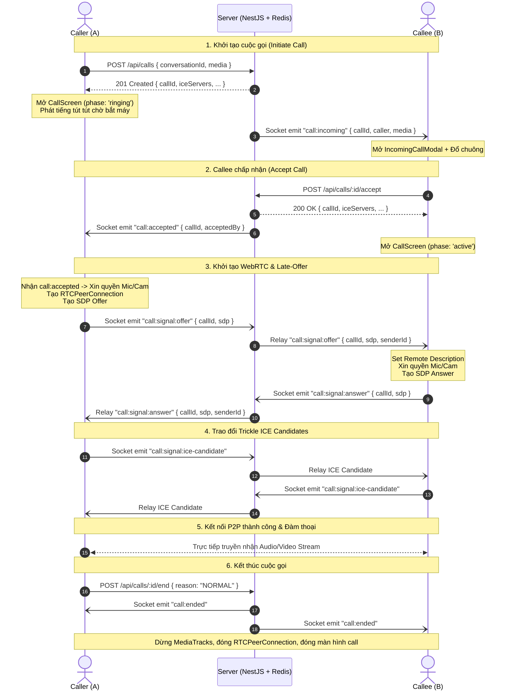

# HƯỚNG DẪN TRIỂN KHAI WEBRTC 1-1 VOICE & VIDEO CALL CHO FRONTEND
## LemonChat Web Client (React 19 + TypeScript + Vite + TailwindCSS)

---

## 1. TỔNG QUAN KIẾN TRÚC & MỤC TIÊU

Tài liệu này là đặc tả kỹ thuật và kế hoạch chi tiết để tích hợp tính năng **WebRTC 1-1 Voice & Video Call** vào Frontend của ứng dụng LemonChat (`E:/Project-Web-IT4409/FE`), kết nối với Backend Signalling Server đã hoàn thành.

### 1.1. Nguyên lý cốt lõi: Late-Offer Signalling Handshake
Hệ thống tuân thủ nghiêm ngặt mô hình **Late-Offer Handshake**:
- Khi **Caller (A)** khởi tạo cuộc gọi, A **CHƯA** tạo SDP Offer. A chỉ gọi API `POST /api/calls` để yêu cầu Server gửi tín hiệu đổ chuông `call:incoming` tới **Callee (B)**.
- Khi **Callee (B)** bấm "Chấp nhận" (`POST /api/calls/:id/accept`), Server phát sự kiện `call:accepted` cho cả hai bên.
- **Sau khi nhận `call:accepted`**, Caller (A) mới khởi tạo `RTCPeerConnection`, xin quyền Media (Camera/Mic), tạo **SDP Offer** và gửi lên Socket event `call:signal:offer`.
- Callee (B) nhận `call:signal:offer`, thiết lập remote description, tạo **SDP Answer** và gửi lên `call:signal:answer`.
- Hai bên trao đổi các **ICE Candidates** (`call:signal:ice-candidate`) và thiết lập kênh truyền P2P (hoặc thông qua TURN relay).

### 1.2. Mô hình phân tầng Frontend
```
src/
├── features/call/
│   ├── api/
│   │   └── call.api.ts              # REST API client (/api/calls/*)
│   ├── types/
│   │   └── call.types.ts            # Data transfer objects & WebRTC types
│   ├── hooks/
│   │   └── useWebRTCCall.ts         # Hook quản lý RTCPeerConnection & MediaStream
│   ├── context/
│   │   └── CallContext.tsx          # Global call state provider (Incoming call, active session)
│   ├── components/
│   │   ├── IncomingCallModal.tsx    # Modal hiển thị chuông cuộc gọi đến toàn cục
│   │   ├── CallsView.tsx            # Màn hình danh sách lịch sử cuộc gọi
│   │   └── CallScreen/              # Giao diện đàm thoại (Video/Voice Stage, Controls, PiP)
│   │       ├── CallScreen.tsx
│   │       ├── CallControls.tsx
│   │       ├── VideoCallStage.tsx
│   │       ├── VoiceCallStage.tsx
│   │       └── CallWindowProvider.tsx
```

---

## 2. QUY TRÌNH LUỒNG TÍN HIỆU CHI TIẾT (SEQUENCE DIAGRAM)



---

## 3. CÁC ĐIỂM ĐẦU CUỐI API & SỰ KIỆN SOCKET

### 3.1. REST API Client (`src/features/call/api/call.api.ts`)

| Phương thức | Đường dẫn | Tham số / Body | Ý nghĩa |
| :--- | :--- | :--- | :--- |
| `POST` | `/calls` | `{ conversationId: string, media: "VOICE" \| "VIDEO" }` | Bắt đầu gọi đi. Trả về thông tin cuộc gọi và danh sách `iceServers`. |
| `GET` | `/calls/ice-servers` | Không có | Lấy danh sách STUN/TURN credentials. |
| `GET` | `/calls/active` | Không có | Lấy thông tin cuộc gọi đang hoạt động của người dùng (nếu có). |
| `GET` | `/calls/:id` | Path param `:id` | Lấy chi tiết cuộc gọi. |
| `POST` | `/calls/:id/accept` | Path param `:id` | Callee chấp nhận cuộc gọi. Trả về `iceServers`. |
| `POST` | `/calls/:id/reject` | `{ reason?: string }` | Callee từ chối cuộc gọi. |
| `POST` | `/calls/:id/cancel` | Path param `:id` | Caller hủy cuộc gọi trước khi đối phương bắt máy. |
| `POST` | `/calls/:id/end` | `{ reason?: string }` | Kết thúc cuộc gọi đang diễn ra. |
| `GET` | `/calls` | Query `conversationId?`, `limit?`, `cursor?` | Lấy lịch sử danh sách cuộc gọi phân trang. |

### 3.2. Socket.IO Events

#### Sự kiện Client gửi lên Server:
- `call:signal:offer`: `{ callId: string, sdp: RTCSessionDescriptionInit }`
- `call:signal:answer`: `{ callId: string, sdp: RTCSessionDescriptionInit }`
- `call:signal:ice-candidate`: `{ callId: string, candidate: RTCIceCandidateInit }`
- `call:media-state`: `{ callId: string, isMuted?: boolean, isVideoOff?: boolean }`

#### Sự kiện Client nhận từ Server:
- `call:incoming`: `{ callId, conversationId, caller, media }` $\rightarrow$ Kích hoạt modal đổ chuông.
- `call:accepted`: `{ callId, acceptedBy, answeredAt }` $\rightarrow$ Caller bắt đầu tạo Offer.
- `call:rejected`: `{ callId, rejectedBy, reason }` $\rightarrow$ Đóng màn hình, báo người nhận từ chối.
- `call:cancelled`: `{ callId, cancelledBy }` $\rightarrow$ Tắt modal đổ chuông trên máy Callee.
- `call:missed`: `{ callId, callerId, media, reason }` $\rightarrow$ Đóng modal chuông, ghi nhận cuộc gọi nhỡ.
- `call:ended`: `{ callId, endedBy?, reason, durationSecs }` $\rightarrow$ Đóng cuộc gọi, dọn dẹp WebRTC.
- `call:user-disconnected`: `{ callId, userId }` $\rightarrow$ Hiển thị cảnh báo *"Đối phương đang kết nối lại..."*.
- `call:user-reconnected`: `{ callId, userId }` $\rightarrow$ Ẩn cảnh báo kết nối lại, tiếp tục đàm thoại.
- `call:signal:offer`, `call:signal:answer`, `call:signal:ice-candidate`, `call:media-state`.

---

## 4. CHI TIẾT CÁC THÀNH PHẦN TRIỂN KHAI FRONTEND

### 4.1. Định nghĩa Types (`src/features/call/types/call.types.ts`)
```typescript
export type CallMedia = 'VOICE' | 'VIDEO'

export type CallStatus =
  | 'INITIATED'
  | 'RINGING'
  | 'ACCEPTED'
  | 'REJECTED'
  | 'MISSED'
  | 'CANCELLED'
  | 'COMPLETED'
  | 'FAILED'

export interface RTCIceServer {
  urls: string | string[]
  username?: string
  credential?: string
}

export interface CallParticipant {
  id: string
  username: string
  fullName: string
  avatarUrl: string | null
}

export interface CallResponse {
  id: string
  conversationId: string
  callerId: string
  calleeId: string
  media: CallMedia
  status: CallStatus
  startedAt: string
  answeredAt: string | null
  endedAt: string | null
  endReason: string | null
  durationSecs: number
  caller?: CallParticipant
  callee?: CallParticipant
}

export interface InitiateCallResponse extends CallResponse {
  iceServers: RTCIceServer[]
}

export interface AcceptCallResponse extends CallResponse {
  iceServers: RTCIceServer[]
}

export interface CallIncomingPayload {
  callId: string
  conversationId: string
  caller: CallParticipant
  media: CallMedia
}
```

---

### 4.2. Hook cốt lõi: `useWebRTCCall.ts`
Hook này chịu trách nhiệm:
1. Yêu cầu quyền Micro / Camera qua `navigator.mediaDevices.getUserMedia`.
2. Khởi tạo đối tượng `RTCPeerConnection` với cấu hình ICE Servers.
3. Quản lý trạng thái Local Stream và Remote Stream.
4. Lắng nghe và emit các gói tin signalling qua `getChatSocket()`.
5. Đổi trạng thái Microphone / Camera (Mute / Unmute, Tắt / Bật Cam) và đồng bộ qua `call:media-state`.

```typescript
// Sơ đồ luồng logic bên trong hook:
// 1. acquireMedia() -> set localStream
// 2. new RTCPeerConnection({ iceServers })
// 3. localStream.getTracks().forEach(track => pc.addTrack(track, localStream))
// 4. pc.ontrack = (event) => set remoteStream(event.streams[0])
// 5. pc.onicecandidate = (event) => emit "call:signal:ice-candidate"
// 6. socket.on("call:signal:offer") / socket.on("call:signal:answer")
```

---

### 4.3. Quản lý trạng thái toàn cục: `CallContext.tsx`
Vì cuộc gọi đến có thể xảy ra ở bất kỳ màn hình nào, `CallContext` được đặt tại root của ứng dụng:
- Khởi tạo lắng nghe Socket events ngay khi người dùng đăng nhập thành công:
  - `call:incoming`: Lưu `incomingCall` vào state, phát âm thanh chuông gọi.
  - `call:cancelled`, `call:missed`: Hủy `incomingCall`, dừng chuông.
- Cung cấp các hành vi cho toàn ứng dụng:
  - `startCall(conversationId: string, media: CallMedia)`: Bắt đầu gọi đi.
  - `acceptCall()`: Chấp nhận cuộc gọi đến.
  - `rejectCall()`: Từ chối cuộc gọi đến.
  - `endCall()`: Kết thúc cuộc gọi hiện tại.

---

### 4.4. Modal cuộc gọi đến: `IncomingCallModal.tsx`
- Hiển thị trên cùng (Z-Index cao nhất) khi `incomingCall !== null`.
- Giao diện:
  - Avatar người gọi (có hiệu ứng pulse gợn sóng).
  - Tên người gọi và text: *"Cuộc gọi thoại đến..."* hoặc *"Cuộc gọi video đến..."*.
  - Nút **Từ chối** (màu đỏ, icon gác máy).
  - Nút **Trả lời** (màu xanh lá cây, icon nghe máy).
- Quản lý âm thanh: Tự động chạy audio loop chuông reo, tự ngắt khi ấn nút hoặc khi có sự kiện hủy.

---

### 4.5. Nâng cấp `CallScreen.tsx` & Các Stage hiển thị
- **Loại bỏ hoàn toàn code giả định:** Xóa bỏ `window.setTimeout(() => updateCall({ state: 'active' }), 3200)`.
- **`VideoCallStage.tsx`:**
  - Remote Video: Gắn `remoteStream` vào `<video ref={remoteVideoRef} autoPlay playsInline />` trải rộng toàn màn hình.
  - Local Video: Gắn `localStream` vào khung video nhỏ (PiP) ở góc dưới màn hình.
  - Khi đối phương tắt cam: Tự động chuyển về hiển thị Avatar có hiệu ứng gradient.
  - Khi đối phương rớt mạng: Hiển thị thanh thông báo nổi *"Đang kết nối lại..."*.
- **`VoiceCallStage.tsx`:**
  - Gắn thẻ `<audio ref={remoteAudioRef} autoPlay />`.
  - Hiển thị Avatar kích thước lớn kèm hiệu ứng vòng sóng âm thanh khi đối phương đang nói.
- **`CallControls.tsx`:**
  - Nút Mute Mic: Bật/tắt `audioTrack.enabled`, emit `call:media-state`.
  - Nút Tắt Camera: Bật/tắt `videoTrack.enabled`, emit `call:media-state`.
  - Nút Đổi Camera (trên thiết bị di động): Hỗ trợ chuyển đổi giữa camera trước và sau (`facingMode: 'user' | 'environment'`).
  - Nút Kết thúc: Gọi API `POST /api/calls/:id/end`.

---

### 4.6. Thay thế Mock Data trong `CallsView.tsx`
- Thay thế `MOCK_CALLS` bằng React Query `useQuery`:
  ```typescript
  const { data: calls, isLoading } = useQuery({
    queryKey: ['calls', 'history'],
    queryFn: () => callApi.listCalls({ limit: 20 }),
  });
  ```
- Hiển thị danh sách lịch sử cuộc gọi với icon hướng gọi (Đi, Đến, Nhỡ), thời lượng đàm thoại (`durationSecs`), và nút gọi lại nhanh.

---

## 5. XỬ LÝ CÁC TÌNH HUỐNG BIÊN & SỰ CỐ MẠNG (EDGE CASES)

| Kịch bản | Cách Frontend xử lý |
| :--- | :--- |
| **Người dùng từ chối cấp quyền Mic/Cam** | Bắt lỗi `NotAllowedError` từ `getUserMedia`, hiển thị Toast thông báo yêu cầu bật quyền trong trình duyệt, tự động kết thúc cuộc gọi với reason `PERMISSION_DENIED`. |
| **Không tìm thấy thiết bị phần cứng** | Bắt lỗi `NotFoundError` (máy không cắm mic/webcam), thông báo lỗi rõ ràng cho người dùng. |
| **B không nghe máy (45s Ringing Timeout)** | Nhận socket `call:ended` (reason: `MISSED_TIMEOUT`), hiển thị Toast *"Người nhận không trả lời"*, tắt màn hình gọi. Phía A có guard timer 47s tự tắt phòng khi mạng chậm. |
| **A hủy gọi trước khi B nghe máy** | B nhận socket `call:cancelled`, modal chuông tự tắt ngay lập tức, dừng tiếng chuông. |
| **Đối phương rớt mạng tạm thời** | Nhận socket `call:user-disconnected`, hiển thị badge *"Đối phương đang kết nối lại..."* trên màn hình cuộc gọi. Nếu nhận `call:user-reconnected` trong 15s thì ẩn badge. Nếu quá 15s, nhận `call:ended` (`DISCONNECTED_TIMEOUT`) và đóng cuộc gọi. |
| **P2P ICE Connection chuyển sang Failed** | Lắng nghe `pc.oniceconnectionstatechange === 'failed'`, tự động thử `pc.restartIce()`; nếu không thành công sau 5 giây thì chủ động gọi `endCall` để giải phóng. |

---

## 6. KẾ HOẠCH KIỂM THỬ & XÁC MINH (VERIFICATION PLAN)

### 6.1. Kiểm thử Tự động (Lint, Typecheck & Test)
Tại thư mục `E:/Project-Web-IT4409/FE`:
```bash
# 1. Kiểm tra toàn bộ kiểu TypeScript
npm run build # hoặc tsc -b

# 2. Chạy linter
npm run lint

# 3. Chạy unit test suite
npm run test
```

### 6.2. Kiểm thử Thực nghiệm Thực tế (Manual E2E Testing)
1. **Chuẩn bị môi trường:**
   - Chạy Backend: `npm run start:dev` (cổng 3000).
   - Chạy Frontend: `npm run dev` (cổng 5173).
   - Mở 2 cửa sổ trình duyệt:
     - Cửa sổ 1 (Chrome): Đăng nhập tài khoản User A.
     - Cửa sổ 2 (Edge hoặc Tab Ẩn danh): Đăng nhập tài khoản User B.
2. **Kịch bản Happy Path (Video Call):**
   - User A vào cuộc trò chuyện với B, bấm nút "Gọi Video".
   - Kiểm tra User B: Ngay lập tức hiện `IncomingCallModal` kèm chuông reo.
   - User B bấm "Chấp nhận":
     - Cả 2 màn hình chuyển sang `CallScreen` (giai đoạn `active`).
     - Camera của A và B hiển thị trực tiếp (A nhìn thấy B toàn màn hình và thấy chính mình ở góc nhỏ, và ngược lại).
     - Đồng hồ đếm thời gian cuộc gọi bắt đầu chạy.
   - Thử nghiệm tắt Mic / tắt Cam: Kiểm tra icon trạng thái cập nhật đúng ở đầu bên kia.
   - Một bên bấm "Kết thúc": Cả 2 bên tắt màn hình, camera tắt đèn báo, chuyển về giao diện chat.
3. **Kịch bản Cuộc gọi nhỡ (Timeout 45s):**
   - A gọi B, B không tương tác gì.
   - Sau đúng 45 giây: Cuộc gọi tự kết thúc trên máy A, máy B tắt chuông và lưu vào danh sách cuộc gọi nhỡ.
4. **Kịch bản Ngắt kết nối mạng:**
   - Khi đang đàm thoại, tắt kết nối mạng ở máy B.
   - Kiểm tra máy A: Hiện thông báo *"Đối phương đang kết nối lại..."*.
   - Bật lại mạng trong 10 giây: Cuộc gọi tự phục hồi thành công.
